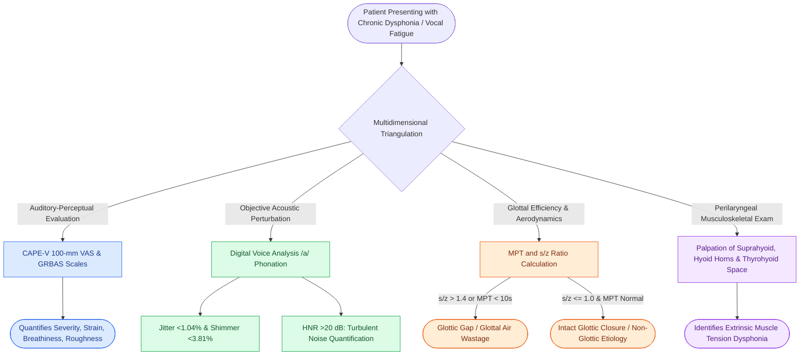

# Multidimensional voice assessment integrates perceptual CAPE-V and GRBAS scales with acoustic perturbation and aerodynamic measures

## Active Recall

> [!question]- What are the six core perceptual parameters evaluated on the CAPE-V, and what visual scoring metric does it utilize?
> *Answer / Clinical Rationale*: The Consensus Auditory-Perceptual Evaluation of Voice (CAPE-V) assesses **Overall Severity, Roughness, Breathiness, Strain, Pitch, and Loudness**. Each domain is scored by placing a tick mark along a **100-mm Visual Analog Scale (VAS)**, allowing fine-grained, continuous clinical and research quantification of dysphonia severity. Ratings are categorized as either **Consistent (C)** or **Intermittent (I)**.

> [!question]- How do the normative thresholds for acoustic jitter, shimmer, and harmonics-to-noise ratio (HNR) quantify vocal stability?
> *Answer / Clinical Rationale*: Acoustic perturbation objectively tracks cycle-to-cycle glottal waveform stability. **Jitter** measures cycle-to-cycle frequency perturbation (normal **<1.04%**), reflecting neuromuscular stability and vocal fold mass symmetry. **Shimmer** measures cycle-to-cycle amplitude perturbation (normal **<3.81%** or **<0.5 dB**), reflecting glottic contact uniformity and transglottic resistance. **Harmonics-to-Noise Ratio (HNR)** quantifies the ratio of periodic acoustic energy to turbulent airflow noise, with normal values strictly **>20 dB**; drops below 20 dB indicate turbulent glottal leakage or breathiness.

> [!question]- What does an s/z ratio greater than 1.4 indicate about vocal fold biomechanics?
> *Answer / Clinical Rationale*: An **s/z ratio > 1.4** indicates isolated **laryngeal vibratory or glottic insufficiency**. The unvoiced /s/ sound bypasses vocal fold vibration, measuring pure lower-airway expiratory support. The voiced /z/ sound requires vocal fold adduction and sustained mucosal oscillation. In patients with normal pulmonary function, an s/z ratio should remain approximately **1.0**. When mucosal lesions (polyps, nodules) or neurogenic immobility impair glottic closure, /z/ phonation time drops precipitously due to excessive glottal air leakage while /s/ remains normal, driving the ratio above 1.4.

## Core Clinical & Mechanistic Principles

A comprehensive, evidence-based voice evaluation requires multidimensional triangulation across perceptual, acoustic, aerodynamic, and manual examination domains *(Cummings Review, Ch7, p.150–151)*. Relying on isolated laryngoscopy or single acoustic metrics misses dynamic hyperfunctional adaptations and subtle phonatory fatigue.

### 1. Auditory-Perceptual Evaluation: CAPE-V vs. GRBAS

| Dimension | CAPE-V (ASHA Consensus Protocol) | GRBAS Scale (Hirano) |
| :--- | :--- | :--- |
| **Scoring Tool** | 100-mm Visual Analog Scale (VAS) with mm score | 4-point Likert scale (0 = normal, 1 = slight, 2 = moderate, 3 = severe) |
| **Domains Assessed** | Overall Severity, Roughness, Breathiness, Strain, Pitch, Loudness | Grade (G), Roughness (R), Breathiness (B), Asthenia (A), Strain (S) |
| **Consistency** | Evaluates Consistency (C) vs. Intermittency (I) | Static overall global rating |
| **Task Battery** | Sustained vowels (/a/, /i/), 6 standardized sentences, running speech | Sustained vowels and spontaneous running conversation |

#### Standardized CAPE-V Sentence Phonetic Targets
1. *"The blue spot is on the key"* — Isolates clear vowel production and coarticulation.
2. *"How hard did he hit him?"* — Assesses soft glottal attacks and voiceless-to-voiced consonant transitions (critical in abductor spasmodic dysphonia).
3. *"We were away a year ago"* — Composed entirely of voiced phonemes; unmasks adductor spasms and glottal breaks.
4. *"We eat eggs every Easter"* — Elicits vocal fry and hard glottal attacks.
5. *"My mama makes lemon muffins"* — Maximizes nasal murmurs; evaluates velopharyngeal resonance and hyper/hyponasality.
6. *"Peter will keep at the peak"* — Stresses voiceless stop-plosive consonants; assesses high intraoral pressure generation.

---

### 2. Acoustic Perturbation & Signal Stability Norms

During sustained phonation of /a/ at comfortable pitch and loudness, digital acoustic software extracts objective aerodynamic and acoustic parameters:

| Metric | Biomechanical Parameter | Normal Adult Threshold | Pathologic Implication |
| :--- | :--- | :--- | :--- |
| **Fundamental Frequency ($F_0$)** | Vocal fold length, tension, and vibratory rate | Males: 100–150 Hz Females: 180–250 Hz Children: 250–300 Hz | Low: Reinke's edema, hypothyroidism, virilization. High: Presbyphonia, mutational falsetto (puberphonia). |
| **Jitter (Frequency Perturbation)** | Cycle-to-cycle frequency variability | **< 1.04%** | Elevated in asymmetric mass, mucosal stiffness, and vocal tremor. |
| **Shimmer (Amplitude Perturbation)** | Cycle-to-cycle glottic amplitude variability | **< 3.81%** (or <0.5 dB) | Elevated in glottic incompetence, paralysis, and irregular mucosal contact. |
| **Harmonics-to-Noise (HNR)** | Ratio of periodic harmonic energy to turbulent noise | **> 20 dB** | Low (<15 dB) denotes severe breathiness, turbulence, and vocal fold paralysis. |

---

### 3. Aerodynamic Measures of Glottal Function

- **Maximum Phonation Time (MPT)**: Maximum duration of sustained /a/ on deep inspiration. Normal adult males sustain **20–25 seconds**; females sustain **15–20 seconds**. Values **< 10 seconds** indicate severe glottic incompetence, air wastage, or restrictive pulmonary pathology.
- **The $s/z$ Ratio**: Duration of /s/ divided by /z/. 
  $$\text{Ratio} = \frac{\text{Maximum duration of sustained /s/}}{\text{Maximum duration of sustained /z/}}$$
  Normal is **$\le 1.0$**. A ratio **$> 1.4$** indicates that vocal fold glottic incompetence (nodules, polyps, paralysis) is wasting respiratory volume during phonation, whereas purely pulmonary airflow control (/s/) is preserved.
- **Phonation Threshold Pressure (PTP)**: The minimum subglottic pressure required to initiate and sustain vocal fold oscillation. Normal values range from **2 to 4 cm $\text{H}_2\text{O}$**. PTP increases sharply with mucosal dehydration, vocal fatigue, and subglottic scarring.

---

### 4. Laryngeal Manual Musculoskeletal Tension Evaluation

In patients presenting with vocal fatigue, odynophonia, or muscle tension dysphonia, physical evaluation requires systematic palpation of extrinsic perilaryngeal muscular tension *(Cummings Review, Ch7, p.150, Fig 7.5)*:
1. **Suprahyoid Musculature**: Palpation along the submental floor (mylohyoid, geniohyoid, anterior digastric) detects excessive hyperfunctional contraction during speech.
2. **Greater Horn of the Hyoid Bone**: Gentle digital lateral-to-medial rocking assesses tenderness, asymmetric thyrohyoid ligament spasm, and excessive extrinsic tension.
3. **Thyrohyoid Space**: Measures the vertical gap between the thyroid notch and the hyoid bone. Foreshortening or complete obliteration of this space indicates chronic elevated laryngeal carriage characteristic of primary Muscle Tension Dysphonia (MTD).

Comprehensive anatomical and therapeutic integration links these principles directly to [[Sulcus vocalis manifests as mucosal furrowing staged by the Ford classification|Sulcus Vocalis Glottic Incompetence]].

## Connected Concepts & Graph Traversal
- **Physiologic Baseline**: [[Videostroboscopy visualizes mucosal wave dynamics and glottal closure|Videostroboscopic Mucosal Wave]]
- **Morphologic Correlate**: [[Glottal closure patterns identify specific laryngeal biomechanical deficits|Glottal Closure Patterns]]
- **Hyperfunctional Disorder**: [[Muscle tension dysphonia arises from supraglottic hyperfunction and responds to circumlaryngeal voice therapy|Muscle Tension Dysphonia Evaluation]]
- **Neurologic Impairment**: [[Unilateral vocal fold paralysis causes glottic insufficiency, breathiness, and aspiration|Vocal Fold Paralysis Aerodynamics]]
- **Phonotraumatic Lesions**: [[Vocal fold nodules are bilateral mid-membranous lesions treated with voice therapy|Acoustic Profile of Vocal Nodules]]
