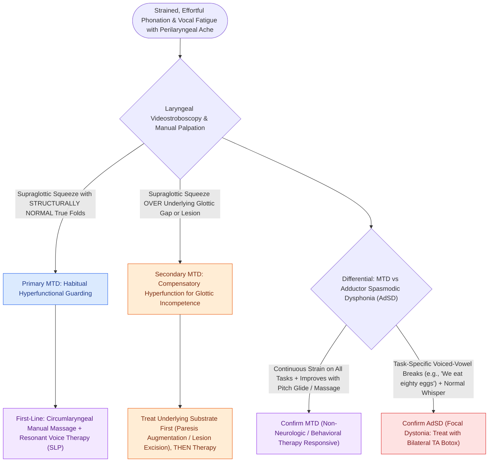

# Muscle tension dysphonia arises from supraglottic hyperfunction and responds to circumlaryngeal voice therapy

## Active Recall

> [!question]- Why must secondary MTD change the treatment order?
> *Answer / Clinical Rationale*: The hyperfunction is compensation for a lesion or gap; removing the compensation without fixing the cause worsens function — treat the underlying pathology first.

> [!question]- Give two features separating MTD from adductor spasmodic dysphonia.
> *Answer / Clinical Rationale*: MTD: continuous strain, technique-responsive, improves with massage/distraction. AdSD: task-specific voiced-vowel breaks, botulinum-responsive.

## Core Clinical & Mechanistic Principles
- **Primary MTD**: dysphonia from excessive perilaryngeal/supraglottic muscle activity with structurally and neurologically normal folds; **secondary MTD** is compensatory squeeze around an underlying lesion or [[Unilateral vocal fold paralysis causes glottic insufficiency, breathiness, and aspiration|glottic insufficiency]] — treat the underlying first or the therapy fights a purpose.
- Stroboscopic patterns: anteroposterior compression (arytenoids-to-petiole), lateral false-fold compression, incomplete SLP vibration from squeeze; palpation finds suprahyoid/thyrohyoid tension and a high larynx.
- The voice: strained, effortful, pitch instability, vocal fatigue; onset often after URI, reflux flare, or vocal overload — the larynx learned a guarding posture and kept it.
- Distinguish from adductor spasmodic dysphonia: MTD strain is continuous and improves with therapy techniques/distraction; AdSD breaks are task-specific (voiced vowels) and respond to botulinum toxin, not massage.

### Management & Critical Safety Checks
- Therapy is the treatment: **circumlaryngeal massage/laryngeal reposturing**, resonant voice, flow phonation, semi-occluded vocal tract exercises — delivered by an SLP-voice specialist with stroboscopic feedback.
- Address perpetuators concurrently (reflux, hydration, occupational vocal load) and re-scope if the voice does not follow the therapy.

## Connected Concepts & Graph Traversal
- **Spasmodic Dysphonia Differential**: [[Adductor spasmodic dysphonia causes strained voice breaks treated with thyroarytenoid Botox|Spasmodic Dysphonia]]
- **PVFM Laryngeal Spasm**: [[Paradoxical vocal fold motion causes inspiratory stridor from episodic adduction relieved by rescue breathing|Paradoxical Vocal Fold Motion]]
- **LPR Triggering Factor**: [[Laryngopharyngeal reflux presents with globus and throat clearing but responds inconsistently to empiric PPIs|Laryngopharyngeal Reflux]]
- **Videostroboscopy Diagnosis**: [[Videostroboscopy visualizes mucosal wave dynamics and glottal closure|Videostroboscopy]]
- **Presbyphonia Hyperfunction**: [[Presbyphonia reflects vocal fold atrophy and bowing managed with therapy before augmentation|Presbyphonia]]
- **Multidimensional Voice Battery**: [[Multidimensional voice assessment integrates perceptual CAPE-V and GRBAS scales with acoustic perturbation and aerodynamic measures|Multidimensional Voice Assessment]]
