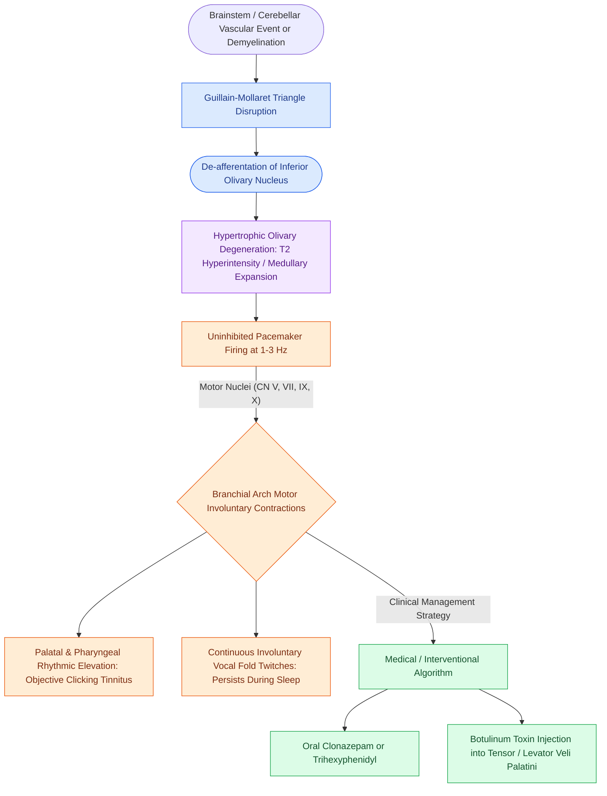

# Oculopalatopharyngeal myoclonus causes continuous one to three Hertz branchial contractions persisting in sleep due to Guillain-Mollaret triangle disruption

## Active Recall

> [!question]- What is the key diagnostic discriminator that separates oculopalatopharyngeal myoclonus from essential vocal tremor during sleep?
> *Answer / Clinical Rationale*: **Oculopalatopharyngeal myoclonus (OPM) persists uninterrupted during sleep and general anesthesia**, whereas essential vocal tremor, Parkinsonian tremor, and spasmodic dysphonia **completely cease during sleep**. Furthermore, OPM fires at a characteristic slow rhythm of **1 to 3 Hz**, compared to the faster **4 to 8 Hz** rate of essential vocal tremor.

> [!question]- Which three anatomical structures constitute the Guillain-Mollaret triangle, and what characteristic neuroimaging finding occurs following pathway disruption?
> *Answer / Clinical Rationale*: The Guillain-Mollaret triangle (dentato-rubro-olivary pathway) comprises:
> 1. The **dentate nucleus** of the cerebellum,
> 2. The contralateral **red nucleus** in the midbrain (connected via the superior cerebellar peduncle), and
> 3. The **inferior olivary nucleus** in the medulla (connected via the central tegmental tract).
> Disruption of the central tegmental tract leads to transsynaptic de-afferentation and **Hypertrophic Olivary Degeneration (HOD)**, which appears on brain MRI as a pathognomonic **non-enhancing, T2/FLAIR hyperintense, enlarged inferior olivary nucleus**.

> [!question]- How do Symptomatic Palatal Tremor (SPT / OPM) and Essential Palatal Tremor (EPT) differ in anatomical muscle driver, sleep behavior, and the presence of clicking tinnitus?
> *Answer / Clinical Rationale*: **Symptomatic Palatal Tremor (SPT / OPM)** is driven primarily by rhythmic contractions of the **levator veli palatini** (CN X / pharyngeal plexus) secondary to structural lesions in the Guillain-Mollaret triangle; it **persists during sleep**, involves broader branchial/ocular muscles, and rarely causes ear clicks. Conversely, **Essential Palatal Tremor (EPT)** is driven by the **tensor veli palatini** (CN V3), which repeatedly dilates and snaps shut the cartilaginous orifice of the **Eustachian tube** to produce hallmark **objective clicking tinnitus**; EPT has a normal brainstem MRI and **typically ceases during sleep**.

## Core Clinical & Mechanistic Principles

Oculopalatopharyngeal myoclonus (OPM), also termed symptomatic palatal tremor (SPT), is a unique central neurogenic movement disorder defined by continuous, involuntary, rhythmic contractions of branchial arch-derived structures *(Cummings Review, Ch7, p.152)*. The anatomical regions involved include the soft palate, pharynx, larynx, face, diaphragm, and ocular musculature (manifesting as pendular vertical/rotary nystagmus).

### Distinctive Features: Symptomatic OPM vs. Essential Palatal Tremor vs. Essential Vocal Tremor

| Clinical Parameter | Symptomatic Palatal Tremor (OPM) | Essential Palatal Tremor (EPT) | Essential Vocal Tremor |
| :--- | :--- | :--- | :--- |
| **Oscillation Frequency** | **Slow: 1 to 3 Hz** (typically 1.5–2.5 Hz) | **Slow: 1 to 3 Hz** | **Fast: 4 to 8 Hz** (typically 5–6 Hz) |
| **Sleep / Anesthesia State** | **Persists continuously during sleep and GA** | **Typically ceases during sleep** | **Abolished completely during sleep** |
| **Primary Muscle Driver** | **Levator veli palatini (CN X)**, pharynx, eyes, larynx | **Tensor veli palatini (CN V3)** (isolated palate) | True and false vocal folds, strap muscles, tongue base |
| **Aural Symptoms** | Infrequent clicking; prominent oscillopsia/dysphonia | **Hallmark objective clicking tinnitus** (ET snap) | None (pure dysphonia and voice wobble) |
| **Underlying Pathology** | Brainstem/cerebellar stroke, trauma, demyelination | Idiopathic / functional central generator | Idiopathic or familial benign essential tremor |
| **Neuroimaging Hallmark** | **Hypertrophic Olivary Degeneration (HOD)** on MRI | Structurally normal brainstem/cerebellum | Structurally normal brainstem/cerebellum |
| **First-Line Medical Therapy** | Clonazepam, valproate, anticholinergics, Botox | Tensor veli palatini Botox, clonazepam | Propranolol (beta-blocker), primidone |

---

### The Guillain-Mollaret Triangle & Hypertrophic Olivary Degeneration

The underlying pathophysiology of OPM is rooted in the interruption of the **dentato-rubro-olivary tract** (the triangle of Guillain and Mollaret):
1. **Dorsal Dentato-Rubral Pathway**: Fibers originate in the cerebellar dentate nucleus, decussate through the superior cerebellar peduncle, and synapse in the contralateral red nucleus.
2. **Central Tegmental Tract**: Axons project ipsilaterally from the red nucleus down the brainstem tegmentum to synapse within the inferior olivary nucleus.
3. **Olivocerebellar Loop**: Inferior olivary fibers project back across the midline through the inferior cerebellar peduncle to the contralateral cerebellar cortex and dentate nucleus.

When an acute vascular insult (posterior circulation ischemic stroke, cavernoma rupture, Pontine hemorrhage) or demyelinating plaque severs the **central tegmental tract** or dentate nucleus, the inferior olive is stripped of tonic GABAergic inhibition. Unlike classical Wallerian degeneration (which causes atrophy), de-afferented olivary neurons undergo unique transsynaptic **hypertrophic olivary degeneration (HOD)**:
- Histologically characterized by marked cytoplasmic vacuolization, neuronal enlargement, and reactive astrocytosis.
- Radiographically manifests **1 to 6 months post-insult** as T2/FLAIR hyperintensity with expansion of the medulla without contrast enhancement.
- Clinically produces spontaneous, rhythmic, uninhibited pacemaker firing at **1 to 3 Hz** transmitted along brainstem motor nuclei (CN V, VII, IX, X, XII) to branchial musculature.

---

### Diagnosis & Therapeutic Management

#### 1. Clinical Examination
- **Flexible Fiberoptic Nasopharyngolaryngoscopy**: Essential for direct visual confirmation. Demonstrates rhythmic, synchronous upward jerking of the soft palate and concentric pharyngeal wall contractions at 1–3 Hz. The vocal folds exhibit involuntary rhythmic adductory/abductory twitches during breathing and phonation.
- **Microscopic Otoscopy**: May reveal visible tympanic membrane excursions synchronous with palatal elevation.

#### 2. Pharmacotherapy & Interventions
- **Anticonvulsants**: **Clonazepam** ($0.5\text{–}2.0\text{ mg/day}$) is the most effective oral agent for dampening palatal rhythmic firing. Valproic acid and carbamazepine serve as second-line options.
- **Anticholinergics**: Trihexyphenidyl or scopolamine help reduce associated palatal and pharyngeal spasms.
- **Botulinum Toxin Injections**: For intractable clicking tinnitus or debilitating phonatory tremor, Botulinum toxin A ($2.5\text{–}10\text{ units}$) injected into the **tensor veli palatini** (via transoral or transnasal endoscopic approaches) effectively paralyzes Eustachian tube snapping.
- **Tympanostomy Tube Placement**: Relieves middle ear pressure swings associated with clicking tinnitus in selected refractory patients.

Comprehensive physiological and surgical principles connect these findings directly to [[The recurrent laryngeal nerve innervates all intrinsic muscles except cricothyroid|laryngeal motor innervation]].

## Connected Concepts & Graph Traversal
- **Differential Neurogenic Tremor**: [[Essential voice tremor causes rhythmic four to eight Hertz phonatory oscillations treated with propranolol, primidone, and botulinum toxin|Essential Vocal Tremor (4-8 Hz)]]
- **Focal Laryngeal Dystonia**: [[Adductor spasmodic dysphonia causes strained voice breaks treated with thyroarytenoid Botox|Adductor Spasmodic Dysphonia]]
- **Acoustic Waveform Analysis**: [[Multidimensional voice assessment integrates perceptual CAPE-V and GRBAS scales with acoustic perturbation and aerodynamic measures|Voice Perturbation & Tremor Metrics]]
- **🔗 Tinnitus Differential (Otology)**: [[Pulsatile tinnitus is differentiated into arterial and venous etiologies by auscultation, jugular compression, and targeted vascular imaging|Somatosound Clicking vs Pulsatile Tinnitus]]
- **LEMG Electrophysiology**: [[Laryngeal electromyography differentiates vocal fold paralysis from joint fixation|Laryngeal Electromyography (LEMG)]]
