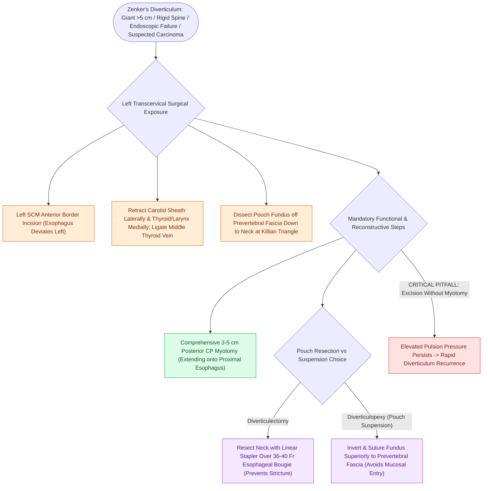

# Open diverticulectomy combines pouch resection with cricopharyngeal myotomy

## Active Recall

> [!question]- Why must a complete cricopharyngeal myotomy be performed even if the Zenker pouch is entirely excised?
> *Answer / Clinical Rationale*: The diverticulum is a secondary symptom of **hypertonic cricopharyngeal outflow resistance**; excising the pouch without performing a myotomy leaves the elevated hypopharyngeal pulsion pressure untreated, leading to rapid diverticular recurrence.

> [!question]- Why is an esophageal bougie (36–40 Fr) placed during stapler diverticulectomy?
> *Answer / Clinical Rationale*: To prevent taking too much tissue at the neck of the diverticulum, which would cause **iatrogenic esophageal stricture and severe post-operative dysphagia**.

## Core Clinical & Mechanistic Principles
**Open Transcervical Diverticulectomy** is the definitive external surgical approach for [[Zenker's diverticulum herniates through Killian's triangle due to elevated pulsion pressure|Zenker's diverticulum]], indicated when transoral endoscopic approaches are contraindicated, impossible, or have failed.

### Primary Clinical Indications
1. **Giant Pouches ($>5\text{–}6\text{ cm}$ in vertical depth)**: Huge redundant sacs extending into the superior mediastinum.
2. **Unfavorable Transoral Anatomy**: Severe retrognathia, prominent maxillary dentition, morbid obesity, or cervical spine rigidity precluding safe diverticuloscope insertion.
3. **Recurrent Disease / Severe Cicatricial Fibrosis**: Recurrent diverticula following prior endoscopic stapling or laser surgery.
4. **Suspicion of Diverticular Carcinoma**: Pouch harboring an [[Adult-onset laryngoceles require ventricular biopsy to rule out occult SCC|occult squamous cell carcinoma]] requiring en bloc resection.

## Step-by-Step Surgical Execution
1. **Incision & Exposure**: Left horizontal skin crease incision or oblique incision along the anterior border of the sternocleidomastoid (SCM) muscle (left side preferred due to leftward esophageal deviation).
2. **Dissection Plane**: Retract carotid sheath laterally and thyroid gland / larynx medially; divide the omohyoid muscle and middle thyroid vein.
3. **Pouch Mobilization**: Identify the diverticulum projecting posteriorly from [[Killian's triangle is a posterior muscular dehiscence above the cricopharyngeus|Killian's triangle]]. Dissect the pouch cleanly off the prevertebral fascia down to its neck.
4. **Comprehensive Cricopharyngeal Myotomy**: Perform a complete **$3\text{–}5\text{ cm}$ posterior midline myotomy**, dividing all transverse cricopharyngeus muscle fibers and extending $1\text{–}2\text{ cm}$ onto the proximal cervical esophagus and $1\text{ cm}$ onto the inferior constrictor.
5. **Pouch Management**:
   - *Diverticulectomy*: Resect the pouch across its neck using a linear cutting or TA-stapler over a 36-40 Fr bougie placed in the esophagus (to prevent esophageal luminal narrowing).
   - *Diverticulopexy*: Suspend the fundus of the pouch superiorly and invert it, suturing it to the prevertebral fascia (avoids opening the mucosal lumen).

## Critical Failure Modes & Error Traps
- **Pharyngocutaneous Fistula**: Resecting the pouch too flush with the esophageal wall can cause luminal stenosis or staple line breakdown, causing saliva extravasation, neck abscess, and fistula formation.
- **RLN Injury**: Retracting the tracheoesophageal groove aggressively can stretch or transect the recurrent laryngeal nerve.

## Connected Concepts & Graph Traversal
- **Pulsion Diverticulum Pathology**: [[Zenker's diverticulum herniates through Killian's triangle due to elevated pulsion pressure|Zenker's Diverticulum]]
- **Esophageal Manometry**: [[High-resolution manometry classifies achalasia and esophageal motility disorders by the Chicago criteria|High-Resolution Manometry]]
- **Aspiration Staging**: [[The Rosenbek Scale standardizes the depth of airway penetration and aspiration|Rosenbek Penetration Scale]]
- **PE Segment Tone**: [[Pharyngoesophageal segment hypertonicity causes TEP failure treated with Botox or myotomy|PE Segment Myotomy]]
- **Emergency Airway Complications**: [[High-stakes laryngeal complications require proactive landmarking and rescue protocols|Laryngeal Complication Protocols]]
