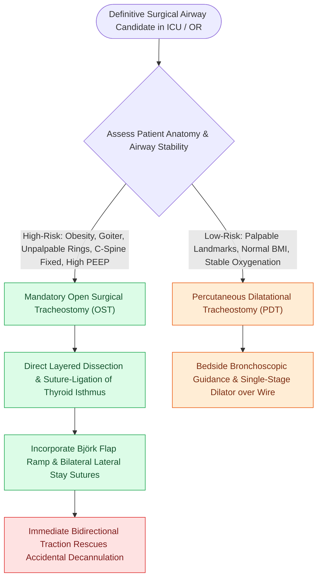

# Open tracheostomy provides superior exposure and stay suture placement compared to percutaneous technique

## Active Recall

> [!question]- Why does an open surgical tracheostomy offer significantly greater safety during an accidental early decannulation event compared to a percutaneous tracheostomy?
> *Answer / Clinical Rationale*: Open tracheostomy incorporates **lateral tracheal stay sutures** and an optional **Björk flap**; pulling laterally and superiorly on the stay sutures immediately pulls the retracted trachea up to the skin and opens the stomal lumen, preventing false passage into the pretracheal space.

> [!question]- What anatomical contraindications make percutaneous dilatational tracheostomy unsafe?
> *Answer / Clinical Rationale*: **Unpalpable anatomical landmarks**, severe obesity with a thick fat pad, thyroid goiter, prior neck radiation/scars, inability to extend the cervical spine, or an aberrant **high-riding innominate artery**.

## Core Clinical & Mechanistic Principles
Establishing a definitive surgical airway in critically ill adult patients requires choosing between **Open Surgical Tracheostomy (OST)** and **[[Percutaneous dilatational tracheostomy utilizes bronchoscopic guidance and Seldinger dilation between tracheal rings|Percutaneous Dilatational Tracheostomy]] (PDT)**. While PDT is widely utilized at the bedside in intensive care units due to logistics, OST remains the definitive standard when anatomical constraints, safety margins, or high-risk airway tract dynamics require superior surgical exposure and tactile verification:

- **Comparative Biomechanical & Technical Advantages**:
  - **Direct Visual Exposure**: OST allows layered, direct visual dissection through the skin, superficial fascia, strap muscles, and pretracheal fascia, ensuring absolute identification of the thyroid isthmus, cricoid cartilage, and tracheal rings 2 through 4.
  - **Surgical Creation of a Björk Flap or Window**: Suturing an inferiorly based tracheal flap ([[The Bjork flap facilitates emergency tracheostomy recannulation|Björk flap]] from 2nd/3rd tracheal ring) to the inferior dermal margin creates an epithelialized slide ramp, preventing the tube from plunging into the pretracheal space during tube changes.
  - **Placement of Tracheal Stay Sutures**: Heavy non-absorbable (2-0 Prolene or silk) stay sutures placed through the lateral margins of the tracheal incision and taped to the neck provide immediate bidirectional lateral traction to spread the stoma open during an accidental decannulation crisis. PDT cannot place stay sutures.
  - **Cervical Defatting in Morbid Obesity**: Direct excision of anterior pretracheal adipose tissue ("defatting") shortens the distance from skin to tracheal lumen, allowing standard flange tubes to seat comfortably without tension.
  - **Vascular Control**: Direct visualization allows ligation of an enlarged thyroid isthmus, anterior jugular veins, or anomalous thyroid ima vessels, preventing occult postoperative hematomas.

- **Contraindications to Percutaneous Dilatational Tracheostomy**:
  - Unpalpable cricoid or tracheal cartilage landmarks.
  - Inability to extend the cervical spine (cervical fracture, severe instability, halo fixation, severe cervical spondylosis, or Trisomy 21).
  - Thyroid goiter overlying the upper trachea.
  - Known vascular anomaly (high-riding innominate artery cross-compressing above the sternal notch).
  - High positive end-expiratory pressure ($PEEP > 15\text{ cm }H_2O$) or $FiO_2 > 0.70$ where prolonged bronchoscopic airway occlusion causes severe hypoxemic derecruitment.

### Key Consultation Supplies
- Surgical headlight and sterile open tracheotomy instrument tray
- 15-blade and 11-blade scalpels with blade holders
- Monopolar and bipolar electrocautery pencils
- Cricoid hook and Senn / Army-Navy / vein retractors
- Tracheal dilator (Trousseau) and tracheal hook
- Suture materials: 2-0 or 3-0 silk/Prolene stay sutures on curved needles, 3-0 Vicryl for strap muscle approximation, 4-0 Monocryl/nylon for skin
- Appropriately sized cuffed tracheostomy tubes (target size, e.g., Shiley 6 or 8 cuffed, plus one size smaller) with tested cuffs and obturators
- Dale tracheostomy collar and Velcro ties

### Surgical Technique & Critical Safety Checks
1. **Fire Prevention Protocol**: Prior to incising the anterior tracheal cartilage with cold knife or electrocautery, strictly confirm with Anesthesia that **$FiO_2$ is reduced to $\le 30\%$** and room air is running to eliminate airway fire hazard.
2. **Cricoid Traction**: Use a heavy cricoid hook held firmly in the midline to lift the trachea superiorly and anteriorly out of the thoracic inlet, transforming a deep, sub-sternal tracheal path into a superficial surgical field.

> [!example]- **Operative Note Template: Open surgical tracheostomy with Björk flap creation and bilateral tracheal stay suture placement**
> **PREOPERATIVE DIAGNOSIS**: Respiratory failure requiring prolonged mechanical ventilation
> **POSTOPERATIVE DIAGNOSIS**: Respiratory failure requiring prolonged mechanical ventilation
> **PROCEDURE**: Open surgical tracheostomy with Björk flap creation and bilateral tracheal stay suture placement
> **SURGEON**: [Surgeon Name, MD]
> **ASSISTANT**: [Resident/Fellow Name, MD]
> ANESTHESIA: General endotracheal anesthesia
> ESTIMATED BLOOD LOSS: <15 mL
> SPECIMENS: None
> INDICATION: [Patient age]-year-old intubated for [XX] days in the ICU requiring long-term ventilator weaning and pulmonary toilet.
>
> **PROCEDURE IN DETAIL**:
> After informed consent was verified, the patient was positioned supine with a shoulder roll to gently extend the neck. A surgical safety pause was completed. The anterior neck was prepped with chlorhexidine and draped in standard sterile fashion.
>
> Landmarks including the thyroid notch, cricoid cartilage, and sternal notch were palpated and marked. Local infiltration with 5 mL of 1% lidocaine with 1:100,000 epinephrine was performed. A 2.5 cm horizontal skin incision was made halfway between the cricoid cartilage and sternal notch. Dissection was carried through the subcutaneous tissue and platysma with monopolar electrocautery. Subcutaneous defatting was performed. The midline linea alba between the strap muscles was identified and divided vertically. The strap muscles were retracted laterally with Senn retractors. The thyroid isthmus was identified, divided in the midline, and suture-ligated with 3-0 silk ties to ensure complete hemostasis. Palpation of the anterior pretracheal space confirmed absence of a high-riding innominate artery.
>
> Dissection cleared the pretracheal fascia overlying the second, third, and fourth tracheal rings. A heavy cricoid hook was engaged under the cricoid cartilage and retracted superiorly and anteriorly. Communication was made with Anesthesia to confirm FiO2 was reduced to 30%. A horizontal incision was made between the 2nd and 3rd tracheal rings with a 15-blade scalpel. A standardized inferiorly based Björk flap was developed with lateral vertical incisions. Bilateral 2-0 Prolene tracheal stay sutures were placed through the lateral tracheal cartilage margins. The Björk flap was secured to the inferior subcutaneous tissue margin with a 3-0 Vicryl suture. Under direct visualization, the endotracheal tube was slowly withdrawn until its tip was positioned just superior to the stoma. An appropriately sized cuffed tracheostomy tube (Shiley [X] cuffed) with loaded obturator was smoothly inserted into the tracheal lumen. The obturator was removed and the inner cannula locked into place. The cuff was inflated, ventilator circuit attached, and bilateral breath sounds and end-tidal CO2 were immediately confirmed. Tracheal stay sutures were labeled and taped securely to the chest wall. The tracheostomy flange was secured with a Dale collar.

## References
1. Mitchell, R.B., Hussey, H.M., Setzen, G., et al. (2013). Clinical consensus statement: Tracheostomy care. *Otolaryngol Head Neck Surg*, 148(1):6-20.
2. Kraft, S.M., Schindler, J.S. (2020). Tracheotomy. In Flint, P.W., et al. (Eds.), *Cummings Otolaryngology Head and Neck Surgery* 7e (pp. 95-103). Philadelphia, PA: Elsevier.
3. Durbin Jr., C.G. (2010). Tracheostomy: why, when, and how? *Respir Care*, 55(8):1056-1068.

## Connected Concepts & Graph Traversal
- **Tracheal Flap Craft**: [[The Bjork flap facilitates emergency tracheostomy recannulation|Bjork Flap Protocol]]
- **Stay Sutures & Exchange**: [[Adult tracheostomy tube exchange at one week requires a mature tract, tracheal stay sutures, and bougie guidance|Tracheostomy Tube Exchange Protocol]]
- **Timing & Indications**: [[Prolonged intubation beyond seven to ten days increases glottic stenosis and ventilator-associated pneumonia risk|Timing of Tracheostomy]]
- **Airway Fire Safety**: [[Airway fire prevention requires FiO2 below 30 percent and laser-safe tubes|Airway Fire Protocols]]
- **Catastrophic Hemorrhage**: [[Tracheoinnominate fistula presents with sentinel bleeding requiring hyperinflation tamponade and emergency surgical ligation|Tracheoinnominate Fistula Prevention]]
