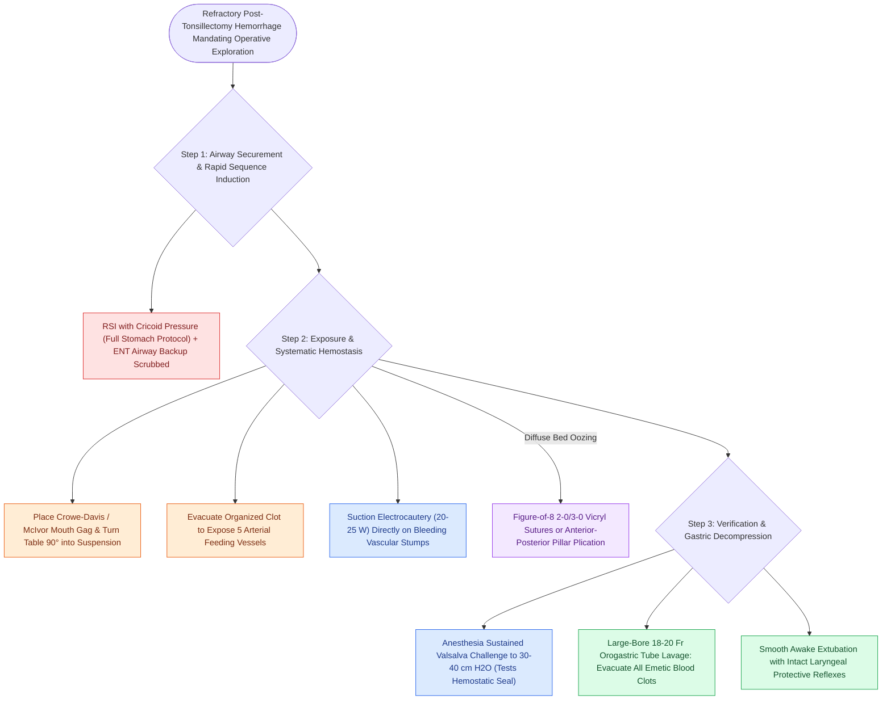

# Operative post-tonsillectomy hemorrhage control employs suction cautery, pillar suturing, and orogastric suctioning

## Active Recall

> [!question]- Why is large-bore orogastric suctioning of the stomach mandatory before extubation in operative tonsillar hemorrhage repair?
> *Answer / Clinical Rationale*: Swallowed blood is extremely irritating to the gastric mucosa, acting as a potent emetic. Evacuating clots prevents immediate postoperative nausea and vigorous vomiting, which creates massive pharyngeal venous engorgement and blows off fresh eschar, causing acute recurrent hemorrhage.

> [!question]- What critical anatomical vascular anomaly must be kept in mind when placing deep figure-of-8 hemostatic sutures in the lateral tonsillar fossa?
> *Answer / Clinical Rationale*: A **medialized or tortuous internal carotid artery**, which can course within millimeters of the tonsillar capsule rather than its typical position 1.5–2.5 cm posterolaterally.

## Core Clinical & Mechanistic Principles
**Operative management of [[Post-tonsillectomy secondary hemorrhage occurs seven to ten days postoperatively from eschar sloughing requiring urgent airway control|post-tonsillectomy hemorrhage]]** is indicated for brisk arterial bleeding, failure of [[Post-tonsillectomy hemorrhage bedside management requires ice water gargling, oxymetazoline compression, and silver nitrate cautery|bedside hemostasis]], uncooperative patients, and virtually all pediatric presentations. Because swallowed blood irritates gastric mucosa and accumulates silently, every patient undergoing emergent re-exploration must be treated as having a **"full stomach"**, carrying a substantial risk for massive regurgitation, aspiration, and laryngospasm during induction:

- **Anesthetic Induction & Airway Securement**:
  - **Pre-Oxygenation & Rapid Sequence Induction (RSI)**: Conducted with cricoid pressure (Sellick maneuver) and two functioning high-flow Yankauer suctions instantly accessible at bedside.
  - **Surgical Backup Setup**: The Otolaryngology team must have direct laryngoscopes (Parsons or Dedo), McGill forceps, and appropriately sized cuffed endotracheal tubes open on the sterile stand to establish an emergent surgical or translaryngeal airway if blood obscures Anesthesia's videolaryngoscopy.

- **Systematic Surgical Hemostasis Steps**:
  1. **Mouth Gag Suspension**: Place a Crowe-Davis or McIvor mouth gag with the tongue blade centered, turn the operating table 90 degrees, and suspend the patient. Inspect the nasopharynx and hypopharynx for dislodged clots.
  2. **Vascular Pole Exploration**: Evacuate all hematoma to expose the five feeding arterial branches supplying the fossa: the tonsillar branch of the facial artery and dorsal lingual artery (inferior pole), ascending pharyngeal and ascending palatine arteries (mid-fossa), and descending palatine artery (superior pole).
  3. **Suction Electrocautery**: Employ monopolar suction cautery or bipolar forceps (set to 20–25 W) to coagulate discrete bleeding points under continuous active suction.
  4. **Pillar Approximation & Figure-of-8 Sutures**: If diffuse muscular oozing persists, place 2-0 or 3-0 absorbable sutures (Vicryl or chromic gut) in a figure-of-8 configuration through the bleeding muscle bed or approximate the anterior (palatoglossus) and posterior (palatopharyngeus) pillars over a rolled hemostatic cellulose bolster.
  5. **Valsalva Provocation**: Ask Anesthesia to perform a sustained Valsalva maneuver to 30–40 cm H2O to confirm absolute hemostasis under increased venous and arterial pressure.
  6. **Large-Bore Orogastric Decompression**: Prior to extubation, pass a large-bore (18–20 Fr) orogastric tube or Ewald tube into the stomach. Copiously irrigate and evacuate all blood clots to eliminate emetogenic stimuli that provoke postoperative retching and rebleeding.

### Key Consultation & Operative Supplies
- Personal protective equipment (PPE): Mask with face shield, gloves, gown
- Surgical headlight and tongue depressor
- Yankauer suction tips (rigid and flexible) with dual high-vacuum suction lines
- Topical local anesthetic (Cetacaine or benzocaine spray, 1% lidocaine with 1:100,000 epinephrine)
- Silver nitrate applicators, oxymetazoline spray, and tonsil sponges with curved ring forceps
- Crowe-Davis or McIvor mouth gag with varied tongue blades
- Monopolar suction coagulator and bipolar cautery forceps (set at 20–25 W)
- Suture materials: 2-0 and 3-0 absorbable sutures (Vicryl, chromic gut) on tapered needles with needle drivers
- Large-bore orogastric tube (18–20 Fr Salem sump) with 60 mL catheter-tip syringe for gastric lavage

### Critical Surgical Danger Zones
- **Aberrant Internal Carotid Artery (ICA)**: The normal ICA lies 1.5 to 2.5 cm posterolateral to the tonsillar fossa behind the superior constrictor. However, in patients with medialized, tortuous, or retropharyngeal carotid loops, deep unguided suture passes or aggressive lateral deep cauterization can cause catastrophic carotid laceration. Suture bites must remain superficial within the muscular tonsillar bed.

> [!example]- **Operative Note Template: Control of post-tonsillectomy hemorrhage via direct laryngoscopy, suspension, and electrocautery [+/- pillar plication]**
> **PREOPERATIVE DIAGNOSIS**: [[Post-tonsillectomy hemorrhage is classified into primary within twenty-four hours and secondary beyond twenty-four hours|Post-tonsillectomy hemorrhage]], [left/right/bilateral]
> **POSTOPERATIVE DIAGNOSIS**: Post-tonsillectomy hemorrhage, [left/right/bilateral]
> **PROCEDURE**: Control of post-tonsillectomy hemorrhage via direct laryngoscopy, suspension, and electrocautery [+/- pillar plication]
> **SURGEON**: [Surgeon Name, MD]
> **ASSISTANT**: [Resident/Fellow Name, MD]
> ANESTHESIA: General endotracheal anesthesia (Rapid Sequence Induction)
> ESTIMATED BLOOD LOSS: [XX] mL
> SPECIMENS: None
> INDICATION: [Patient age]-year-old presenting on postoperative day [X] status-post tonsillectomy with acute, brisk oropharyngeal bleeding refractory to conservative measures.
> KEY FINDINGS: Clot and active bleeding noted at the [left/right] [superior/inferior] tonsillar pole; successfully controlled with suction electrocautery and figure-of-8 suture.
>
> **PROCEDURE IN DETAIL**:
> After informed consent was verified, the patient was brought to the operating room and placed supine. A surgical safety pause was completed. Rapid sequence induction was performed with cricoid pressure, and the patient was successfully intubated with an appropriately sized cuffed endotracheal tube with continuous large-bore suction ready. The operating table was turned 90 degrees. A Crowe-Davis mouth gag was placed with careful blade positioning over the tongue and suspended, achieving excellent visualization of the oropharynx and bilateral tonsillar fossae.
>
> Extensive organized blood clot was suctioned from the [left/right] tonsil bed, exposing active arterial bleeding from the [inferior/superior] pole. Hemostasis was achieved using monopolar suction electrocautery set at 20 W and bipolar cautery. [If suture used: A figure-of-8 3-0 Vicryl suture was placed through the bleeding tonsil bed musculature with complete cessation of bleeding.] The contralateral tonsillar fossa and nasopharynx were inspected and confirmed completely clear. A sustained Valsalva maneuver to 35 cm H2O was performed by Anesthesia with zero evidence of persistent oozing or hematoma. A large-bore 18 Fr orogastric tube was passed into the stomach, yielding [XX] mL of swallowed blood and clots followed by clear returns after saline lavage. The patient was taken out of suspension, mouth gag removed, and extubated smoothly when fully awake with protective airway reflexes intact.

## References
1. Christian, J.M., Felts, C.B., Beckman, N.A., et al. (2020). Deep Neck and Odontogenic Infections. In Flint, P.W., et al. (Eds.), *Cummings Otolaryngology Head and Neck Surgery* 7e (pp. 141-154). Philadelphia, PA: Elsevier.
2. Jeyakumar, A., Miller, S., Mitchell, R.B. (2013). Adenotonsillar Disease in Children. In Johnson, J.J., Rosen, C.A. (Eds.), *Bailey’s Head and Neck Surgery-Otolaryngology* 5e (pp. 1430-1444). Baltimore, MD: Lippincott Williams & Wilkins.
3. Mitchell, R.B., Archer, S.M., Ishman, S.L., et al. (2019). Clinical Practice Guideline: Tonsillectomy in Children (Update). *Otolaryngology–Head and Neck Surgery*, 160(1_suppl), S1–S42.

## Connected Concepts & Graph Traversal
- **Bedside Protocol**: [[Post-tonsillectomy hemorrhage bedside management requires ice water gargling, oxymetazoline compression, and silver nitrate cautery|Bedside Hemostasis Strategy]]
- **Anatomical Substrate**: [[Post-tonsillectomy secondary hemorrhage occurs seven to ten days postoperatively from eschar sloughing requiring urgent airway control|Tonsillar Vascular Supply]]
- **🔗 Pediatric Tonsillectomy (Pediatrics)**: [[Pediatric acute bacterial tonsillitis is differentiated from viral pharyngitis using modified Centor criteria|Pediatric Adenotonsillar Disease]]
- **Emergency Surgical Airway**: [[Standard open tracheotomy utilizes horizontal intersinusoidal or Bjork flap entry|Emergency Open Tracheotomy]]
- **🔗 Vascular Complication (Head and Neck)**: [[Carotid blowout syndrome is classified into threatened, impending, and acute hemorrhage|Carotid Injury & Blowout]]
