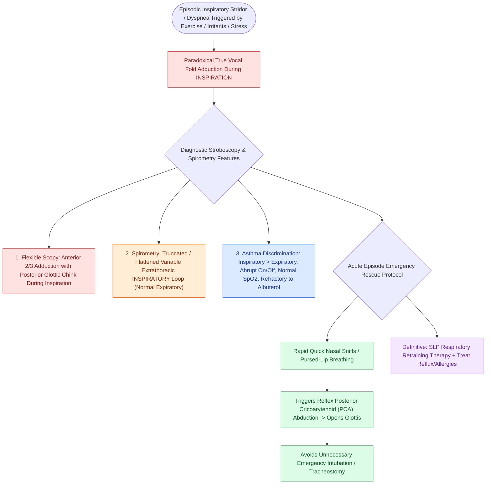

# Paradoxical vocal fold motion causes inspiratory stridor from episodic adduction relieved by rescue breathing

## Active Recall

> [!question]- Which flow-volume loop limb flattens in PVFM and why?
> *Answer / Clinical Rationale*: The **inspiratory** limb — extrathoracic variable obstruction from folds adducting during inspiration.

> [!question]- What is the physiologic rationale of sniff-based rescue breathing?
> *Answer / Clinical Rationale*: Rapid nasal inspiration reflexively drives posterior cricoarytenoid abduction, breaking the adductor spasm.

## Core Clinical & Mechanistic Principles
- Mechanism: episodic **inspiratory adduction** of the folds (often with a preserved posterior 'chink'), producing throat-localized inspiratory stridor, dyspnea, and tightness — modern umbrella term **inducible laryngeal obstruction (ILO)**, with exercise-induced (EILO) the athlete's variant.
- Discriminators from asthma: abrupt on/offset, inspiratory rather than expiratory limitation, normal oxygenation during dramatic episodes, flattened **inspiratory** flow-volume loop, poor bronchodilator response — and the two coexist often enough to keep both diagnoses live.
- Diagnosis is visual: flexible laryngoscopy during a spontaneous or provoked episode (exercise challenge for EILO); between episodes the exam is normal.
- Associations: [[Chronic refractory cough reflects laryngeal hypersensitivity treated with neuromodulators and behavioral suppression therapy|laryngeal hypersensitivity/chronic cough]], reflux, anxiety, high-performance athletics, irritant exposures — treat the neighbors.

### Management & Critical Safety Checks
- Acute rescue: coached **sniff or pursed-lip/straw breathing** (inspiratory nasal flow reflexively abducts), reassurance, heliox rarely; intubation is almost never the answer to a functional larynx.
- Definitive therapy is SLP-delivered laryngeal control therapy; refractory EILO with supraglottic collapse has surgical options in specialized hands.

## Connected Concepts & Graph Traversal
- **Chronic Cough Overlap**: [[Chronic refractory cough reflects laryngeal hypersensitivity treated with neuromodulators and behavioral suppression therapy|Chronic Cough]]
- **Muscle Tension Overlap**: [[Muscle tension dysphonia arises from supraglottic hyperfunction and responds to circumlaryngeal voice therapy|Muscle Tension Dysphonia]]
- **LPR Reflux Irritant**: [[Laryngopharyngeal reflux presents with globus and throat clearing but responds inconsistently to empiric PPIs|Laryngopharyngeal Reflux]]
- **Sole Abductor Muscle**: [[The posterior cricoarytenoid is the sole vocal fold abductor|Posterior Cricoarytenoid]]
- **Diagnostic Stroboscopy**: [[Videostroboscopy visualizes mucosal wave dynamics and glottal closure|Videostroboscopy]]
