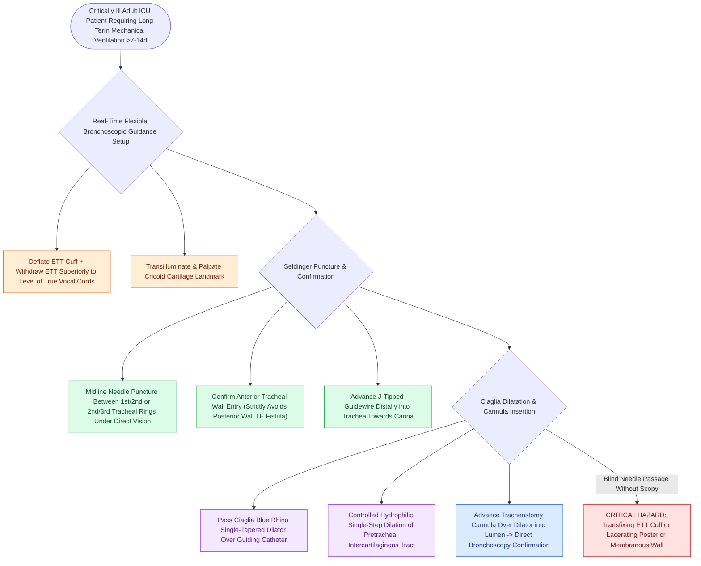

# Percutaneous dilatational tracheostomy utilizes bronchoscopic guidance and Seldinger dilation between tracheal rings

## Active Recall

> [!question]- Why is continuous flexible bronchoscopy considered mandatory during percutaneous tracheostomy?
> *Answer / Clinical Rationale*: It confirms **midline needle entry between target tracheal rings** and **prevents catastrophic puncture of the posterior tracheal wall or indwelling ETT**.

> [!question]- Between which tracheal rings should percutaneous dilatational tracheostomy needle entry occur?
> *Answer / Clinical Rationale*: Between the **1st and 2nd** or **2nd and 3rd tracheal rings** (strictly below the cricoid cartilage to avoid subglottic stenosis).

## Core Clinical & Mechanistic Principles
**Percutaneous Dilatational [[Standard open tracheotomy utilizes horizontal intersinusoidal or Bjork flap entry|Tracheostomy]] (PDT)** (first popularized by Pasquale Ciaglia in 1985) is the primary bedside procedure for establishing long-term ventilatory access in critically ill adult ICU patients:
- **Indications & Setting**:
  - Prolonged mechanical ventilation ($>7\text{–}14\text{ days}$), severe neurological injury, or failure of extubation.
  - Performed at the bedside under deep sedation and neuromuscular blockade.
- **The Mandatory Role of Real-Time Flexible Bronchoscopy**:
  - Bronchoscopic guidance through the indwelling endotracheal tube (ETT) provides continuous direct visualization of the anterior tracheal wall:
    1. Prevents posterior tracheal wall puncture and **tracheoesophageal fistula**.
    2. Confirms exact needle entry between the **1st and 2nd or 2nd and 3rd tracheal rings** in the true midline.
    3. Confirms smooth passage of the J-tipped guidewire, single-tapered dilator (Ciaglia Blue Rhino), and tracheostomy cannula.
- **Contraindications**:
  - *Absolute*: Unstable cervical spine fracture, uncorrectable severe coagulopathy, gross anatomical distortion or inability to palpate cricoid cartilage.
  - *Relative*: Severe morbid obesity (short neck), high PEEP ($>15\text{ cm H}_2\text{O}$), pediatric age ($<12\text{–}15\text{ years}$).

### Surgical Technique & Critical Safety Checks
- **Safety Safeguard**: The endotracheal tube cuff is deflated and the ETT is pulled back under bronchoscopic vision to the level of the vocal cords before needle puncture to prevent transfixing the ETT.

## Connected Concepts & Graph Traversal
- **Open Surgical Alternative**: [[Open tracheostomy provides superior exposure and stay suture placement compared to percutaneous technique|Open Tracheostomy]]
- **Subcutaneous Emphysema Complication**: [[Subcutaneous emphysema arises when tracheotomy incisions are closed too tightly|Subcutaneous Emphysema]]
- **Tracheoinnominate Erosion**: [[Tracheoinnominate fistula presents with sentinel bleeding requiring hyperinflation tamponade and emergency surgical ligation|Tracheoinnominate Fistula]]
- **Emergency Airway Resuscitation**: [[Total laryngectomy stomas and tracheostomies require distinct emergency airway resuscitation algorithms|Trach vs Stoma Resuscitation]]
- **Bjork Flap Security**: [[The Bjork flap facilitates emergency tracheostomy recannulation|Bjork Flap Recannulation]]
