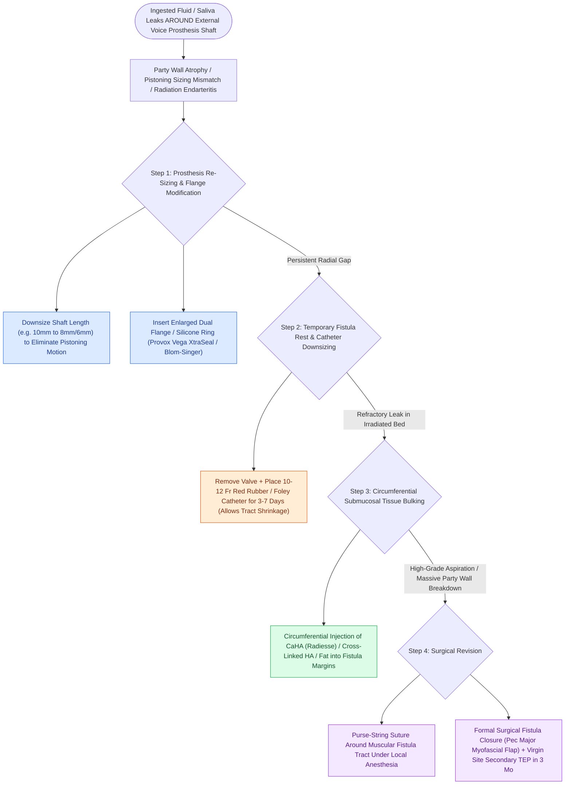

# Periprosthetic TEP leaks occur around the shaft due to tissue atrophy or dilation

## Active Recall

> [!question]- What is the primary anatomical cause of a periprosthetic TEP leak?
> *Answer / Clinical Rationale*: **Atrophy, radial dilation, or radiation-induced tissue loss** of the tracheoesophageal party wall, creating a gap between the prosthesis shaft and the tissue margins.

> [!question]- What are the first two conservative bedside steps in managing a mild-to-moderate periprosthetic leak?
> *Answer / Clinical Rationale*: (1) **Downsizing the prosthesis shaft length and placing an enlarged custom flange**, and (2) **temporary downsizing with a 10–12 Fr catheter** to allow the tract to shrink.

## Core Clinical & Mechanistic Principles
A **Periprosthetic [[Tracheoesophageal puncture diverts pulmonary air through a one-way valve into the neopharynx|TEP]] Leak** is defined as the leakage of ingested liquids, saliva, and secretions **around the external perimeter / shaft of the voice prosthesis** through a widened, atrophic, or necrotic tracheoesophageal puncture tract.

### Underlying Etiological Mechanisms
1. **Radiation-Induced Microvascular Endarteritis & Tissue Thinning**: Radiation impairs local collagen synthesis and capillary perfusion, causing progressive atrophy and thinning of the tracheoesophageal party wall.
2. **Radial Tract Dilation / Pistol-Barrel Effect**: Chronic mechanical toggling of the prosthesis during swallowing or manual stomal occlusion stretches the fistula tract radially.
3. **Prosthesis Sizing Mismatch**: An excessively long prosthesis shaft slides back and forth (pistoning), widening the tract.
4. **Recurrent Neoplasm or Infection**: Local tumor recurrence or fungal chondritis at the puncture site destroying tissue bulk.

## Stepwise Management & Treatment Escalation
Unlike [[Transprosthetic TEP leaks occur through the valve due to Candida biofilm or wear|transprosthetic leaks]] (which are resolved by simple valve replacement), periprosthetic leaks require tissue-based management:

1. **Downsizing Prosthesis Dimensions**:
   - Re-measure party wall thickness using a dedicated sizing tool.
   - Downsize the **shaft length** (e.g., from $10\text{ mm}$ to $8\text{ mm}$ or $6\text{ mm}$) to achieve a snug fit between the tracheal and esophageal flanges, eliminating pistoning.
   - Place a prosthesis with an **enlarged custom tracheal/esophageal flange** (e.g., Provox Vega XtraSeal or Blom-Singer Large Flange).
2. **Temporary Puncture Rest & Catheter Stenting**:
   - Remove the prosthesis and place a smaller **cuffed or uncuffed catheter (e.g., 10-Fr or 12-Fr red rubber or Foley)** across the tract for 3 to 7 days.
   - Puncture tracts naturally shrink around smaller stents in non-irradiated tissue.
3. **Subepithelial Tissue Bulking Injections**:
   - Inject [[Calcium hydroxylapatite provides durable medialization but causes granulomas if superficial|micronized Calcium Hydroxylapatite (CaHA)]], [[Cross-linked hyaluronic acid provides intermediate-duration vocal fold augmentation|cross-linked Hyaluronic Acid]], or [[Autologous fat augmentation requires overcorrection for resorption|autologous fat]] circumferentially into the submucosal borders of the fistula tract under direct endoscopic vision to augment tissue bulk and tighten the seal.
4. **Surgical Interventions**:
   - *Purse-String Suture*: Suture the muscular margins of the tract under local anesthesia.
   - *Puncture Closure & Secondary Repuncture*: Complete closure of the dilated tract with local tissue advancement flaps (or pectoralis major myofascial flap in irradiated necks), followed by secondary TEP at a virgin anatomical site $>2\text{–}3\text{ months}$ later.

## Critical Failure Modes & Error Traps
- **Ignoring the Leak**: Chronic periprosthetic aspiration in an irradiated neck causes severe recurrent aspiration pneumonia, tracheostomal breakdown, and mediastinitis.

## Connected Concepts & Graph Traversal
- **TEP Voice Basics**: [[Tracheoesophageal puncture diverts pulmonary air through a one-way valve into the neopharynx|Tracheoesophageal Puncture]]
- **PE Segment Spasm**: [[Pharyngoesophageal segment hypertonicity causes TEP failure treated with Botox or myotomy|PE Segment Hypertonicity]]
- **Hands-Free Slings**: [[Hands-free stomaplasty stabilizes the peristomal contour using fascia lata slings|Hands-Free Stomaplasty]]
- **Total Laryngectomy Surgery**: [[Total laryngectomy achieves en bloc laryngeal resection with permanent end-stoma|Total Laryngectomy]]
- **Aspiration Scale Assessment**: [[The Rosenbek Scale standardizes the depth of airway penetration and aspiration|Rosenbek Penetration Scale]]
