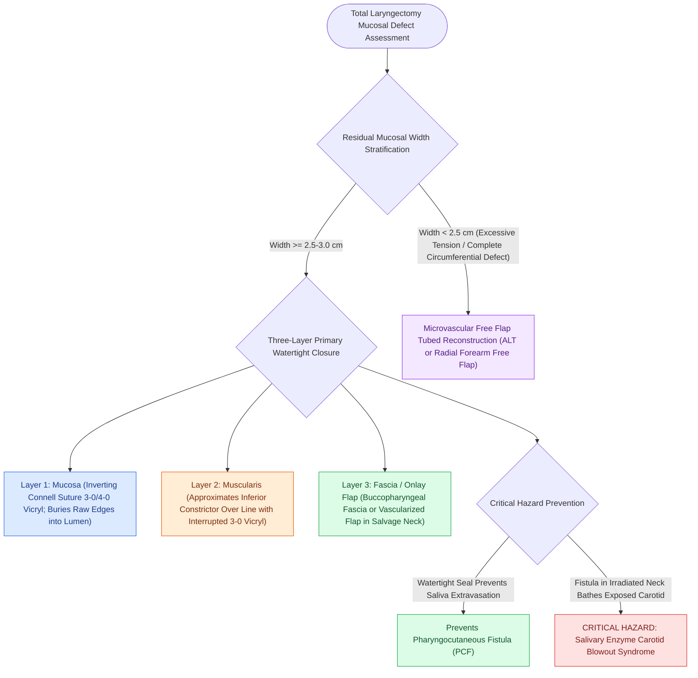

# Pharyngeal reconstruction requires a three-layer closure to prevent fistula

## Active Recall

> [!question]- Why is an inverting Connell stitch utilized for the mucosal layer during pharyngeal reconstruction?
> *Answer / Clinical Rationale*: It inverts the mucosal edges into the pharyngeal lumen, preventing raw mucosal margins from communicating with the deep neck space, which creates a watertight barrier that prevents saliva extravasation and fistula formation.

> [!question]- What is the most critical catastrophic vascular complication of a pharyngocutaneous fistula?
> *Answer / Clinical Rationale*: **Carotid blowout syndrome**; salivary enzymes and infection erode the adventitia of the carotid artery, causing fatal hemorrhage.

## Core Clinical & Mechanistic Principles
Following [[Total laryngectomy achieves en bloc laryngeal resection with permanent end-stoma|Total Laryngectomy]], closing the pharyngeal defect is the critical technical milestone determining whether the patient achieves normal oral feeding or develops a debilitating **Pharyngocutaneous Fistula (PCF)**.

### The Three-Layer Closure Technique
To ensure an airtight, watertight, and tension-free pharyngeal tube, the closure is executed in three distinct anatomical layers:
1. **Layer 1: Mucosal Closure (Inverting Connell Suture)**:
   - Closed in a **"T" or vertical configuration** using continuous running or interrupted inverting **3-0 or 4-0 absorbable sutures (e.g., Vicryl)**.
   - The inverting Connell stitch buries the raw mucosal edges entirely within the pharyngeal lumen, ensuring that raw edges never face the external surgical bed.
2. **Layer 2: Submucosal / Muscularis Reinforcement**:
   - Approximates the inferior constrictor muscle fibers and pharyngeal submucosa over the mucosal line using interrupted 3-0 Vicryl sutures, taking tension off Layer 1.
3. **Layer 3: Fascial & Adventitial Support**:
   - The overlying prevertebral and buccopharyngeal fascial layers or vascularized muscle flaps (e.g., sternocleidomastoid or pectoralis major myofascial flap in salvage/irradiated cases) are closed as a third watertight barrier.

## Risk Factors for Pharyngocutaneous Fistula (PCF)
- **Prior Chemoradiation Therapy (Salvage Laryngectomy)**: Microvascular radiation endarteritis reduces mucosal capillary perfusion, dramatically increasing fistula rates to $30\text{–}50\%$ (prompting prophylactic vascularized muscle flap coverage).
- **Excessive Closure Tension**: Attempting primary closure when $<2.5\text{–}3.0\text{ cm}$ of mucosal width remains causes ischemic breakdown and stricture (requires free flap reconstruction, e.g., anterolateral thigh or radial forearm flap).
- **Poor Nutritional Status**: Serum albumin $<3.0\text{ g/dL}$ or prealbumin $<15\text{ mg/dL}$.

## Critical Failure Modes & Error Traps
- **Salivary Leak & Carotid Blowout**: Saliva leaking from an unrecognized PCF bathes the exposed carotid artery in digestive enzymes and oral bacteria, leading to pseudoaneurysm formation and catastrophic carotid artery blowout.

## Connected Concepts & Graph Traversal
- **Parent Surgical Procedure**: [[Total laryngectomy achieves en bloc laryngeal resection with permanent end-stoma|Total Laryngectomy]]
- **Voice Rehabilitation**: [[Tracheoesophageal puncture diverts pulmonary air through a one-way valve into the neopharynx|Tracheoesophageal Puncture (TEP)]]
- **High-Stakes Complication Matrix**: [[High-stakes laryngeal complications require proactive landmarking and rescue protocols|Complication Matrix]]
- **Swallowing Diagnostics**: [[VFSS provides continuous radiographic evaluation of all deglutition phases|Videofluoroscopic Swallow Study (VFSS)]]
- **Clinical Management**: [[Esophageal speech utilizes swallowed air across the PE segment for voicing|Esophageal Speech]]
