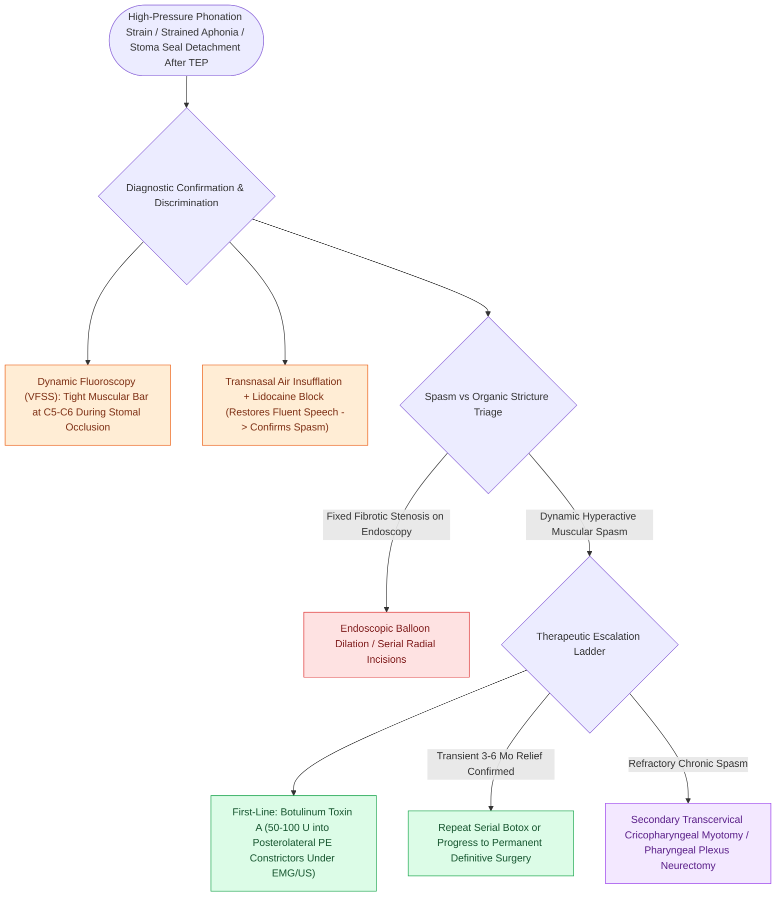

# Pharyngoesophageal segment hypertonicity causes TEP failure treated with Botox or myotomy

## Active Recall

> [!question]- Why does PE segment hypertonicity cause TEP speech failure despite an intact, patent voice prosthesis?
> *Answer / Clinical Rationale*: Reflex muscular spasm of the neopharyngeal constrictor muscles tightly clamps the lumen shut against ascending pulmonary air, creating massive back-pressure and preventing the mucosal vibration necessary for sound production.

> [!question]- What pharmacological intervention provides immediate diagnostic and therapeutic relief of PE segment spasm?
> *Answer / Clinical Rationale*: **Botulinum Toxin A ($50\text{–}100\text{ units}$)** injected into the bilateral posterolateral pharyngeal constrictor muscles of the PE segment.

## Core Clinical & Mechanistic Principles
**Pharyngoesophageal (PE) Segment Hypertonicity / Spasm** is the leading neuromuscular cause of primary or secondary voice restoration failure following [[Total laryngectomy achieves en bloc laryngeal resection with permanent end-stoma|Total Laryngectomy]] and [[Tracheoesophageal puncture diverts pulmonary air through a one-way valve into the neopharynx|Tracheoesophageal Puncture (TEP)]].

### Pathophysiological Mechanism
- **The Pseudoglottic Vibratory Source**: For alaryngeal speech to occur, pulmonary air diverted across the TEP prosthesis must pass through and vibrate the mucosal and muscular folds of the PE segment (the reconstructed neopharynx and [[VFSS provides continuous radiographic evaluation of all deglutition phases|upper esophageal sphincter]]).
- **Hyperactive Reflex Spasm**: In a hypertonic PE segment, the reconstructed inferior constrictor / [[Open diverticulectomy combines pouch resection with cricopharyngeal myotomy|cricopharyngeus muscle]] fibers undergo violent reflex contraction in response to upward airflow.
- **Clinical Presentation**:
  - The patient generates high intrathoracic pulmonary pressures during stomal occlusion, but **cannot produce sound (strained aphonia)** or produces only short, high-pitched, effortful squeaks.
  - The stomal adhesive seal frequently blows off due to excessive back-pressure.

## Diagnostic Confirmation
- **Modified Barium Swallow / VFSS**: Visualizes a tight, non-relaxing muscular constriction at the PE segment level during attempted phonation.
- **Transnasal Air Insufflation Test**: Passing a catheter into the esophagus and insufflating air produces strained sound; injecting local lidocaine into the constrictor temporarily restores fluent, effortless speech (confirming spasm vs stricture).

## Treatment Interventions
1. **Targeted Botulinum Toxin A (Botox) Injection**:
   - **Dose**: **$50\text{ to }100\text{ units}$ of Botox**.
   - **Approach**: Injected under EMG guidance, transnasal endoscopic guidance, or ultrasound guidance into the posterolateral pharyngeal constrictor muscles at the PE segment (divided across 2 to 4 injection sites).
   - *Outcome*: Temporarily paralyzes hyperactive muscle fibers, reducing opening resistance and immediately restoring fluent, low-pressure TEP speech for 3 to 6 months.
2. **Secondary Surgical Cricopharyngeal Myotomy / Neurectomy**:
   - For permanent relief in refractory spasm, an open transcervical secondary CP myotomy or unilateral pharyngeal plexus neurectomy is performed.

## Critical Failure Modes & Error Traps
- **Confusing Spasm with Mechanical Stricture**: A true cicatricial mucosal stricture will not respond to Botox and requires endoscopic balloon dilation; dynamic fluoroscopy is essential to differentiate spasm from stricture.

## Connected Concepts & Graph Traversal
- **TEP Valve Mechanics**: [[Tracheoesophageal puncture diverts pulmonary air through a one-way valve into the neopharynx|Tracheoesophageal Puncture]]
- **Esophageal Speech Mechanics**: [[Esophageal speech utilizes swallowed air across the PE segment for voicing|Esophageal Speech]]
- **Periprosthetic Leak Complication**: [[Periprosthetic TEP leaks occur around the shaft due to tissue atrophy or dilation|Periprosthetic TEP Leaks]]
- **Zenker's Myotomy Counterpart**: [[Open diverticulectomy combines pouch resection with cricopharyngeal myotomy|Cricopharyngeal Myotomy]]
- **Total Laryngectomy Anatomy**: [[Total laryngectomy achieves en bloc laryngeal resection with permanent end-stoma|Total Laryngectomy]]
