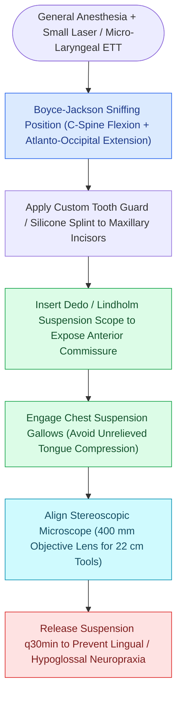

# Phonomicrosurgery requires suspension laryngoscopy and stereoscopic magnification

## Active Recall

> [!question]- Why is a 400 mm focal length objective lens standard for laryngeal phonomicrosurgery?
> *Answer / Clinical Rationale*: It provides an optimal working distance ($40\text{ cm}$) allowing the surgeon to introduce and manipulate $22\text{-cm}$ micro-instruments through the laryngoscope without colliding with the microscope housing.

> [!question]- What nerve injuries can occur secondary to prolonged, excessive laryngoscope suspension against the base of tongue?
> *Answer / Clinical Rationale*: Compression neuropraxia of the **lingual nerve** (causing anterior tongue sensory loss/dysgeusia) and **hypoglossal nerve** (causing tongue motor weakness/deviation).

## Core Clinical & Mechanistic Principles
**Phonomicrosurgery** encompasses the precision microsurgical techniques designed to excise benign or malignant vocal fold pathology while preserving the delicate multi-layered micro-architecture required for voice production.

### Essential Instrumentation & Setup
1. **Maxillary Dental Protection**: Custom tooth guards or silicone dental splints protect maxillary incisors from pressure-induced fracture or avulsion during scope suspension.
2. **Suspension Laryngoscopes**:
   - *Dedo Laryngoscope*: Large oval lumen providing wide visualization, particularly in difficult anterior commissure exposures.
   - *Lindholm / Bouchayer Laryngoscope*: Expanded glosso-epiglottic flaring optimized for bimanual instrument manipulation and supraglottic retraction.
   - *Micro-Laryngeal Instrumentation*: Long ($22\text{ cm}$), delicate micro-forceps, micro-scissors (curved, straight, vertical), micro-elevators, and suction tubes.
3. **Stereoscopic Operating Microscope**:
   - Equipped with a **$400\text{ mm}$ focal length objective lens** to provide adequate working distance for long instruments between the microscope and the laryngoscope ocular port.
   - True binocular stereoscopic depth perception is required to manipulate sub-millimeter tissue planes in [[The superficial lamina propria acts as a pliable shearing fluid bed|Reinke's space]].

## Step-by-Step Patient Positioning & Alignment
1. **Sniffing Position**: Cervical spine flexion with atlanto-occipital extension ("Boyce-Jackson sniffing position") aligns the oral, pharyngeal, and laryngeal axes.
2. **Insertion under Direct Vision**: Pass the laryngoscope blade over the tongue base, identify the epiglottis, gently elevate the lingual surface of the epiglottis, and enter the laryngeal vestibule.
3. **Suspension Arm Engagement**: Lock the laryngoscope into the suspension fulcrum (e.g., Boston suspension gallows or chest support arm) to achieve static, hands-free exposure of the anterior commissure.
4. **Vocal Fold Palpation**: Prior to making any incisions, palpate the lesions and [[The cricoarytenoid joint moves via coupled rocking and sliding|cricoarytenoid joints]] with a blunt probe to assess depth and mobility.

## Critical Failure Modes & Error Traps
- **Hypoglossal / Lingual Nerve Neuropraxia**: Excessive suspension pressure compressed against the base of the tongue can cause transient or permanent neuropraxia of the lingual or hypoglossal nerves (manifesting as tongue numbness or deviation). Release suspension periodically during long cases.
- **Inadequate Anterior Commissure Visualization**: In patients with retrognathia, prominent incisors, or stiff cervical spine, failing to achieve full anterior commissure view risks incomplete lesion resection or inadvertent [[The vocal ligament comprises intermediate and deep lamina propria|vocal ligament]] trauma.

## Connected Concepts & Graph Traversal
- **Histological Layers**: [[The vocal fold comprises five distinct histological layers|Five Histological Layers]]
- **Basement Membrane Anatomy**: [[The basement membrane zone anchors epithelium to superficial lamina propria|Basement Membrane Zone]]
- **Adynamic Segment Pathology**: [[Adynamic vocal fold segments indicate mucosal stiffening, malignancy, or scar|Adynamic Segments]]
- **Vocal Ligament Boundary**: [[The vocal ligament comprises intermediate and deep lamina propria|Vocal Ligament]]
- **Superficial Lamina Preservation**: [[The superficial lamina propria acts as a pliable shearing fluid bed|Superficial Lamina Propria]]
