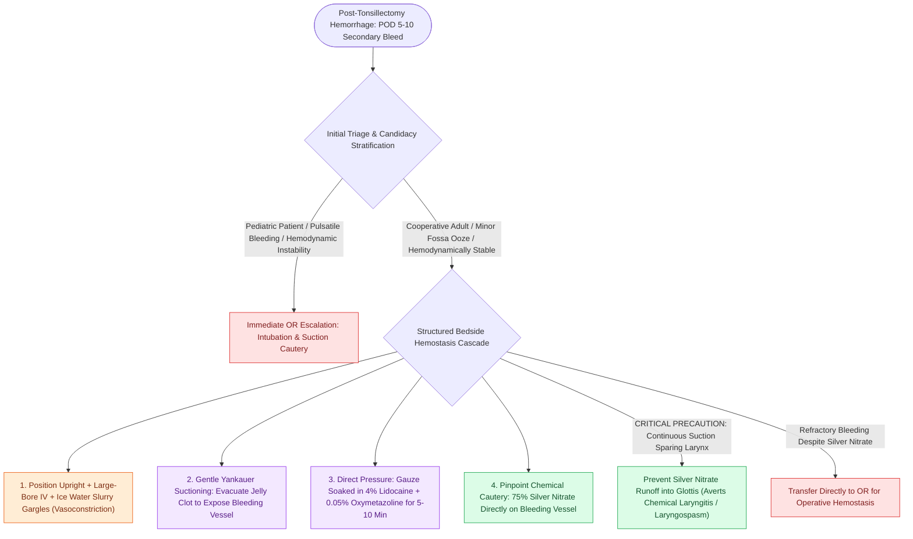

# Post-tonsillectomy hemorrhage bedside management requires ice water gargling, oxymetazoline compression, and silver nitrate cautery

## Active Recall

> [!question]- Why must the overlying clot in the tonsillar fossa be completely suctioned away before attempting chemical cautery?
> *Answer / Clinical Rationale*: The clot exerts no direct tamponade, prevents the exposed bleeding arteriole from retracting into the fibromuscular bed, and acts as a physical barrier preventing topical vasoconstrictors and silver nitrate from contacting the vessel wall.

> [!question]- What life-threatening airway hazard is associated with improper silver nitrate application in the oropharynx?
> *Answer / Clinical Rationale*: **Inferior run-off of caustic silver nitrate into the supraglottis or vocal folds**, which causes severe chemical mucosal burns, acute laryngeal edema, and potentially fatal laryngospasm.

## Core Clinical & Mechanistic Principles
**[[Post-tonsillectomy secondary hemorrhage occurs seven to ten days postoperatively from eschar sloughing requiring urgent airway control|Post-tonsillectomy hemorrhage]] (PTH)** is the most common serious complication of tonsillectomy, occurring in 2%–5% of patients. It is categorized into **primary hemorrhage** (occurring within the first 24 hours, typically technical or secondary to acute hypertension upon emergence) and **secondary hemorrhage** (occurring most frequently on postoperative days 5–10 when fibrin eschar sloughs from the healing granulation bed). In cooperative adult and adolescent patients presenting with non-exsanguinating, low-volume bleeding, structured bedside intervention can successfully achieve hemostasis and avert urgent general anesthesia:

- **Patient Triage & Candidacy Criteria**:
  - **Bedside Trial Candidates**: Stable, alert, cooperative adults or adolescents with minor oozing or a discrete organized clot in the tonsillar fossa, without airway distress or hemodynamic instability.
  - **Absolute OR Indications**: Young pediatric patients (who cannot cooperate with pharyngeal instrumentation and swallow large amounts of blood unnoticed), brisk pulsatile arterial bleeding, refractory oozing, or uncooperative patients.

- **Step-by-Step Bedside Hemostasis Protocol**:
  1. **Immediate ABCs & Resuscitation**: Position the patient fully upright. Obtain large-bore peripheral IV access, draw baseline CBC, coagulation panel, and Type & Screen. Provide an emesis basin and high-flow Yankauer suction.
  2. **Cold Water / Ice Slurry Gargles**: Patient actively swishes and gargles ice water; local hypothermia induces submucosal reflex vasoconstriction.
  3. **Clot Evacuation**: Under direct headlight visualization and tongue depression, use the Yankauer tip to gently aspirate the "sentinel" jelly clot. An overlying clot promotes continued fibrinolysis and prevents vascular retraction.
  4. **Topical Anesthetic & Decongestant Tamponade**: Soak a tonsil sponge or folded gauze in a 1:1 mixture of 4% lidocaine (or Cetacaine spray) and 0.05% oxymetazoline (Afrin). Grasp with curved Kelly or ring forceps and apply steady direct compression into the bleeding tonsil pole for a minimum of 5–10 minutes.
  5. **Targeted Silver Nitrate Chemical Cautery**: Following pack removal, pinpoint the bleeding vessel and apply a 75% silver nitrate applicator directly to the bleeding focus for 5–10 seconds until an eschar forms.

### Surgical Safeguards & Chemical Burn Prevention
- **Silver Nitrate Runoff Hazard**: Liquid silver nitrate dripping into the pyriform sinus or glottis produces acute chemical laryngitis, mucosal ulceration, severe laryngospasm, and sudden airway compromise. Keep suction immediately adjacent to the cautery tip and blot excess moisture.
- **Topical Anesthetic Toxicity**: Excessive benzocaine sprays (Hurricane/Cetacaine) carry the risk of life-threatening **methemoglobinemia**. Monitor continuous pulse oximetry (refractory 85% reading) and keep methylene blue available.

## References
1. Christian, J.M., Felts, C.B., Beckman, N.A., et al. (2020). Deep Neck and Odontogenic Infections. In Flint, P.W., et al. (Eds.), *Cummings Otolaryngology Head and Neck Surgery* 7e (pp. 141-154). Philadelphia, PA: Elsevier.
2. Jeyakumar, A., Miller, S., Mitchell, R.B. (2013). Adenotonsillar Disease in Children. In Johnson, J.J., Rosen, C.A. (Eds.), *Bailey’s Head and Neck Surgery-Otolaryngology* 5e (pp. 1430-1444). Baltimore, MD: Lippincott Williams & Wilkins.
3. Mitchell, R.B., Archer, S.M., Ishman, S.L., et al. (2019). Clinical Practice Guideline: Tonsillectomy in Children (Update). *Otolaryngology–Head and Neck Surgery*, 160(1_suppl), S1–S42.

## Connected Concepts & Graph Traversal
- **Operative Escalation**: [[Operative post-tonsillectomy hemorrhage control employs suction cautery, pillar suturing, and orogastric suctioning|Operative Hemorrhage Control]]
- **Anatomical Substrate**: [[Post-tonsillectomy secondary hemorrhage occurs seven to ten days postoperatively from eschar sloughing requiring urgent airway control|Tonsillar Vascular Supply]]
- **🔗 Pediatric Indications (Pediatrics)**: [[Pediatric acute bacterial tonsillitis is differentiated from viral pharyngitis using modified Centor criteria|Tonsillectomy Indications]]
- **Emergency Airway Protocol**: [[Standard open tracheotomy utilizes horizontal intersinusoidal or Bjork flap entry|Emergency Surgical Airway]]
- **🔗 Deep Space Infection (Head and Neck)**: [[Deep neck space infections spread along cervical fascial planes between the pharynx, mediastinum, and skull base|Peritonsillar Space Anatomy]]
