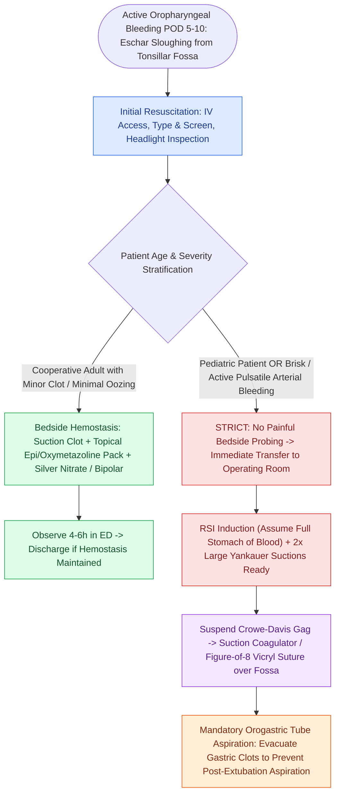

# Post-tonsillectomy secondary hemorrhage occurs seven to ten days postoperatively from eschar sloughing requiring urgent airway control

## Active Recall

> [!question]- Why does secondary post-tonsillectomy hemorrhage typically peak between postoperative days 5 and 10?
> *Answer / Clinical Rationale*: Days 5 to 10 correspond to the biological timeframe of **fibrinolysis and sloughing of the healing fibrinous eschar (pseudomembrane)** covering the granulating tonsillar fossa. As the thick fibrin scab detaches, underlying mucosal vessels that are not yet completely thrombosed or scarred can re-bleed vigorously.

> [!question]- What is the primary anatomical arterial feeder responsible for brisk bleeding from the inferior pole of the tonsil?
> *Answer / Clinical Rationale*: The **tonsillar branch of the facial artery**, which enters the inferior pole of the tonsillar capsule after piercing the superior pharyngeal constrictor muscle, representing the largest and most high-pressure arterial supply to the tonsil.

## Core Clinical & Mechanistic Principles

**Post-tonsillectomy hemorrhage (PTH)** is classified chronologically into:
1. **Primary Hemorrhage**: Occurring within the first **24 hours** postoperatively (incidence 0.2–2%), typically due to intraoperative technique failure, slipped ligatures, rebound hypertension from anesthesia emergence, or coagulopathy.
2. **Secondary Hemorrhage**: Occurring **>24 hours** postoperatively, with peak incidence between **postoperative days 5 and 10** (incidence 2–5%). Secondary PTH results from normal fibrinolytic dissolution and premature sloughing of the healing fibrinous pseudomembrane (**eschar**) over the exposed tonsillar fossa, unmasking branch vessels of the tonsillar arterial plexus before microvascular thrombosis is fully organized.

The palatine tonsil receives a dense, rich arterial supply from branches of the external carotid artery (ECA):
- **Inferior Pole**: **Tonsillar branch of the facial artery** (main arterial supply, responsible for the vast majority of brisk inferior pole arterial bleeds), ascending palatine artery, and dorsal lingual branches.
- **Superior Pole**: Ascending pharyngeal artery and descending palatine artery (via lesser palatine branches).

In severe secondary hemorrhage, swallowed blood creates gastric distension, triggering spontaneous emesis and massive pulmonary aspiration. Airway compromise—not hypovolemic shock—is the primary cause of mortality in pediatric PTH. In adults undergoing transoral robotic surgery (TORS), delayed arterial hemorrhage requires similar prompt control or [[Lingual artery branches require clip ligation during TORS base of tongue resection|prophylactic branch ligation]].

### Surgical Technique & Craft Nuance: Bedside vs. Operative Hemostasis

1. **Bedside Hemostasis (Select Adolescents / Adults)**:
   - Suction large blood clots from the tonsillar fossa using a Yankauer suction under direct headlight illumination.
   - Place a tonsil sponge soaked in 1% lidocaine with 1:100,000 epinephrine and 0.05% oxymetazoline firmly into the fossa with curved ring forceps for 5 minutes.
   - If discrete oozing persists, precisely apply a **silver nitrate stick** or bedside bipolar cautery. Avoid silver nitrate drip onto the laryngeal inlet (causes severe chemical laryngospasm and mucosal burns).
2. **Operative Management (All Children & Brisk Adult Bleeding)**:
   - **Induction Precautions**: Assume every PTH patient has a "full stomach" filled with swallowed blood clots. Rapid Sequence Induction (RSI) with cricoid pressure is performed with two functioning large-bore Yankauer suctions and video laryngoscopy ready.
   - **Retraction & Inspection**: A Crowe-Davis or McIvor mouth gag is suspended. Clear blood clots to identify the bleeding vessel (usually at the inferior pole or superior pole).
   - **Surgical Hemostasis**: Bipolar electrocautery (forceps or suction coagulator set at 20–25 W) is applied precisely to bleeding vessels. If bleeding persists through scarred muscle beds, place a **figure-of-8 suture** using 3-0 or 4-0 Vicryl on a tapered needle through the superior pharyngeal constrictor muscle.
   - **Gastric Decompression**: Always pass a large-bore orogastric tube before extubation to evacuate all pooled blood and clots from the stomach.

## References
1. Christian, J.M., Felts, C.B., Beckman, N.A., et al. (2020). Deep Neck and Odontogenic Infections. In Flint, P.W., et al. (Eds.), *Cummings Otolaryngology Head and Neck Surgery* 7e (pp. 141-154). Philadelphia, PA: Elsevier.
2. Jeyakumar, A., Miller, S., Mitchell, R.B. (2013). Adenotonsillar Disease in Children. In Johnson, J.J., Rosen, C.A. (Eds.), *Bailey’s Head and Neck Surgery-Otolaryngology* 5e (pp. 1430-1444). Baltimore, MD: Lippincott Williams & Wilkins.
3. Mitchell, R.B., Archer, S.M., Ishman, S.L., et al. (2019). Clinical Practice Guideline: Tonsillectomy in Children (Update). *Otolaryngology–Head and Neck Surgery*, 160(1_suppl), S1–S42.

## Connected Concepts & Graph Traversal
- **🔗 Diagnostic Staging & Primary Bleeds (Pediatrics)**: [[Post-tonsillectomy hemorrhage is classified into primary within twenty-four hours and secondary beyond twenty-four hours|PTH Classification & Timing]]
- **🔗 Severe Rescue Protocol (Pediatrics)**: [[Severe secondary post-tonsillectomy hemorrhage requires urgent airway stabilization and surgical electrocautery|Severe Secondary Bleed Rescue]]
- **🔗 Primary Surgical Indication (Pediatrics)**: [[Pediatric acute bacterial tonsillitis is differentiated from viral pharyngitis using modified Centor criteria|Paradise Criteria & Tonsillitis]]
- **🔗 Robotic Tonsillectomy Hemostasis (Head and Neck)**: [[Transoral robotic surgery TORS achieves en bloc resection of tonsillar and base of tongue neoplasms|TORS Radical Tonsillectomy]]
- **🔗 Anatomical Foundation (Head and Neck)**: [[Lingual artery branches require clip ligation during TORS base of tongue resection|Lingual & Facial Artery Branches]]
