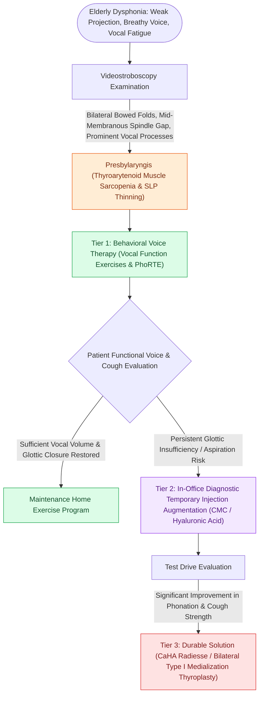

# Presbyphonia reflects vocal fold atrophy and bowing managed with therapy before augmentation

## Active Recall

> [!question]- Describe the classic stroboscopic configuration of presbylaryngis.
> *Answer / Clinical Rationale*: Bilateral bowing with a spindle-shaped midmembranous gap and prominent vocal processes; reduced mucosal wave amplitude from SLP thinning.

> [!question]- Why trial a temporary injectable before durable medialization?
> *Answer / Clinical Rationale*: It tests whether closing the gap actually fixes the complaint (and swallow/voice trade-offs) before committing to framework surgery or long-lasting material.

## Core Clinical & Mechanistic Principles
- Substrate: thyroarytenoid muscle atrophy plus superficial lamina propria thinning → **bowed membranous folds, spindle glottic gap, prominent vocal processes**; the voice is breathy, thin, higher-pitched in men, with reduced projection and vocal fatigue.
- It is a diagnosis of exclusion in the elderly dysphonic patient: paralysis/paresis, neurologic disease (Parkinson hypophonia, ALS, tremor), and malignancy must be actively ruled out — bowing is common, but so is everything else at eighty.
- Secondary MTD frequently rides on top (squeeze compensating the gap) and confuses the exam.
- Functional stakes are aspiration-adjacent: the same [[Unilateral vocal fold paralysis causes glottic insufficiency, breathiness, and aspiration|glottic insufficiency]] that thins the voice weakens cough and swallow safety in the frail.

### Management & Critical Safety Checks
- First-line: **voice therapy** (vocal function exercises, resonant voice) — meaningful gains in most, and it doubles as a diagnostic-therapeutic trial.
- Insufficient response: **trial injection augmentation** (temporary material first as a 'test drive'), then durable augmentation or bilateral medialization thyroplasty for sustained benefit.

## Connected Concepts & Graph Traversal
- **Glottal Gap Morphology**: [[Glottal closure patterns identify specific laryngeal biomechanical deficits|Glottal Closure Deficits]]
- **Injection Augmentation**: [[Injection laryngoplasty requires precise placement into lateral thyroarytenoid muscle|Injection Laryngoplasty]]
- **Muscle Tension Compensation**: [[Muscle tension dysphonia arises from supraglottic hyperfunction and responds to circumlaryngeal voice therapy|Muscle Tension Dysphonia]]
- **Thyroplasty Implant Alternative**: [[Type I thyroplasty medializes the vocal fold with conscious voice tuning|Type I Thyroplasty]]
- **Diagnostic Stroboscopy**: [[Videostroboscopy visualizes mucosal wave dynamics and glottal closure|Videostroboscopy]]
