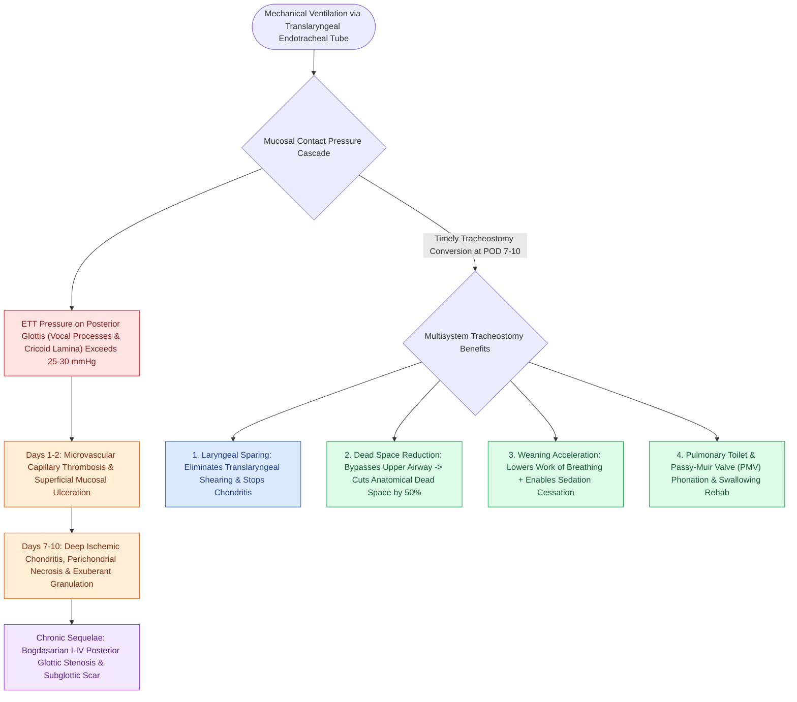

# Prolonged intubation beyond seven to ten days increases glottic stenosis and ventilator-associated pneumonia risk

## Active Recall

> [!question]- What specific anatomical zone of the larynx sustains the highest pressure and ischemic necrosis during prolonged translaryngeal intubation?
> *Answer / Clinical Rationale*: The **posterior glottis**, specifically the medial surfaces of the **arytenoid vocal processes and the interarytenoid mucosa overlying the cricoid lamina**, which bear the compressive load of the endotracheal tube.

> [!question]- How does conversion from an endotracheal tube to a tracheostomy tube facilitate ventilator weaning from a respiratory mechanics standpoint?
> *Answer / Clinical Rationale*: A tracheostomy bypasses the oral cavity, pharynx, and supraglottis, **reducing anatomical dead space by ~50%** and significantly decreasing airway resistance, thereby substantially lowering the patient's work of breathing.

## Core Clinical & Mechanistic Principles
In critically ill adult patients requiring mechanical ventilation, the presence of an indwelling translaryngeal endotracheal tube (ETT) exerts continuous, unphysiologic pressure on the delicate mucosa and cartilaginous framework of the larynx and upper trachea. Transitioning to a tracheostomy is strongly recommended when extubation cannot be accomplished within **7 to 10 days**, because prolonged intubation exponentially escalates the risk of irreversible [[External laryngeal trauma is staged by the Schaefer classification directing tracheostomy and open repair|laryngeal trauma]], ventilator-associated pneumonia (VAP), and prolonged ICU dependency:

- **Pathophysiology of Translaryngeal Intubation Injury**:
  - **Posterior Glottic Ischemia**: The ETT is anchored posteriorly against the vocal processes of the arytenoids, the posterior cricoid lamina, and the interarytenoid fold.
  - **Capillary Perfusion Threshold**: Whenever localized contact pressure exceeds mucosal capillary perfusion pressure (**$>25\text{ to }30\text{ mmHg}$**), tissue ischemia begins. Within 48 hours, superficial mucosal erosion develops; by days 7 to 10, deep ulceration, perichondritis, ischemic chondritis, and dense fibroblastic granulation tissue form.
  - **Chronic Cicatricial Sequelae**: Healing of this granulation tissue culminates in **posterior glottic stenosis (Bogdasarian Types I–IV)**, interarytenoid synostosis, cricoarytenoid joint ankylosis, or full-thickness **[[The Cotton-Myer classification grades subglottic stenosis by luminal reduction|subglottic stenosis]]**.
  - **Exacerbating Risk Factors**: Oversized endotracheal tubes ($>7.0\text{ mm}$ in females, $>8.0\text{ mm}$ in males), high cuff inflation pressures ($>25\text{ cm }H_2O$), frequent re-intubation, systemic hypotension requiring vasopressors, diabetes mellitus, active acid reflux, and prone positioning.

- **Physiological & Clinical Benefits of Tracheostomy**:
  1. **Laryngeal Sparing**: Immediately removes rigid translaryngeal shearing forces from the glottis and subglottis, halting progressive chondritis.
  2. **Dead Space Reduction**: Decreases anatomical dead space by approximately **$50\%$ ($\approx 150\text{ mL} \rightarrow 75\text{ mL}$)** and reduces upper airway resistance, dramatically lowering the mechanical work of breathing and accelerating ventilator weaning.
  3. **Direct Pulmonary Toilet**: Provides direct, low-resistance suction access for deep tracheobronchial clearance of thick inspissated secretions.
  4. **Sedation Weaning & Mobilization**: Eliminates the discomfort of an oral tube, allowing ICU teams to stop continuous sedative infusions, reducing delirium, and enabling early out-of-bed physical and occupational therapy.
  5. **Swallowing & Communication**: Facilitates early swallowing evaluation and phonation via one-way speaking valves (e.g., Passy-Muir valve) during ventilator weaning.

## References
1. Durbin Jr., C.G. (2010). Tracheostomy: why, when, and how? *Respir Care*, 55(8):1056-1068.
2. Mitchell, R.B., Hussey, H.M., Setzen, G., et al. (2013). Clinical consensus statement: Tracheostomy care. *Otolaryngol Head Neck Surg*, 148(1):6-20.
3. Kraft, S.M., Schindler, J.S. (2020). Tracheotomy. In Flint, P.W., et al. (Eds.), *Cummings Otolaryngology Head and Neck Surgery* 7e (pp. 95-103). Philadelphia, PA: Elsevier.

## Connected Concepts & Graph Traversal
- **Surgical Approach**: [[Open tracheostomy provides superior exposure and stay suture placement compared to percutaneous technique|Open vs Percutaneous Tracheostomy]]
- **Laryngeal Stenosis Grading**: [[The Cotton-Myer classification grades subglottic stenosis by luminal reduction|Subglottic Stenosis Classification]]
- **Tube Exchange Protocol**: [[Adult tracheostomy tube exchange at one week requires a mature tract, tracheal stay sutures, and bougie guidance|Tracheostomy Exchange Timing]]
- **Emergency Surgical Airway**: [[Standard open tracheotomy utilizes horizontal intersinusoidal or Bjork flap entry|Standard Open Tracheotomy]]
- **Granulation Tissue Management**: [[Tracheostomy stomal bleeding is controlled with cuff overinflation, hemostatic agents, and silver nitrate cautery|Stomal Granulation & Bleeding]]
