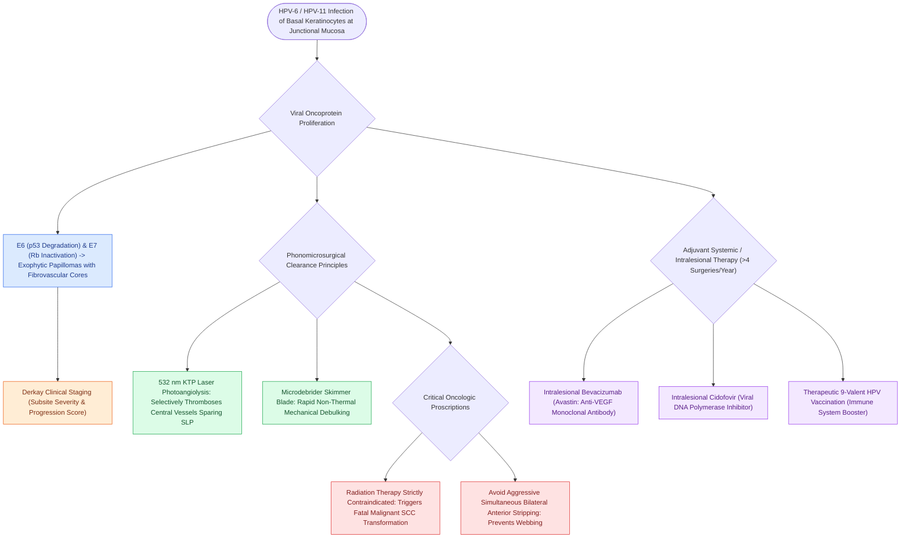

# Recurrent respiratory papillomatosis is caused by HPV and managed with serial debulking

## Active Recall

> [!question]- Why is the 532 nm KTP laser preferred over the 10,600 nm CO2 laser for recurrent respiratory papillomatosis?
> *Answer / Clinical Rationale*: The KTP laser selectively targets hemoglobin in the central fibrovascular cores of papillomas (photoangiolysis), causing involution while sparing the overlying epithelium and preserving the pliable superficial lamina propria.

> [!question]- What is the mechanism of action of intralesional Bevacizumab as an adjuvant in RRP?
> *Answer / Clinical Rationale*: It is a monoclonal antibody against **VEGF (Vascular Endothelial Growth Factor)** that inhibits the robust neoangiogenesis required to sustain papilloma growth.

## Core Clinical & Mechanistic Principles
**Recurrent Respiratory Papillomatosis (RRP)** is a debilitating, recurrent disease of the aerodigestive tract caused by mucosal infection with **Human Papillomavirus (HPV) genotypes 6 and 11**.

### Pathophysiology & Histology
- **Viral Tropism**: HPV infects basal keratinocytes at squamous-ciliated junctional zones (anterior commissure, vocal folds, ventricles, and subglottis).
- **Oncogenes E6 & E7**: Viral oncoproteins E6 and E7 downregulate p53 and retinoblastoma (Rb) tumor suppressor pathways, inducing benign epithelial proliferation and hyperplastic exophytic warty lesions.
- **Histopathology**: Branching, finger-like projections of [[Stratified squamous epithelium forms the vocal fold protective cover|non-keratinizing stratified squamous epithelium]] supported by central fibrovascular cores.
- **Derkay Staging Score**: Standardized scoring system quantifying anatomical disease severity and progression across aerodigestive subsites.

## Surgical Principles & Laser Photoangiolysis
- **Preservation of Native Laryngeal Architecture**: The goal of surgery is **safe debulking and airway clearance while preventing iatrogenic scarring**. Aggressive mucosal stripping or deep laser vaporizations are contraindicated.
- **KTP / PDL Photoangiolytic Laser**: The [[The KTP laser targets oxyhemoglobin at 532 nm for photoangiolysis|KTP laser (532 nm)]] or PDL (585 nm) delivers energy selectively absorbed by hemoglobin in the central fibrovascular cores of the papillomas, inducing vessel thrombosis and regression while sparing the underlying [[The superficial lamina propria acts as a pliable shearing fluid bed|superficial lamina propria]] and [[The mucosal wave travels as a fluid mechanical displacement|mucosal wave]].
- **Microdebrider Debulking**: Powered skimmer blades allow rapid mechanical debulking of bulky lesions without thermal injury.

## Adjuvant Medical Therapies
Indicated for severe, aggressive disease (>4 surgeries/year, rapid airway obstruction, or distal tracheal spread):
1. **Intralesional / Systemic Bevacizumab (Avastin)**: Monoclonal antibody against **Vascular Endothelial Growth Factor (VEGF)**; inhibits abnormal angiogenesis within papilloma cores, significantly prolonging inter-surgical intervals.
2. **Intralesional Cidofovir**: Nucleotide analog of cytosine that selectively inhibits viral DNA polymerase. (Monitor for local nephrotoxicity or theoretical dysplastic transformation).
3. **HPV Vaccination**: Therapeutic administration of the 9-valent HPV vaccine may boost host cell-mediated immune responses.

## Critical Failure Modes & Error Traps
- **Anterior Glottic Webbing**: Operating on opposing anterior commissure papillomas with thermal [[The CO2 laser vaporizes tissue via 10600 nm water absorption|CO2 laser]] or aggressive cold instruments causes severe anterior web formation and permanent airway narrowing.
- **Malignant Transformation**: HPV-11 carries a higher risk of dysplasia and rare spontaneous or radiation-induced transformation to squamous cell carcinoma. Radiation therapy is strictly contraindicated in RRP.

## Connected Concepts & Graph Traversal
- **Photoangiolysis Laser**: [[The KTP laser targets oxyhemoglobin at 532 nm for photoangiolysis|KTP Laser Photoangiolysis]]
- **Ablative Laser**: [[The CO2 laser vaporizes tissue via 10600 nm water absorption|CO2 Laser Physics]]
- **Pliable Cover Layer**: [[The superficial lamina propria acts as a pliable shearing fluid bed|Superficial Lamina Propria (Reinke's Space)]]
- **Webbing Complication Rescue**: [[The epithelial-sparing microflap preserves native mucosa and prevents glottic webbing|Anterior Glottic Webbing]]
- **Anterior Insertion Anchor**: [[Broyles' ligament anchors the vocal ligament to thyroid cartilage|Broyles' Ligament & Cartilage Apex]]
- **🔗 Pediatric Airway Stridor (Pediatrics)**: [[Pediatric stertor and stridor differentiate upper supraglottic airway obstruction from intrathoracic tracheobronchial disease|Pediatric Stridor Evaluation]]
