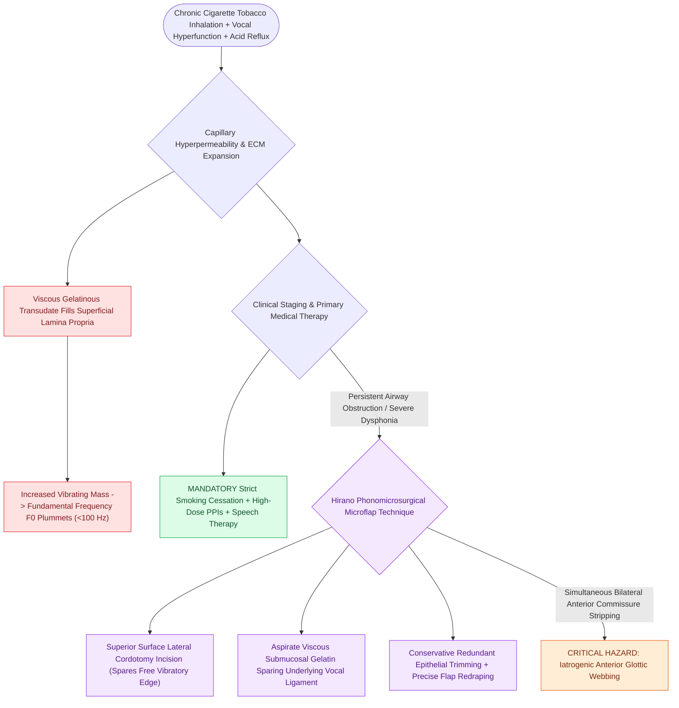

# Reinke's edema causes polypoid degeneration of the superficial lamina propria treated with smoking cessation and lateral microflap evacuation

## Active Recall

> [!question]- What histopathologic alteration within Reinke's space drives the profound drop in fundamental frequency (F0) characteristic of Reinke's edema?
> *Answer / Clinical Rationale*: Massive accumulation of viscous, gelatinous glycosaminoglycan-rich fluid and basement membrane thickening expand the **superficial lamina propria**, increasing vocal fold mass and reducing tissue tension, which dramatically drops the phonatory fundamental frequency ($F_0$).

> [!question]- Why must surgical microflap excision for severe bilateral Reinke's edema be staged or strictly avoid the anterior commissure?
> *Answer / Clinical Rationale*: Bilateral simultaneous deep de-epithelialization crossing the anterior commissure causes denuded opposing cartilage contact, triggering exuberant granulation and **anterior glottic web formation**, resulting in permanent airway restriction and severe dysphonia.

## Core Clinical & Mechanistic Principles
**Reinke's edema** (also termed polypoid corditis or bilateral polypoid degeneration) is a chronic, non-neoplastic disease of the membranous true vocal folds characterized by the progressive accumulation of diffuse, gelatinous, low-protein transudate within the [[The superficial lamina propria acts as a pliable shearing fluid bed|superficial lamina propria (Reinke's space)]].

### Etiology & Pathophysiologic Remodeling
Reinke's edema almost exclusively afflicts chronic cigarette smokers (present in $>90\%\text{ to }98\%$ of clinical cohorts), with female predominance ($3:1$ to $4:1$) seeking medical care due to profound virilization of vocal pitch:
1. **Chemical & Thermal Microvascular Injury**: Tobacco smoke components induce chronic microvascular hyperpermeability, erythrocyte diapedesis, and capillary ectasia within the subepithelial shearing bed.
2. **Extracellular Matrix Expansion**: Chronic mechanical shearing forces from vocal hyperfunction and laryngopharyngeal reflux (LPR) stimulate fibroblasts to produce excessive amorphous mucopolysaccharides, fibronectin, and hyaluronic acid.
3. **Acoustic & Biomechanical Consequences**: The massive volume expansion and structural disorganization of the superficial lamina propria cushion and dampen the underlying [[The vocal ligament comprises intermediate and deep lamina propria|vocal ligament]]. The dramatically increased vibrating mass and reduced tissue stiffness severely decelerate vocal fold oscillation, leading to an abnormal, fluid-like [[The mucosal wave travels as a fluid mechanical displacement|mucosal wave]] and a precipitous fall in fundamental frequency ($F_0$) to below $100\text{ Hz}$ in females, producing the classic raspy "whiskey voice."

### Yonekawa Endoscopic Staging System
- **Grade I**: Edema is confined to the superior surface of the true vocal folds, preserving glottic patency during both quiet respiration and deep inspiration.
- **Grade II**: The edematous, polypoid mucosa extends beyond the free vibratory margin, contacting the opposing vocal fold during phonation and partially encroaching upon the glottic aperture.
- **Grade III**: Bulky, elephantine, pedunculated polypoid sacs prolapse circumferentially into the subglottis and glottic lumen during inspiration, causing dyspnea, choking spells, and inspiratory stridor that can mimic tracheal stenosis or [[Vocal fold polyps arise from phonotraumatic microvascular injury in Reinke's space|vocal fold polyps]].

### Phonomicrosurgical Execution: Hirano's Lateral Microflap Technique
1. **Strict Medical & Behavioral Pre-Requisites**: Surgery is strictly avoided in active smokers except in the setting of acute airway compromise. Tobacco cessation halts ongoing microvascular leakage and often reduces mucosal volume by $20\%\text{ to }30\%$.
2. **Lateral Cordotomy Incision**: Under suspension microlaryngoscopy with high-power magnification, a linear incision is made on the **superior lateral surface** of the vocal fold using a micro-sickle knife. Crucially, the medial free vibratory margin is left completely untouched.
3. **Gentle Fluid Evacuation**: A fine micro-suction tip ($3\text{ to }5\text{ French}$) is introduced into Reinke's space to aspirate the thick, viscous gelatinous matrix. Mechanical peeling, forceful traction, and laser vaporization of the pocket bed are strictly prohibited to protect the delicate intermediate and deep elastic lamina propria.
4. **Microflap Tailoring & Redraping**: Redundant, stretched epithelial flaps are conservatively trimmed with micro-scissors and redraped smoothly over the evacuated bed. Fibrin glue or spontaneous mucosal adherence secures the flap without sutures.
5. **Staging Bilateral Disease**: In advanced Grade III bilateral disease, either one vocal fold is operated at a time (staged by 6 to 8 weeks), or surgery on the contralateral vocal fold is terminated at least $2\text{ to }3\text{ mm}$ posterior to the anterior commissure to eliminate the risk of cicatricial fusion.

## Critical Failure Modes & Error Traps
- **Operating on an Active Smoker**: Performing microflap evacuation while the patient continues smoking leads to rapid recurrence within months and severe fibroblastic scarring.
- **Deep Laser Vaporization**: Using thermal lasers to vaporize polypoid tissue ablates the vocal ligament, producing profound permanent dysphonia and vocal fold tethering.

## Connected Concepts & Graph Traversal
- **Hydrodissection Principle**: [[Subepithelial hydrodissection expands Reinke's space and protects the vocal ligament|Subepithelial Hydrodissection]]
- **Submucosal Gland Lesion**: [[Mucous retention cysts arise from obstructed glands in superficial lamina propria|Mucous Retention Cysts]]
- **Dynamic Optical Analysis**: [[Videostroboscopy visualizes mucosal wave dynamics and glottal closure|Videostroboscopic Evaluation]]
- **Phonotraumatic Lesion**: [[Vocal fold nodules are bilateral mid-membranous lesions treated with voice therapy|Vocal Fold Nodules]]
- **Microarchitectural Bed**: [[The basement membrane zone anchors epithelium to superficial lamina propria|Basement Membrane Zone]]
