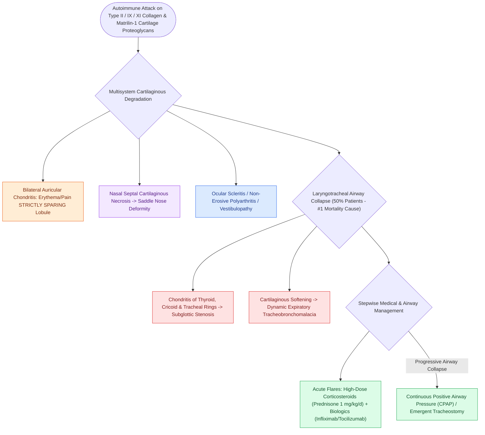

# Relapsing polychondritis causes autoimmune auricular and laryngotracheal chondritis with sparing of the non-cartilaginous lobule

## Active Recall

> [!question]- What physical examination feature distinguishes relapsing polychondritis of the ear from infectious perichondritis or cellulitis?
> *Answer / Clinical Rationale*: Relapsing polychondritis **strictly spares the non-cartilaginous ear lobule**, whereas infectious cellulitis affects both cartilage and lobule.

> [!question]- What is the leading cause of mortality in patients with relapsing polychondritis?
> *Answer / Clinical Rationale*: **Laryngotracheal involvement** leading to subglottic stenosis, tracheobronchomalacia, and dynamic asphyxiating airway collapse.

## Core Clinical & Mechanistic Principles
**Relapsing Polychondritis (RPC)** is a rare, episodic [[Systemic autoimmune diseases manifest in the larynx with subglottic stenosis, rheumatoid bamboo nodes, and granulomatous infiltration|autoimmune systemic disease]] characterized by recurrent, destructive inflammatory episodes targeting cartilaginous structures throughout the body:
- **Pathophysiological Mechanism**:
  - Autoantibodies against **Type II, IX, and XI collagen** and matrilin-1 trigger widespread chondritis, enzymatic proteoglycan matrix degradation, and eventual fibrous replacement with loss of structural cartilage rigidity.
- **The Pathognomonic Ear Sign: Sparing of the Lobule**:
  - **Bilateral Auricular Chondritis ($>85\text{–}90\%$ of patients)**: Severe, painful erythema, warmth, and swelling involving the helix, antihelix, tragus, and conchal bowl, **strictly sparing the non-cartilaginous ear lobule** (differentiating it from infectious perichondritis/cellulitis).
  - Chronic destruction leads to a soft, deformed **"cauliflower ear" or flopped auricle**.
- **Laryngotracheal & Airway Involvement ($50\%$ of patients - Leading Cause of Death)**:
  - Destructive chondritis of the thyroid, cricoid, and tracheal cartilage rings.
  - Causes subglottic stenosis, anterior flaccidity, dynamic tracheobronchomalacia, and acute or progressive airway collapse.
- **Other Systemic Manifestations (McAdam Criteria)**:
  - Non-erosive inflammatory polyarthritis, nasal chondritis (**saddle nose deformity**), ocular inflammation (scleritis/episcleritis), and sensorineural hearing loss / vestibular dysfunction.

### Surgical Technique & Critical Safety Checks
- **Treatment Strategy**: High-dose systemic corticosteroids (prednisone $1\text{ mg/kg/day}$) during acute flares; steroid-sparing immunosuppression (methotrexate, azathioprine) or biologic agents (tocilizumab, infliximab); CPAP or tracheostomy for structural airway collapse.

## Connected Concepts & Graph Traversal
- **Subglottic Stenosis Staging**: [[The Cotton-Myer classification grades subglottic stenosis by luminal reduction|Cotton-Myer Classification]]
- **McCaffrey Subsite Staging**: [[The McCaffrey classification stages laryngotracheal stenosis by anatomical subsite|McCaffrey Staging]]
- **Endoscopic Airway Dilation**: [[Endoscopic airway dilation combines radial incisions with balloon bronchoplasty|Airway Dilation]]
- **Open Airway Stenting**: [[Two-stage LTR maintains a tracheostomy with prolonged endolaryngeal stenting|Two-Stage LTR Stenting]]
- **Emergency Airway Protocol**: [[Total laryngectomy stomas and tracheostomies require distinct emergency airway resuscitation algorithms|Airway Emergency Algorithms]]
- **Differential Diagnosis**: [[Systemic autoimmune diseases manifest in the larynx with subglottic stenosis, rheumatoid bamboo nodes, and granulomatous infiltration|Systemic Autoimmune Laryngeal Disease]]
