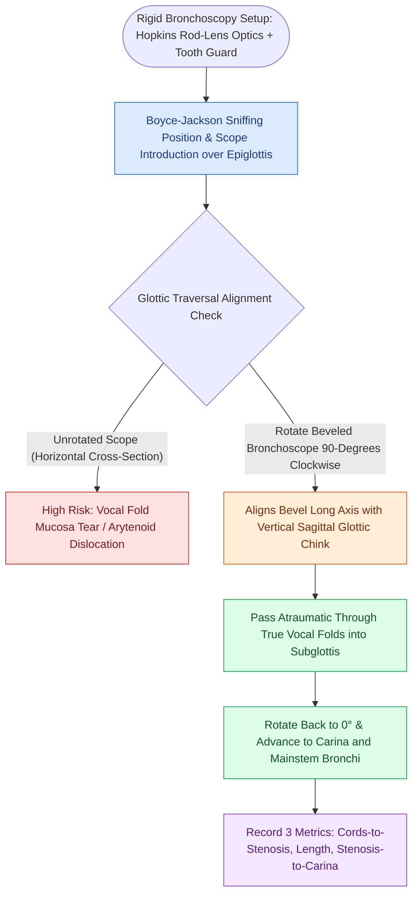

# Rigid bronchoscopy requires 90-degree rotation through the glottis

## Active Recall

> [!question]- Why must a rigid bronchoscope be rotated 90 degrees when traversing the vocal folds?
> *Answer / Clinical Rationale*: The glottic opening is oriented vertically in the sagittal plane; rotating the beveled scope 90° aligns the narrowest diameter of the scope with the vertical glottic chink, allowing atraumatic passage without shearing the vocal fold cover or dislocating the arytenoids.

> [!question]- What three mandatory anatomical distances are measured with a rigid bronchoscope prior to open airway reconstruction?
> *Answer / Clinical Rationale*: (1) Distance from **vocal cords to the upper border of stenosis**, (2) **vertical length of the stenosis**, and (3) distance from **lower border of stenosis to the carina**.

## Core Clinical & Mechanistic Principles
**Operative Rigid Bronchoscopy** is the standard diagnostic and therapeutic endoscopic modality for direct, uninhibited examination of the subglottis, trachea, carina, and tracheobronchial tree.

### Dimensional & Structural Mechanics
- **Open Lumen & Optical Telescopes**: Rigid stainless steel bronchoscope barrels (e.g., Karl Storz, Jackson) accommodate zero-degree and angled (30°, 70°) rod-lens Hopkins telescopes, optical biopsy forceps, suction channels, and [[Jet ventilation requires unimpeded expiratory egress to prevent barotrauma|jet ventilation]] adapters.
- **Dimensional Measurement**: Calibrated markings on the scope barrel allow exact intraoperative measurement of:
  1. Distance from the true vocal cords to the superior border of the stenosis.
  2. Vertical length of the stenotic segment.
  3. Distance from the lower stenotic border to the main carina.

## Step-by-Step Operative Navigation
1. **Patient Positioning**: Boyce-Jackson sniffing position ([[The guardian chin-to-chest suture prevents cervical hyperextension and anastomotic dehiscence|cervical flexion]], atlanto-occipital extension); place heavy silicone tooth guard over maxillary teeth.
2. **Introduction**: Pass scope over the tongue base under direct optical visualization, elevating the epiglottis.
3. **Glottic Traversal via 90° Rotation**:
   - The human vocal cords are aligned vertically in the sagittal plane.
   - The tip of the rigid bronchoscope features an angled bevel.
   - **Rotate the scope 90°** so the long axis of the beveled tip parallels the vertical glottic aperture.
   - Gently slide the scope between the true vocal folds without catching or tearing the [[Stratified squamous epithelium forms the vocal fold protective cover|epithelium]] or [[The vocal ligament comprises intermediate and deep lamina propria|vocal ligament]].
4. **Tracheal & Bronchial Exploration**: Rotate the scope back to the standard horizontal orientation once within the subglottis; systematically advance through the mid-trachea, carina, right mainstem, bronchus intermedius, and left mainstem.

## Critical Failure Modes & Error Traps
- **Vocal Cord Avulsion / Arytenoid Dislocation**: Forcing the broad horizontal diameter of an unrotated bronchoscope through an adducted glottis can dislocate the [[The cricoarytenoid joint moves via coupled rocking and sliding|cricoarytenoid joint]] or avulse the vocal fold mucosa.
- **Tracheal Tear / Perforation**: Overly aggressive dilation or blind advancement against an acute stenotic web can perforate the posterior membranous tracheal wall into the esophagus.

## Connected Concepts & Graph Traversal
- **Airway Dilation Technique**: [[Endoscopic airway dilation combines radial incisions with balloon bronchoplasty|Endoscopic Airway Dilation]]
- **Airway Fire Prevention**: [[Airway fire prevention requires FiO2 below 30 percent and laser-safe tubes|Airway Fire Prevention]]
- **Emergency Airway Resuscitation**: [[Total laryngectomy stomas and tracheostomies require distinct emergency airway resuscitation algorithms|Emergency Airway Resuscitation]]
- **High-Stakes Rescue**: [[High-stakes laryngeal complications require proactive landmarking and rescue protocols|Laryngeal Complications]]
- **Cotton-Myer Stenosis Staging**: [[The Cotton-Myer classification grades subglottic stenosis by luminal reduction|Cotton-Myer Classification]]
