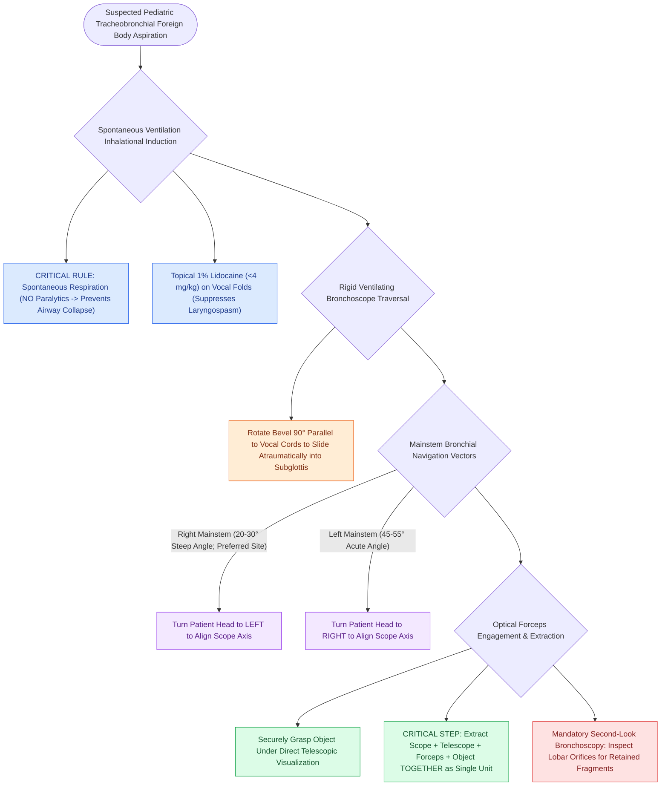

# Rigid bronchoscopy technique for pediatric airway foreign body removal requires systematic distal-to-proximal examination

## Active Recall

> [!question]- Why must neuromuscular paralytics be avoided during general anesthesia for pediatric rigid bronchoscopy in foreign body aspiration?
> *Answer / Clinical Rationale*: Paralysis abolishes spontaneous diaphragmatic motion and dynamic airway dilation, causing the tracheobronchial tree to collapse around the foreign body and converting a partial check-valve obstruction into complete, unventilatable airway occlusion.

> [!question]- Why must the rigid bronchoscope, optical forceps, and foreign body be extracted together as a single unit?
> *Answer / Clinical Rationale*: Most aspirated objects are larger than the working channel of the bronchoscope; attempting to pull the object inside the bronchoscope will crush or fragment the object, or shear it off at the distal tip.

## Core Clinical & Mechanistic Principles
**Tracheobronchial foreign body aspiration** is a critical pediatric emergency predominantly occurring in children under 3 years of age due to lack of molar dentition, immature swallowing coordination, and exploratory mouthing behaviors. While organic materials (peanuts, popcorn, seeds) induce intense localized chemical bronchitis and swelling, inorganic materials (beads, toy components) produce mechanical ball-valve or complete obstruction. The definitive diagnostic and therapeutic gold standard is **ventilating [[Airway foreign body aspiration mandates rigid bronchoscopy despite normal radiographs|rigid bronchoscopy]] under spontaneous-ventilation general anesthesia**:

- **Anesthetic Principles & Airway Control**:
  - **Spontaneous Ventilation Maintenance**: Inhalation induction with sevoflurane while strictly avoiding neuromuscular blockade. Spontaneous respiratory effort preserves negative intrathoracic caliber dilation during inspiration and prevents converting a partial, air-trapping "ball-valve" bronchial obstruction into total atelectatic collapse.
  - **Topical Glottic Anesthesia**: Direct application of 1% lidocaine ($<4\text{ mg/kg}$) to the vocal folds prior to bronchoscope passage suppresses reflex coughing and laryngospasm.

- **Systematic Operative Sequence**:
  1. **Direct Laryngoscopic Exposure**: A Parsons or Dedo laryngoscope is introduced to visualize the supraglottis and vocal folds, using a tooth guard to protect deciduous dentition.
  2. **Glottic Traversal**: The rigid ventilating bronchoscope (with side-arm breathing circuit attached) is rotated 90 degrees so its beveled tip aligns with the vertical orientation of the true vocal cords, sliding atraumatically into the subglottis.
  3. **Tracheobronchial Survey**:
     - Advance down the trachea to the carina.
     - *Right Mainstem Bronchus*: Turn the patient’s head to the **left** to align the bronchoscope with the right mainstem (which branches at a steeper $20^\circ$–$30^\circ$ angle from the tracheal axis).
     - *Left Mainstem Bronchus*: Turn the patient’s head to the **right** to navigate the left mainstem (which branches at an acute $45^\circ$–$55^\circ$ angle).
  4. **Object Engagement & Cohesive Unit Extraction**: Introduce optical grasping forceps (e.g., optical peanut or alligator forceps) through the sheath. Under continuous telescopic vision, securely grasp the foreign body. Because the object is often larger than the internal diameter of the bronchoscope lumen, **the telescope, optical forceps, grasped object, and rigid bronchoscope must be withdrawn simultaneously through the glottis as a single cohesive unit**.
  5. **Mandatory Second Survey**: Immediately re-introduce the bronchoscope to survey all lobar orifices for **retained fragments or a "second foreign body"**, suction distal secretions, and assess for mucosal lacerations or granulation.

### Critical Craft Nuances & Safety Rules
- **Right vs. Left Predilection**: Foreign bodies preferentially lodge in the right main bronchus due to its wider diameter, steeper vertical alignment, and greater volume of inspiratory airflow compared to the left.
- **The "Lost at the Glottis" Crisis**: As the grasped object is pulled through the vocal folds, the true cords or anterior commissure can dislodge the foreign body from the forceps, dropping it back into the subglottis or contralateral lung. Always maintain positive-pressure bag-mask ventilation and direct laryngoscope access on the field.

## References
1. Friedman, E.M. (2016). Videos in Clinical Medicine: Removal of Foreign Bodies from the Ear and Nose. *N Engl J Med*, 374(7):e7.
2. Sidell, D.R., Messner, A.H. (2020). Evaluation and Management of the Pediatric Airway. In *Cummings Otolaryngology Head and Neck Surgery* 7e (pp. 3053-3067). Philadelphia, PA: Elsevier.
3. Tuchman, J.B., Mehta, D.K. (2013). Complex Upper Airway Problems. In Johnson, J.J., Rosen, C.A. (Eds.), *Bailey’s Head and Neck Surgery-Otolaryngology* 5e (pp. 896-907). Baltimore, MD: Lippincott Williams & Wilkins.

## Connected Concepts & Graph Traversal
- **Esophageal Counterpart**: [[Esophageal foreign body locations correspond to anatomic narrowings at the cricopharyngeus, aortic arch, and lower esophageal sphincter|Esophageal Foreign Body Impactions]]
- **🔗 Button Battery Urgency (Pediatrics)**: [[Pediatric esophageal button battery impaction causes liquefaction necrosis within two hours and mandates emergent endoscopic extraction|Button Battery Extraction Protocol]]
- **🔗 Comprehensive Spectrum (Pediatrics)**: [[Tracheobronchial foreign body aspiration presents with choking and air trapping requiring rigid bronchoscopy|Aerodigestive Foreign Bodies]]
- **Subglottic Pathology**: [[The Cotton-Myer classification grades subglottic stenosis by luminal reduction|Subglottic Stenosis Classification]]
- **Emergency Airway Protocol**: [[Standard open tracheotomy utilizes horizontal intersinusoidal or Bjork flap entry|Emergency Open Tracheotomy]]
