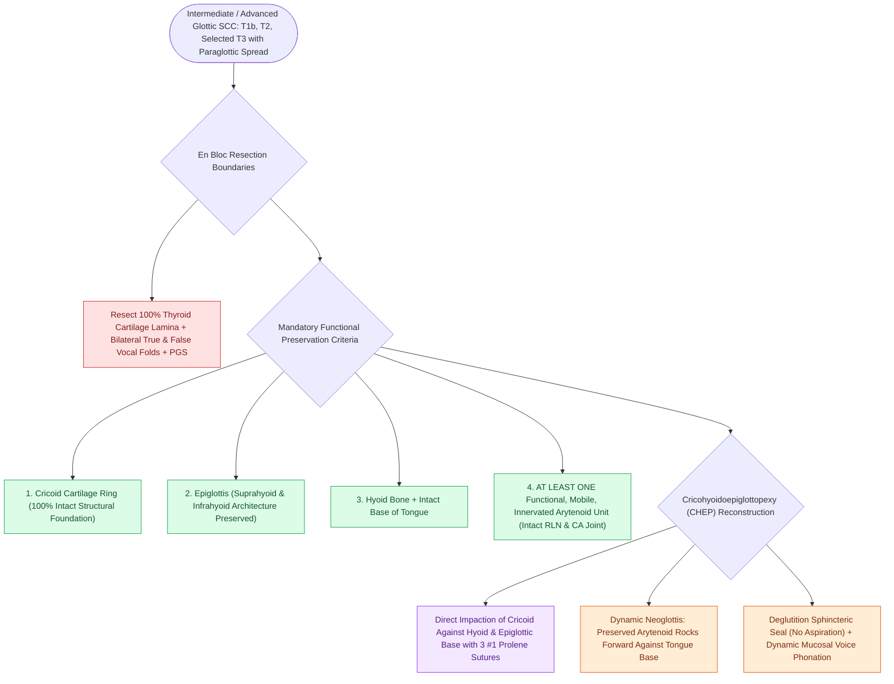

# SCPL with CHEP preserves the epiglottis, cricoid, and one mobile arytenoid

## Active Recall

> [!question]- What is the absolute minimum functional cartilaginous unit required to perform an SCPL-CHEP?
> *Answer / Clinical Rationale*: **An intact cricoid cartilage ring and at least ONE mobile, innervated arytenoid cartilage unit** with functional cricoarytenoid joint kinetics and intact RLN.

> [!question]- How is speech and deglutition restored after total resection of both true vocal folds and the thyroid cartilage in SCPL-CHEP?
> *Answer / Clinical Rationale*: The cricoid is impacted directly against the hyoid and epiglottis (CHEP); the remaining mobile arytenoid rocks forward against the base of tongue to seal the airway during swallowing and vibrate during phonation to generate a neoglottic voice.

## Core Clinical & Mechanistic Principles
**Supracricoid Partial Laryngectomy with Cricohyoidoepiglottopexy (SCPL-CHEP)** (pioneered by Majer, Rieder, and Laccourreye) is an open organ-preservation procedure indicated for **intermediate and locally advanced glottic squamous cell carcinomas (T1b, T2, and selected T3 tumors with [[The paraglottic space facilitates transglottic tumor spread|paraglottic space]] invasion but preserved arytenoid mobility)**.

### Resected vs Preserved Anatomical Structures
- **En Bloc Resected Structures**:
  1. Entire **[[Thyroplasty cartilage window dimensions differ between males and females|thyroid cartilage lamina]]** (from superior notch to inferior rim).
  2. Bilateral **true vocal cords and [[The thyroarytenoid muscle modulates glottal stiffness and adduction|thyroarytenoid]] muscles**.
  3. Bilateral **false vocal cords and ventricles of Morgagni**.
  4. Bilateral **paraglottic spaces**.
- **Mandatory Preserved Functional Units**:
  1. **[[Cricotracheal resection removes subglottic stenosis while sparing posterior cricoid and RLNs|Cricoid Cartilage]] Ring (100% Intact)**.
  2. **Suprahyoid and Infrahyoid Epiglottis**.
  3. **[[Suprahyoid Montgomery release mobilizes the larynx to reduce anastomotic tension|Hyoid Bone]]**.
  4. **At Least One Functional, Mobile, Innervated Arytenoid Cartilage** (with intact [[The cricoarytenoid joint moves via coupled rocking and sliding|cricoarytenoid joint]], [[The posterior cricoarytenoid is the sole vocal fold abductor|PCA]], and [[The recurrent laryngeal nerve innervates all intrinsic muscles except cricothyroid|RLN]]).

## Reconstruction & The Neoglottic Sphincter Mechanism
- **Cricohyoidoepiglottopexy (CHEP)**: The intact cricoid cartilage is impacted directly against the hyoid bone and the base of the epiglottis using **three heavy nonabsorbable sutures (e.g., #1 or #2 Prolene/Vicryl)**.
- **Dynamic Neoglottis**:
  - *Swallowing*: The preserved mobile arytenoid rocks anteromedially against the tongue base and lower epiglottic remnant, achieving a tight, protective neoglottic seal to prevent aspiration.
  - *Phonation*: Exhaled air vibrates the arytenoid mucosa against the tongue base/epiglottis, generating a rough but highly functional, intelligible neoglottic voice without requiring a permanent tracheostoma.

## Critical Failure Modes & Error Traps
- **Resecting Both Arytenoids**: If both arytenoids are fixed or resected, neoglottic competence is permanently lost, causing catastrophic, intractable aspiration requiring conversion to [[Total laryngectomy achieves en bloc laryngeal resection with permanent end-stoma|total laryngectomy]].
- **Poor Pulmonary Reserve**: Patients with $\text{FEV}_1 < 50\%$ cannot clear initial postoperative aspiration during swallow rehabilitation.

## Connected Concepts & Graph Traversal
- **Supraglottic Variant**: [[SCPL with CHP resects the epiglottis and vocal folds for supraglottic cancer|Supracricoid Partial Laryngectomy with CHP]]
- **Supraglottic Sparing Surgery**: [[Horizontal supraglottic laryngectomy resects supraglottic cancer while preserving vocal folds|Horizontal Supraglottic Laryngectomy (HSL)]]
- **Total Laryngectomy Alternative**: [[Total laryngectomy achieves en bloc laryngeal resection with permanent end-stoma|Total Laryngectomy]]
- **Preserved Joint Mechanism**: [[The cricoarytenoid joint moves via coupled rocking and sliding|Cricoarytenoid Joint Kinematics]]
- **Clinical Management**: [[The pre-epiglottic space enables rapid supraglottic cancer spread|Pre-Epiglottic Space (PES)]]
