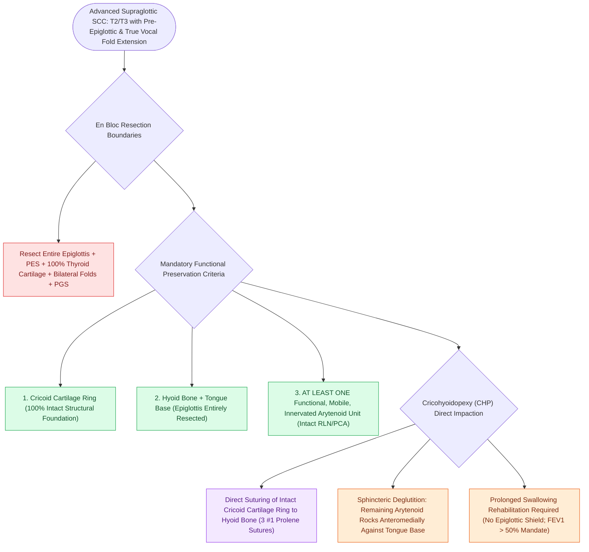

# SCPL with CHP resects the epiglottis and vocal folds for supraglottic cancer

## Active Recall

> [!question]- What is the fundamental anatomical difference in resection between SCPL-CHEP and SCPL-CHP?
> *Answer / Clinical Rationale*: In **SCPL-CHEP**, the epiglottis is preserved (indicated for glottic cancer); in **SCPL-CHP**, the **epiglottis and pre-epiglottic space are completely resected** (indicated for supraglottic cancer), requiring direct impaction of the cricoid to the hyoid bone alone.

> [!question]- Why does SCPL-CHP require a longer period of swallowing rehabilitation than SCPL-CHEP?
> *Answer / Clinical Rationale*: With the complete loss of the epiglottis, laryngeal closure during deglutition depends solely on the remaining [[The cricoarytenoid joint moves via coupled rocking and sliding|arytenoid cartilage]] contacting the base of tongue.

## Core Clinical & Mechanistic Principles
**Supracricoid Partial Laryngectomy with Cricohyoidopexy (SCPL-CHP)** is an open conservation laryngeal surgery indicated for **advanced supraglottic squamous cell carcinomas invading the [[The pre-epiglottic space enables rapid supraglottic cancer spread|pre-epiglottic space]], [[Thyroplasty cartilage window dimensions differ between males and females|thyroid cartilage]], or extending across the ventricle onto the true vocal cords (T2, T3 supraglottic tumors)** that are not amenable to [[Horizontal supraglottic laryngectomy resects supraglottic cancer while preserving vocal folds|horizontal supraglottic laryngectomy (HSL)]].

### Resected vs Preserved Anatomical Structures
- **En Bloc Resected Structures**:
  1. Entire **epiglottis** (suprahyoid and infrahyoid).
  2. Entire **pre-epiglottic space (PES)**.
  3. Entire **thyroid cartilage lamina**.
  4. Bilateral **true and false vocal cords**.
  5. Bilateral **[[The paraglottic space facilitates transglottic tumor spread|paraglottic spaces]]**.
- **Mandatory Preserved Functional Units**:
  1. **[[Cricotracheal resection removes subglottic stenosis while sparing posterior cricoid and RLNs|Cricoid Cartilage]] Ring (100% Intact)**.
  2. **[[Suprahyoid Montgomery release mobilizes the larynx to reduce anastomotic tension|Hyoid Bone]]**.
  3. **At Least One Functional, Mobile, Innervated Arytenoid Unit** (with intact [[The recurrent laryngeal nerve innervates all intrinsic muscles except cricothyroid|RLN]] and [[The posterior cricoarytenoid is the sole vocal fold abductor|PCA]]).

## Reconstruction & Swallowing Rehabilitation
- **Cricohyoidopexy (CHP)**: Because the epiglottis has been entirely resected, the cricoid cartilage ring is impacted and sutured **directly to the hyoid bone** using three heavy nonabsorbable sutures (e.g., #1 or #2 Prolene/Vicryl) looping around the cricoid and hyoid.
- **Swallow Mechanism**: Postoperative airway protection relies exclusively on the preserved mobile arytenoid rocking forward against the base of the tongue.
- **Longer Swallowing Rehabilitation**: Because the epiglottic barrier is completely absent, swallow rehabilitation takes longer than in [[SCPL with CHEP preserves the epiglottis, cricoid, and one mobile arytenoid|SCPL-CHEP]], requiring strict patient motivation and high pulmonary reserve ($\text{FEV}_1 > 50\%$).

## Critical Failure Modes & Error Traps
- **Prevertebral / Post-Cricoid Extension**: Tumors invading the retrocricoid space or fixing bilateral arytenoids contraindicate SCPL-CHP, mandating [[Total laryngectomy achieves en bloc laryngeal resection with permanent end-stoma|total laryngectomy]].

## Connected Concepts & Graph Traversal
- **Supraglottic Horizontal Laryngectomy**: [[Horizontal supraglottic laryngectomy resects supraglottic cancer while preserving vocal folds|Horizontal Supraglottic Laryngectomy]]
- **Total Laryngectomy Alternative**: [[Total laryngectomy achieves en bloc laryngeal resection with permanent end-stoma|Total Laryngectomy]]
- **Pre-Epiglottic Space Infiltration**: [[The pre-epiglottic space enables rapid supraglottic cancer spread|Pre-Epiglottic Space]]
- **Paraglottic Space Boundaries**: [[The paraglottic space facilitates transglottic tumor spread|Paraglottic Space]]
- **Aspiration Scale Assessment**: [[The Rosenbek Scale standardizes the depth of airway penetration and aspiration|Rosenbek Penetration Scale]]
