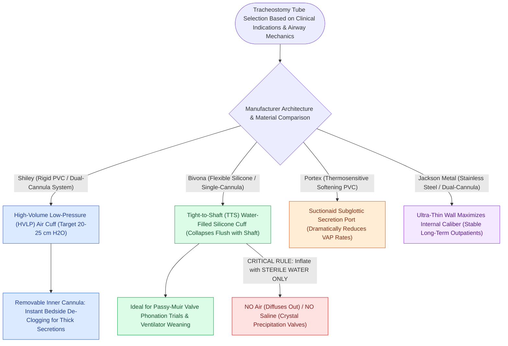

# Shiley, Bivona, and Portex tracheostomy tubes differ in cannula design, cuff profile, and airway resistance

## Active Recall

> [!question]- Why must a Bivona Tight-to-Shaft (TTS) tracheostomy tube cuff be inflated exclusively with sterile water rather than air or saline?
> *Answer / Clinical Rationale*: Silicone is gas-permeable, causing air to diffuse out and the cuff to deflate spontaneously over hours; saline can precipitate micro-crystals inside the delicate pilot line, clogging the one-way valve and preventing subsequent deflation.

> [!question]- What is the principal safety advantage of a dual-cannula Shiley tracheostomy tube over a single-cannula Bivona tube in an ICU patient with thick pulmonary secretions?
> *Answer / Clinical Rationale*: If a patient develops acute airway obstruction from an inspissated mucus plug, the **inner cannula of a Shiley tube can be removed instantly at the bedside**, immediately restoring a patent airway without performing an emergency tube exchange.

## Core Clinical & Mechanistic Principles
Selecting the appropriate [[Standard open tracheotomy utilizes horizontal intersinusoidal or Bjork flap entry|tracheostomy]] tube requires understanding the biomechanical, material, and structural trade-offs between various manufacturers and models. A tracheostomy tube’s **inner diameter (ID)** dictates airflow resistance in accordance with Poiseuille’s law ($R \propto 1/r^4$), while its **outer diameter (OD)**, shaft curvature, and cuff architecture determine stomal seal, peristomal tissue pressure, and ease of ventilator weaning:

- **Comprehensive Comparison of Primary Tracheostomy Tube Systems**:
  - **Shiley™ (Medtronic)**:
    - *Material & Architecture*: Rigid polyvinyl chloride (PVC) with a fixed, relatively sharp right-angled bend.
    - *Cannula System*: **Dual-cannula system** featuring a removable, disposable or reusable inner cannula. Essential for patients with thick, tenacious secretions because an acutely plugged inner cannula can be instantly unlocked and replaced without decannulating the patient.
    - *Cuff Characteristics*: **High-volume, low-pressure (HVLP) air cuff**. Allows direct cuff pressure measurement with an inline manometer (target **$20\text{ to }25\text{ cm }H_2O$** to prevent tracheal mucosal necrosis while sealing against positive-pressure leaks).
    - *Drawback*: When deflated, the thin polymer cuff folds into bulky, floppy "wings" that obstruct trans-glottic airflow, making speech and Passy-Muir valve trials more difficult.
    - *Specialized Variants*: Proximal Extended Length (XLT-P) for deep pretracheal adipose tissue in morbid obesity; Distal Extended Length (XLT-D) for tracheal malacia or low stenosis.
  - **Bivona® (Smiths Medical / ICU Medical)**:
    - *Material & Architecture*: Hydrophobic, flexible medical-grade silicone with a gentle, smooth anatomic curve.
    - *Cannula System*: **Single-cannula design** (lacks an inner cannula; inner lumen diameter equals outer tube diameter, maximizing effective airflow, but carries higher risk of catastrophic complete occlusion if inspissated mucus plugs the tube).
    - *Cuff Characteristics*: **Tight-to-Shaft (TTS) silicone cuff**. Must be filled **STRICTLY WITH STERILE WATER** (never air, because silicone is permeable to air and deflates over hours, and never saline, which precipitates crystals that shred the inflation valve). When completely deflated via active syringe evacuation, the cuff collapses completely flat against the shaft profile.
    - *Primary Indication*: Ideal for ventilator weaning, speech trials, and intermittent nocturnal ventilation, allowing effortless breathing around the shaft when deflated.
  - **Portex® (Smiths Medical)**:
    - *Material & Architecture*: Thermosensitive PVC that softens upon exposure to body temperature, conforming atraumatically to unique airway contours.
    - *Specialized Features*: Available with an integrated **subglottic suction port** (Suctionaid) situated directly above the cuff to evacuate pooled secretions, significantly reducing ventilator-associated pneumonia (VAP). Features a clear flange allowing direct visual inspection of the underlying stomal skin.
  - **Jackson Metal Tracheostomy**:
    - *Material*: Stainless steel or sterling silver. Uncuffed, dual-cannula, reusable. Extremely thin wall maximizes inner lumen relative to outer diameter; primarily used for long-term chronic stable outpatients without positive-pressure needs.

## References
1. Mitchell, R.B., Hussey, H.M., Setzen, G., et al. (2013). Clinical consensus statement: Tracheostomy care. *Otolaryngol Head Neck Surg*, 148(1):6-20.
2. Kraft, S.M., Schindler, J.S. (2020). Tracheotomy. In Flint, P.W., et al. (Eds.), *Cummings Otolaryngology Head and Neck Surgery* 7e (pp. 95-103). Philadelphia, PA: Elsevier.
3. Durbin Jr., C.G. (2010). Tracheostomy: why, when, and how? *Respir Care*, 55(8):1056-1068.

## Connected Concepts & Graph Traversal
- **Exchange Procedure**: [[Tracheostomy tube exchange technique requires pre-oxygenation, nasal speculum visualization, and endoscopic confirmation|Tracheostomy Tube Exchange Protocol]]
- **Stay Sutures & Timing**: [[Adult tracheostomy tube exchange at one week requires a mature tract, tracheal stay sutures, and bougie guidance|First Tracheostomy Exchange Timing]]
- **Surgical Creation**: [[Open tracheostomy provides superior exposure and stay suture placement compared to percutaneous technique|Open vs Percutaneous Tracheostomy]]
- **Granulation Management**: [[Tracheostomy stomal bleeding is controlled with cuff overinflation, hemostatic agents, and silver nitrate cautery|Stomal Granulation & Hemostasis]]
- **Catastrophic Bleeding**: [[Tracheoinnominate fistula presents with sentinel bleeding requiring hyperinflation tamponade and emergency surgical ligation|Tracheoinnominate Fistula]]
- **🔗 Pediatric Stay Suture Protocol (Pediatrics)**: [[Pediatric tracheostomy mandates horizontal skin incision, vertical tracheal split sparing the cricoid, and bilateral stay sutures to mitigate accidental decannulation|Pediatric Tracheostomy Technique]]
