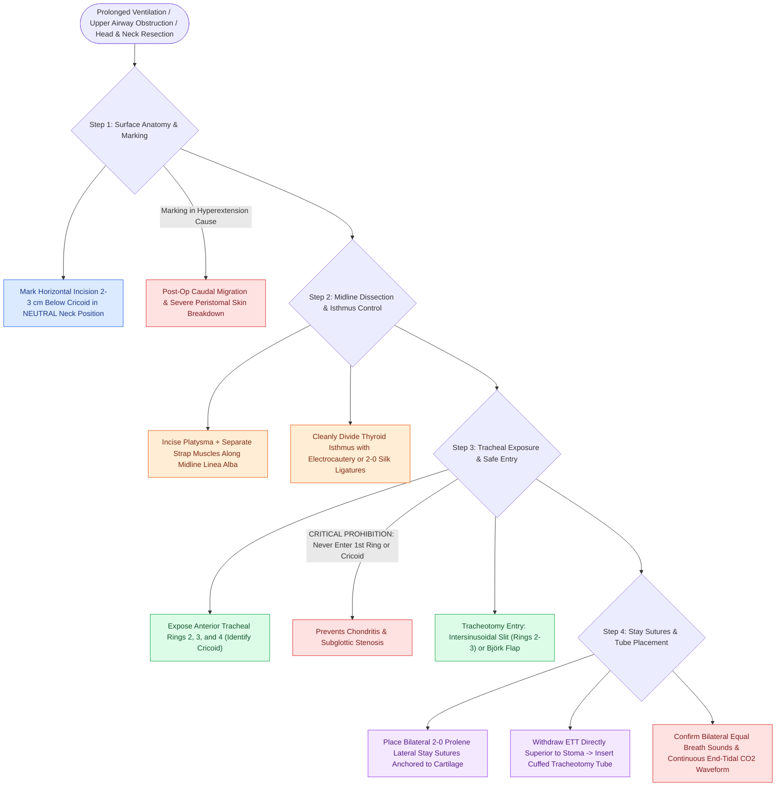

# Standard open tracheotomy utilizes horizontal intersinusoidal or Bjork flap entry

## Active Recall

> [!question]- Why must the skin incision for an open tracheotomy be marked in a neutral neck position rather than in hyperextension?
> *Answer / Clinical Rationale*: Marking in hyperextension causes the skin incision to drop inferiorly over the sternal notch when the neck returns to neutral postoperatively, creating excessive caudal traction on the tracheotomy tube and pretracheal tissue ulceration.

> [!question]- Why is entering the first tracheal ring or cricoid cartilage strictly prohibited during elective tracheotomy?
> *Answer / Clinical Rationale*: Violating the first tracheal ring or cricoid cartilage damages the subglottic mucous membrane and cricoid perichondrium, inciting chondritis and high-grade subglottic stenosis.

## Core Clinical & Mechanistic Principles
**Standard Open Tracheotomy** is a primary surgical airway procedure indicated for prolonged mechanical ventilation, acute upper airway obstruction, pulmonary hygiene, or prophylactic protection during major head and neck resections.

### Surgical Nuances & Step-by-Step Technique
1. **Preoperative Markings in Neutral Neck**:
   - The horizontal skin incision ($2\text{–}3\text{ cm}$ below the [[Cricotracheal resection removes subglottic stenosis while sparing posterior cricoid and RLNs|cricoid cartilage]]) must be marked with the neck in a **neutral or slightly flexed position**.
   - *Critical Pitfall*: If marked with the neck in maximal hyperextension, the skin incision drops caudally over the sternum when the neck returns to neutral postoperatively, causing heavy downward torque on the tracheotomy tube, peristomal skin breakdown, and anterior tracheal wall erosion.
2. **Midline Dissection & Isthmus Management**:
   - Incise skin, platysma, and identify the midline *linea alba* between the sternohyoid and sternothyroid strap muscles.
   - Retract straps laterally; divide the pretracheal fascia to expose the thyroid isthmus.
   - The thyroid isthmus must be cleanly divided with electrocautery or clamp-and-ligate with 2-0 or 3-0 silk sutures; never bluntly tear the isthmus.
3. **Tracheal Exposure & Entry Options**:
   - Expose anterior tracheal rings 2, 3, and 4.
   - *Option A: Horizontal Intersinusoidal Slit (Rings 2–3)*: A horizontal incision through the interannular membrane between rings 2 and 3 preserves 100% of cartilaginous framework.
   - *Option B: [[The Bjork flap facilitates emergency tracheostomy recannulation|Björk Flap]]*: An inferiorly hinged flap of the 2nd or 3rd ring sutured to the inferior skin edge.
4. **Placement of Stay Sutures**:
   - Always place bilateral horizontal mattress stay sutures through the tracheal rings flanking the stoma (see [[Tracheal stay sutures prevent false tract entry during accidental decannulation|tracheal stay sutures]]).
5. **Tube Insertion & Ventilation Confirmation**:
   - Under direct vision, withdraw the endotracheal tube until the tip is immediately superior to the stoma.
   - Insert the cuffed tracheotomy tube with obturator; remove obturator, insert inner cannula, inflate cuff, connect circuit, and confirm bilateral breath sounds and end-tidal $\text{CO}_2$.

## Critical Failure Modes & Error Traps
- **Entering 1st Tracheal Ring / Cricoid**: Entering too high through the 1st ring or cricoid cartilage induces chondritis and severe, intractable [[The Cotton-Myer classification grades subglottic stenosis by luminal reduction|subglottic stenosis]].
- **Tight Skin Closure**: Suturing the skin tightly around the tracheotomy tube traps escaping airway air, causing severe [[Subcutaneous emphysema arises when tracheotomy incisions are closed too tightly|subcutaneous emphysema]], pneumomediastinum, and pneumothorax.

## Connected Concepts & Graph Traversal
- **Specific Flap Variant**: [[The Bjork flap facilitates emergency tracheostomy recannulation|The Björk Flap]]
- **Critical Safety Maneuver**: [[Tracheal stay sutures prevent false tract entry during accidental decannulation|Tracheal Stay Sutures]]
- **Specialized Lipectomy Variant**: [[Defatting tracheotomy secures the airway in morbidly obese patients|Defatting Tracheotomy]]
- **Avoided Complication**: [[Subcutaneous emphysema arises when tracheotomy incisions are closed too tightly|Subcutaneous Emphysema]]
- **Emergent Alternative**: [[Emergency cricothyrotomy provides rapid airway access through the cricothyroid membrane|Emergency Cricothyrotomy]]
- **🔗 Pediatric Technique Variant (Pediatrics)**: [[Pediatric tracheostomy mandates horizontal skin incision, vertical tracheal split sparing the cricoid, and bilateral stay sutures to mitigate accidental decannulation|Pediatric Tracheostomy Technique]]
