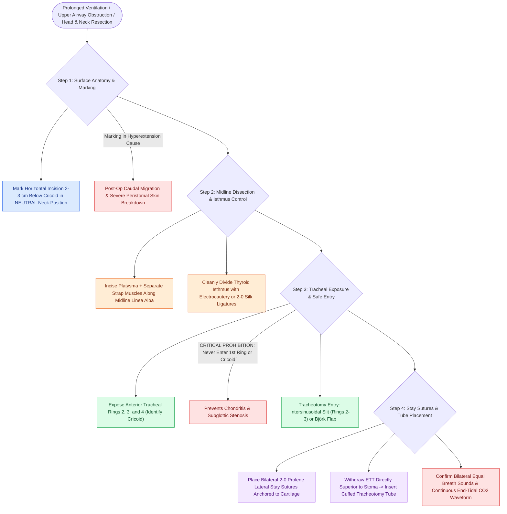

# Standard open tracheotomy utilizes horizontal intersinusoidal or Bjork flap entry

## Active Recall

> [!question]- Why must the skin incision for an open tracheotomy be marked in a neutral neck position rather than in hyperextension?
> *Answer / Clinical Rationale*: Marking in hyperextension causes the skin incision to drop inferiorly over the sternal notch when the neck returns to neutral postoperatively, creating excessive caudal traction on the tracheotomy tube and pretracheal tissue ulceration.

> [!question]- Why is entering the first tracheal ring or cricoid cartilage strictly prohibited during elective tracheotomy?
> *Answer / Clinical Rationale*: Violating the first tracheal ring or cricoid cartilage damages the subglottic mucous membrane and cricoid perichondrium, inciting chondritis and high-grade subglottic stenosis.

## Core Clinical & Mechanistic Principles
**Standard Open Surgical Tracheotomy (OST)** is the definitive surgical airway procedure for prolonged mechanical ventilation, acute upper airway obstruction, pulmonary hygiene, or prophylactic protection during major head and neck resections. Compared to bedside **[[Percutaneous dilatational tracheostomy utilizes bronchoscopic guidance and Seldinger dilation between tracheal rings|Percutaneous Dilatational Tracheostomy]] (PDT)**, OST provides direct visual exposure, vascular control, cervical defatting, [[The Bjork flap facilitates emergency tracheostomy recannulation|Björk flap]] epithelialization, and **bilateral tracheal stay sutures** (PDT cannot place stay sutures). PDT is contraindicated in patients with unpalpable cricoid/tracheal landmarks, severe obesity with thick pretracheal adipose tissue, thyroid goiter, prior neck radiation/scarring, inability to extend the cervical spine (C-spine fracture, halo, severe spondylosis, Trisomy 21), aberrant high-riding innominate artery, or high $PEEP > 15\text{ cm }H_2O$ / $FiO_2 > 0.70$.

### Surgical Nuances & Step-by-Step Technique
1. **Preoperative Markings in Neutral Neck**:
   - The horizontal skin incision ($2\text{–}3\text{ cm}$ below the [[Cricotracheal resection removes subglottic stenosis while sparing posterior cricoid and RLNs|cricoid cartilage]]) must be marked with the neck in a **neutral or slightly flexed position**.
   - *Critical Pitfall*: If marked with the neck in maximal hyperextension, the skin incision drops caudally over the sternum when the neck returns to neutral postoperatively, causing heavy downward torque on the tracheotomy tube, peristomal skin breakdown, and anterior tracheal wall erosion.
2. **Midline Dissection, Defatting & Isthmus Vascular Control**:
   - Incise skin, platysma, and excise redundant pretracheal adipose tissue ("defatting") in morbidly obese necks to shorten the skin-to-trachea tract.
   - Identify the midline *linea alba* between the sternohyoid and sternothyroid strap muscles, retract straps laterally, and divide pretracheal fascia to expose the thyroid isthmus.
   - Cleanly divide and suture-ligate the thyroid isthmus (plus anterior jugular or thyroid ima vessels) with 2-0/3-0 silk; never bluntly tear the isthmus.
   - Engage a heavy **cricoid hook** in the midline to lift the trachea superiorly and anteriorly out of the thoracic inlet, and palpate the pretracheal space to rule out a high-riding innominate artery.
3. **Airway Fire Prevention & Tracheal Entry Options**:
   - Strictly confirm with Anesthesia that **$FiO_2 \le 30\%$** prior to incising the trachea to prevent airway fire.
   - Expose anterior tracheal rings 2, 3, and 4:
     - *Option A: Horizontal Intersinusoidal Slit (Rings 2–3)*: Preserves 100% of cartilaginous framework.
     - *Option B: Björk Flap*: An inferiorly hinged flap of the 2nd or 3rd ring sutured to the inferior dermal margin, forming an epithelialized ramp for safe recannulation.
4. **Placement of Stay Sutures**:
   - Always place bilateral heavy non-absorbable (2-0 Prolene or silk) horizontal mattress stay sutures through the lateral tracheal cartilage margins and tape them to the chest wall (see [[Tracheal stay sutures prevent false tract entry during accidental decannulation|tracheal stay sutures]]); bidirectional lateral traction immediately opens the stoma during early accidental decannulation.
5. **Tube Insertion & Ventilation Confirmation**:
   - Under direct vision, withdraw the endotracheal tube until the tip is immediately superior to the stoma.
   - Insert the cuffed tracheotomy tube with obturator; remove obturator, insert inner cannula, inflate cuff, connect circuit, and confirm bilateral breath sounds and end-tidal $\text{CO}_2$.

## Critical Failure Modes & Error Traps
- **Entering 1st Tracheal Ring / Cricoid**: Entering too high through the 1st ring or cricoid cartilage induces chondritis and severe, intractable [[The Cotton-Myer classification grades subglottic stenosis by luminal reduction|subglottic stenosis]].
- **Tight Skin Closure**: Suturing the skin tightly around the tracheotomy tube traps escaping airway air, causing severe [[Subcutaneous emphysema arises when tracheotomy incisions are closed too tightly|subcutaneous emphysema]], pneumomediastinum, and pneumothorax.

### Key Consultation Supplies
- Surgical headlight and sterile open tracheotomy instrument tray (15/11-blades, monopolar/bipolar cautery, cricoid hook, Senn/Army-Navy/vein retractors, Trousseau tracheal dilator)
- 2-0/3-0 silk or Prolene stay sutures, 3-0 Vicryl, 4-0 Monocryl/nylon, target cuffed tracheostomy tube + one size smaller, Dale collar

> [!example]- **Operative Note Template: Open surgical tracheostomy with Björk flap creation and bilateral tracheal stay suture placement**
> **PREOPERATIVE DIAGNOSIS**: Respiratory failure requiring prolonged mechanical ventilation
> **POSTOPERATIVE DIAGNOSIS**: Respiratory failure requiring prolonged mechanical ventilation
> **PROCEDURE**: Open surgical tracheostomy with Björk flap creation and bilateral tracheal stay suture placement
> **SURGEON**: [Surgeon Name, MD] | **ANESTHESIA**: General endotracheal anesthesia | **EBL**: <15 mL
>
> **PROCEDURE IN DETAIL**:
> After informed consent and surgical pause, the patient was positioned supine with gentle neck extension and prepped with chlorhexidine. Landmarks (thyroid notch, cricoid, sternal notch) were marked in neutral alignment, infiltrated with 5 mL 1% lidocaine with 1:100,000 epinephrine, and incised horizontally 2.5 cm midway between cricoid and sternal notch. Dissection proceeded through platysma and midline linea alba; strap muscles were retracted laterally. The thyroid isthmus was divided and suture-ligated with 3-0 silk ties; palpation confirmed no high-riding innominate artery. With a cricoid hook elevating the trachea and Anesthesia confirming $FiO_2 \le 30\%$, a horizontal entry between the 2nd and 3rd rings with an inferiorly based Björk flap (3-0 Vicryl to inferior dermis) and bilateral 2-0 Prolene tracheal stay sutures was created. The ETT was withdrawn above the stoma, a cuffed tracheostomy tube was inserted smoothly, obturator removed, inner cannula locked, cuff inflated, and bilateral breath sounds and $EtCO_2$ were confirmed. Stay sutures were labeled/taped to the chest wall and the flange secured with a Dale collar.

## References
1. Mitchell, R.B., Hussey, H.M., Setzen, G., et al. (2013). Clinical consensus statement: Tracheostomy care. *Otolaryngol Head Neck Surg*, 148(1):6-20.
2. Kraft, S.M., Schindler, J.S. (2020). Tracheotomy. In Flint, P.W., et al. (Eds.), *Cummings Otolaryngology Head and Neck Surgery* 7e (pp. 95-103). Philadelphia, PA: Elsevier.
3. Durbin Jr., C.G. (2010). Tracheostomy: why, when, and how? *Respir Care*, 55(8):1056-1068.

## Connected Concepts & Graph Traversal
- **Specific Flap Variant**: [[The Bjork flap facilitates emergency tracheostomy recannulation|The Björk Flap]]
- **Critical Safety Maneuver**: [[Tracheal stay sutures prevent false tract entry during accidental decannulation|Tracheal Stay Sutures]]
- **Specialized Lipectomy Variant**: [[Defatting tracheotomy secures the airway in morbidly obese patients|Defatting Tracheotomy]]
- **Percutaneous Alternative**: [[Percutaneous dilatational tracheostomy utilizes bronchoscopic guidance and Seldinger dilation between tracheal rings|Percutaneous Tracheostomy (PDT)]]
- **Stay Sutures & Exchange**: [[Adult tracheostomy tube exchange at one week requires a mature tract, tracheal stay sutures, and bougie guidance|Tracheostomy Tube Exchange]]
- **Avoided Complication**: [[Subcutaneous emphysema arises when tracheotomy incisions are closed too tightly|Subcutaneous Emphysema]]
- **Emergent Alternative**: [[Emergency cricothyrotomy provides rapid airway access through the cricothyroid membrane|Emergency Cricothyrotomy]]
- **🔗 Pediatric Technique Variant (Pediatrics)**: [[Pediatric tracheostomy mandates horizontal skin incision, vertical tracheal split sparing the cricoid, and bilateral stay sutures to mitigate accidental decannulation|Pediatric Tracheostomy Technique]]
