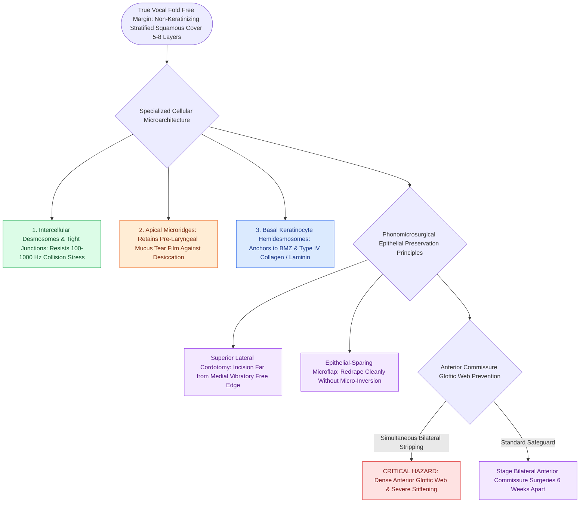

# Stratified squamous epithelium forms the vocal fold protective cover

## Active Recall

> [!question]- What is the histological difference between the epithelium covering the true vocal fold margin versus the false vocal fold?
> *Answer / Clinical Rationale*: The true vocal fold margin is lined by non-keratinizing stratified squamous epithelium (5–8 cell layers) to withstand collision stress, whereas the false vocal fold is lined by respiratory pseudostratified ciliated columnar epithelium.

> [!question]- Why is bilateral anterior commissure epithelial stripping strictly contraindicated during a single operative sitting?
> *Answer / Clinical Rationale*: Opposing raw subepithelial surfaces at the acute anterior commissure angle bridge across the midline during healing, forming a dense anterior glottic web that severely shortens the vibratory margin and elevates fundamental frequency.

## Core Clinical & Mechanistic Principles
The true vocal fold free edge is covered by a specialized **non-keratinizing stratified squamous epithelium** consisting of 5 to 8 cell layers. This contrasts with the ciliated pseudostratified columnar (respiratory) epithelium that lines the false vocal cords, ventricles, subglottis, and trachea.

- **Mechanical Function**: Acts as a protective barrier and outer mechanical capsule that retains tissue fluid within the underlying [[The superficial lamina propria acts as a pliable shearing fluid bed|superficial lamina propria]].
- **Cellular Junctions**: Intercellular adhesion is mediated by robust desmosomes and tight junctions (zonula occludens), providing resistance to repetitive mechanical shearing forces during phonatory collision.
- **Surface Microvilli and Microridges**: The apical surface features microscopic ridges that help anchor the pre-laryngeal tear-film and mucus layer, preventing desiccation during high-velocity transglottic airflow.
- **Basement Membrane Anchoring**: The basal layer of keratinocytes is anchored to the underlying lamina propria via the specialized [[The basement membrane zone anchors epithelium to superficial lamina propria|basement membrane zone (BMZ)]].

## Surgical Anatomy, Step-by-Step Technique & Nuances
- **Epithelial Preservation**: In [[The epithelial-sparing microflap preserves native mucosa and prevents glottic webbing|phonomicrosurgical microflap surgery]], baseline epithelial margins must be preserved.
- **Cordotomy Incision**: Incisions are placed on the superior lateral surface of the vocal fold, strictly avoiding the free vibratory margin.
- **Anterior Web Prevention**: When resecting bilateral lesions involving the anterior commissure, never strip epithelium bilaterally at the same time to prevent synergistic collagen deposition that causes anterior glottic webbing. Stage bilateral anterior procedures 6 weeks apart.

## Critical Failure Modes & Error Traps
- **Micro-inversion of Flap Edges**: Failure to carefully redrape epithelial edges following lesion excision allows the epithelium to invert into the raw bed, generating chronic foreign body granulation and persistent dysphonia.
- **Keratinizing Metaplasia / Dysplasia**: Chronic [[Vocal fold nodules are bilateral mid-membranous lesions treated with voice therapy|phonotrauma]], smoking, and acid reflux can induce hyperkeratosis, parakeratosis, or dysplasia, increasing epithelial stiffness and dampening the [[The mucosal wave travels as a fluid mechanical displacement|mucosal wave]].

## Connected Concepts & Graph Traversal
- **Parent Architecture**: [[The vocal fold comprises five distinct histological layers|Five-Layer Vocal Fold Architecture]]
- **Deep Anchoring**: [[The basement membrane zone anchors epithelium to superficial lamina propria|Basement Membrane Zone (BMZ)]]
- **Underlying Fluid Bed**: [[The superficial lamina propria acts as a pliable shearing fluid bed|Superficial Lamina Propria (Reinke's Space)]]
- **Vibratory Dynamics**: [[The mucosal wave travels as a fluid mechanical displacement|Mucosal Wave Dynamics]]
- **Surgical Applications**: [[The epithelial-sparing microflap preserves native mucosa and prevents glottic webbing|Microflap Phonomicrosurgery]]
