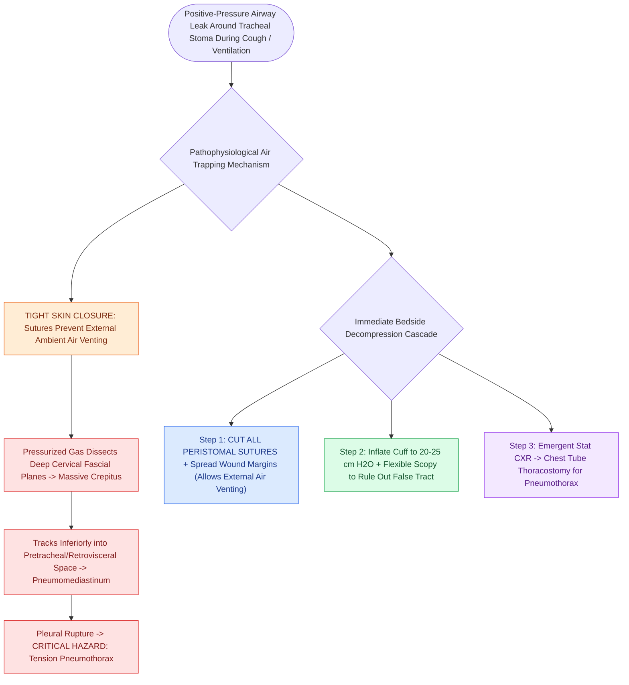

# Subcutaneous emphysema arises when tracheotomy incisions are closed too tightly

## Active Recall

> [!question]- What is the primary technical cause of immediate post-tracheotomy subcutaneous emphysema?
> *Answer / Clinical Rationale*: **Closing the skin incision too tightly around the tracheotomy tube**; escaping airway gas cannot vent externally and is forced along the deep cervical fascial planes into the neck, mediastinum, and pleural spaces.

> [!question]- What is the first immediate bedside intervention when severe subcutaneous crepitus is detected after tracheotomy?
> *Answer / Clinical Rationale*: **Immediately cut and remove all skin sutures** and spread the peristomal wound edges to create a pathway for the pressurized air to vent freely to the outside air.

## Core Clinical & Mechanistic Principles
**Subcutaneous Emphysema** following tracheotomy is a potentially life-threatening complication resulting from the escape of positive-pressure airway gas into the subcutaneous and deep fascial spaces of the neck, face, and chest.

### Pathophysiological Mechanism
1. **Airway Dissection Plane**: Creating a tracheotomy opens the deep pretracheal fascia, visceral vascular space, and retrovisceral space (which communicates directly with the superior and posterior mediastinum).
2. **Positive-Pressure Extravasation**: If the tracheostomy cuff has a leak, if the patient coughs vigorously, or if positive-pressure mechanical ventilation is applied, air escapes around the tracheal stoma.
3. **The Tight Skin Trap**: If the skin incision is **closed tightly with dense sutures around the tracheotomy tube**, the escaping gas cannot vent externally through the skin.
4. **Fascial Plane Tracking**: Trapped air is forced under pressure along the deep [[Deep neck space infections spread along cervical fascial planes between the pharynx, mediastinum, and skull base|cervical fascial planes]] into the subcutaneous tissues of the neck and face, tracking inferiorly into the mediastinum to cause **pneumomediastinum**, and rupturing into the pleural space to cause **tension pneumothorax**.

## Immediate Prevention & Rescue Protocol
- **Surgical Prevention**:
  - Never close tracheotomy skin incisions tightly.
  - Suture only the lateral-most corners of the incision (if at all); the skin immediately surrounding the tube must remain loose and unapproximated to allow free external venting of air.
  - Avoid tight, occlusive peristomal packing.
- **Immediate Management / Rescue Actions**:
  1. **Release Skin Sutures**: Immediately remove all skin and platysmal sutures at the bedside; spread the wound edges with a hemostat to allow trapped air to decompress externally.
  2. **Check Cuff Integrity & Position**: Confirm the tracheostomy tube cuff is properly inflated with no leak, and verify intraluminal position (rule out pretracheal false tract via flexible tracheoscopy).
  3. **Radiographic Evaluation**: Obtain immediate portable chest radiography to evaluate for pneumomediastinum and rule out tension pneumothorax (which requires emergency needle decompression or chest tube placement).

## Connected Concepts & Graph Traversal
- **Open Tracheostomy Surgical Steps**: [[Open tracheostomy provides superior exposure and stay suture placement compared to percutaneous technique|Open Tracheostomy]]
- **Percutaneous Tracheostomy**: [[Percutaneous dilatational tracheostomy utilizes bronchoscopic guidance and Seldinger dilation between tracheal rings|Percutaneous Tracheostomy]]
- **Tracheoinnominate Erosion**: [[Tracheoinnominate fistula presents with sentinel bleeding requiring hyperinflation tamponade and emergency surgical ligation|Tracheoinnominate Fistula]]
- **Emergency Airway Resuscitation**: [[Total laryngectomy stomas and tracheostomies require distinct emergency airway resuscitation algorithms|Emergency Airway Resuscitation]]
- **Bjork Flap Security**: [[The Bjork flap facilitates emergency tracheostomy recannulation|Bjork Flap]]
