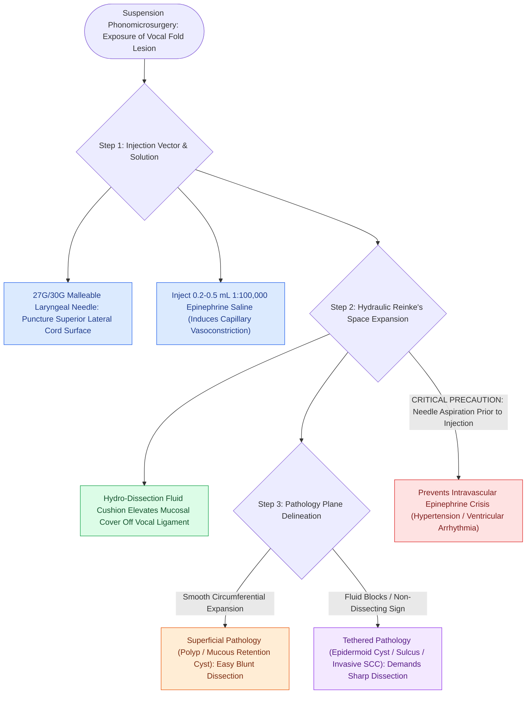

# Subepithelial hydrodissection expands Reinke's space and protects the vocal ligament

## Active Recall

> [!question]- What is the primary mechanical benefit of subepithelial hydrodissection in phonomicrosurgery?
> *Answer / Clinical Rationale*: It expands the loose superficial lamina propria, creating a protective fluid cushion that elevates the pathology away from the vocal ligament, defining the dissection plane and preventing deep collagen injury.

> [!question]- What does failure of hydrodissection fluid to expand beneath a vocal fold lesion indicate?
> *Answer / Clinical Rationale*: It indicates that the lesion is fibrously adherent or infiltrating into the vocal ligament or muscle, characteristic of an epidermoid cyst, severe [[Sulcus vocalis manifests as mucosal furrowing staged by the Ford classification|sulcus vocalis]], or invasive carcinoma.

## Core Clinical & Mechanistic Principles
**Subepithelial Hydrodissection** is an essential technical maneuver in [[Phonomicrosurgery requires suspension laryngoscopy and stereoscopic magnification|phonomicrosurgery]], performed by injecting a dilute vasoconstrictive solution directly into the [[The superficial lamina propria acts as a pliable shearing fluid bed|superficial lamina propria (Reinke's space)]] prior to making any incision.

### Pharmacological & Mechanical Functions
1. **Hydraulic Expansion of Reinke's Space**: Fluid infiltration hydraulically expands the loose, amorphous ground substance of the SLP, creating an optical and physical "fluid cushion" that separates the lesion and mucosal cover from the underlying [[The vocal ligament comprises intermediate and deep lamina propria|vocal ligament]].
2. **Pathology Plane Delineation**:
   - In superficial lesions (polyps, [[Mucous retention cysts arise from obstructed glands in superficial lamina propria|mucous retention cysts]]), the fluid readily enters the cleavage plane beneath the lesion.
   - In tethered lesions ([[Epidermoid cysts adhere to the vocal ligament and require sharp dissection|epidermoid cysts]], focal sulcus, invasive carcinoma), the fluid fails to expand beneath the lesion (the "non-dissecting sign"), highlighting the area of deep ligamentous attachment.
3. **Hemostasis & Microvascular Vasoconstriction**: The standard solution is **1:100,000 or 1:200,000 epinephrine** in sterile normal saline. Epinephrine induces immediate vasoconstriction of mucosal capillaries, providing a bloodless surgical field essential for microscopic dissection.

## Step-by-Step Surgical Execution
1. **Needle Selection**: Utilize a dedicated 27-gauge or 30-gauge malleable laryngeal injection needle.
2. **Puncture Site**: Enter the vocal fold on the **superior lateral surface**, lateral to the lesion. Avoid puncturing the free vibratory margin or penetrating directly into the lesion capsule.
3. **Volume Infiltration**: Slowly inject $0.2\text{ to }0.5\text{ mL}$ of epinephrine saline until the vocal fold blanches and the lesion is visibly hydro-elevated.
4. **Dissection**: Proceed immediately with microflap incision and subepithelial dissection in the expanded fluid bed.

## Critical Failure Modes & Error Traps
- **Cardiovascular Toxicity**: Rapid systemic intravascular injection of epinephrine can trigger acute hypertensive crisis, severe tachycardia, or ventricular arrhythmias. Always aspirate prior to injection and coordinate with the anesthesia team.
- **Deep Infiltration into Muscle**: Injecting deep into the [[The thyroarytenoid muscle modulates glottal stiffness and adduction|thyroarytenoid muscle]] fails to expand Reinke's space and increases intramuscular bleeding.

## Connected Concepts & Graph Traversal
- **Target Compartment**: [[The superficial lamina propria acts as a pliable shearing fluid bed|Superficial Lamina Propria (Reinke's Space)]]
- **Protected Anatomical Structure**: [[The vocal ligament comprises intermediate and deep lamina propria|The Vocal Ligament]]
- **Associated Surgical Technique**: [[The epithelial-sparing microflap preserves native mucosa and prevents glottic webbing|Epithelial-Sparing Microflap Technique]]
- **Setup & Visualization**: [[Phonomicrosurgery requires suspension laryngoscopy and stereoscopic magnification|Phonomicrosurgery Setup]]
- **Primary Space-Occupying Pathology**: [[Reinke's edema causes polypoid degeneration of the superficial lamina propria treated with smoking cessation and lateral microflap evacuation|Reinke's Edema]]
