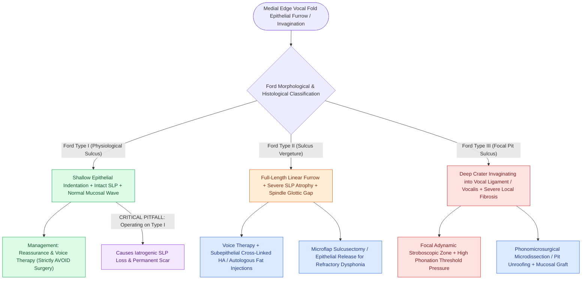

# Sulcus vocalis manifests as mucosal furrowing staged by the Ford classification

## Active Recall

> [!question]- How does Ford Type I sulcus differ from Ford Type II sulcus (sulcus vergeture)?
> *Answer / Clinical Rationale*: Type I is a physiologic epithelial indentation with an **intact superficial lamina propria and normal mucosal wave** requiring no treatment; Type II is a true pathological furrow with **severe loss/atrophy of the SLP** and severe mucosal wave dampening.

> [!question]- What is the structural defect in Ford Type III sulcus vocalis?
> *Answer / Clinical Rationale*: A deep, focal crater-like invagination of epithelium that penetrates directly into the vocal ligament or vocalis muscle, creating a focal adynamic segment.

## Core Clinical & Mechanistic Principles
**Sulcus Vocalis** is a structural depression, furrow, or invagination of the [[Stratified squamous epithelium forms the vocal fold protective cover|vocal fold epithelium]] along the medial vibrating margin, associated with localized loss, thinning, or complete absence of the [[The superficial lamina propria acts as a pliable shearing fluid bed|superficial lamina propria (Reinke's space)]].

### Ford Classification System
The widely accepted **Ford Classification** categorizes sulcus vocalis into three distinct clinical and histological phenotypes:

| Ford Type | Anatomical / Histological Description | Lamina Propria & Ligament Status | Stroboscopic & Functional Impact | Management Strategy |
| :--- | :--- | :--- | :--- | :--- |
| **Type I (Physiological Sulcus)** | Shallow epithelial indentation along the medial edge. | Intact SLP; normal HA ground substance. | Normal mucosal wave; voice is asymptomatic or minimally altered. | **No surgical intervention** required; reassurance. |
| **Type II (Sulcus Vergeture)** | Linear furrow extending along the entire length of the membranous vocal fold. | Severe loss/atrophy of the SLP; epithelium tethers to vocal ligament. | Severely reduced mucosal wave; spindle-shaped glottic gap; high-pitched, breathy, strained voice. | Behavioral voice therapy; subepithelial HA or fat injection; microflap sulcusectomy. |
| **Type III (Focal Pit Sulcus)** | Deep, focal crater-like pit invaginating deeply into tissue. | Focal absence of SLP; invaginates into the vocal ligament or vocalis muscle with intense local fibrosis. | Complete localized adynamic non-vibrating zone; severe breathy dysphonia. | Micro-dissection / unroofing of pit; mucosal grafting or regenerative biopolymer injection. |

**Key Links**: Superficial lamina propria (SLP) · [[The vocal ligament comprises intermediate and deep lamina propria|Vocal ligament]] · [[The mucosal wave travels as a fluid mechanical displacement|Mucosal wave]] · [[The thyrovocalis muscle provides isometric pitch and tension control|Vocalis muscle]] · [[Adynamic vocal fold segments indicate mucosal stiffening, malignancy, or scar|Adynamic segments]]

## Diagnostic & Stroboscopic Features
- **Spindle-Shaped Glottic Gap**: In Type II sulcus, bilateral furrows create an elliptical mid-membranous [[Glottal closure patterns identify specific laryngeal biomechanical deficits|spindle gap]].
- **Loss of Pliability**: On [[Videostroboscopy visualizes mucosal wave dynamics and glottal closure|stroboscopy]], the mucosal wave is severely dampened (Type II) or exhibits a focal non-vibrating adynamic zone (Type III).

## Critical Failure Modes & Error Traps
- **Operating on Type I Sulcus**: Performing surgical excision on an asymptomatic or physiologic Type I sulcus disrupts the intact SLP, causing iatrogenic [[Vocal fold scar results from disorganized Type I collagen deposition|vocal fold scar]].

## Connected Concepts & Graph Traversal
- **Affected Tissue Layer**: [[The superficial lamina propria acts as a pliable shearing fluid bed|Superficial Lamina Propria (Reinke's Space)]]
- **Diagnostic Finding**: [[Glottal closure patterns identify specific laryngeal biomechanical deficits|Spindle Glottal Closure Pattern]]
- **Abolished Dynamic**: [[The mucosal wave travels as a fluid mechanical displacement|Mucosal Wave Dynamics]]
- **Scar Revision & Histopathology**: [[Vocal fold scar results from disorganized Type I collagen deposition|Vocal Fold Scarring]]
- **Therapeutic Biomaterials**: [[Cross-linked hyaluronic acid provides intermediate-duration vocal fold augmentation|Hyaluronic Acid Injection]]
