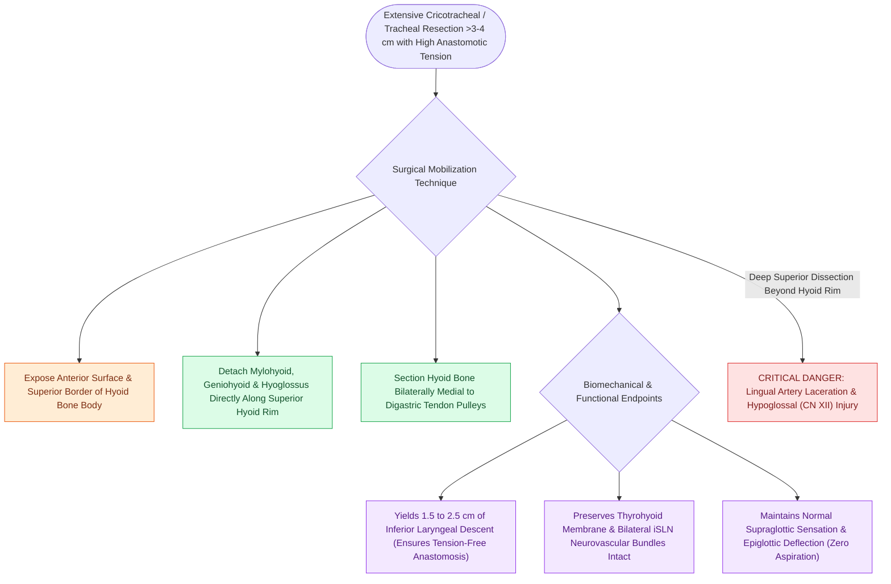

# Suprahyoid Montgomery release mobilizes the larynx to reduce anastomotic tension

## Active Recall

> [!question]- Why is a suprahyoid (Montgomery) release preferred over an infrahyoid release for reducing airway anastomotic tension?
> *Answer / Clinical Rationale*: Suprahyoid release leaves the thyrohyoid membrane, epiglottis, and internal branch of the SLN intact, preventing the severe, intractable aspiration and laryngeal anesthesia associated with infrahyoid releases.

> [!question]- How much inferior laryngeal mobilization is typically achieved by a suprahyoid release?
> *Answer / Clinical Rationale*: Approximately **$1.5\text{ to }2.5\text{ cm}$** of downward laryngeal descent.

## Core Clinical & Mechanistic Principles
**Suprahyoid Laryngeal Release** (described by William W. Montgomery) is an operative maneuver designed to release the superior muscular attachments of the hyoid bone, allowing the entire laryngeal framework to drop inferiorly by **$1.5\text{ to }2.5\text{ cm}$** to achieve a completely tension-free thyrotracheal or end-to-end tracheal anastomosis following extensive airway resection.

### Comparative Advantage over Infrahyoid Release
- **Infrahyoid (Dedo) Release**: Involves dividing the thyrohyoid membrane and strap muscles, which destabilizes the epiglottis, denervates or damages the [[The superior laryngeal nerve provides supraglottic sensation and cricothyroid motor control|internal branch of the superior laryngeal nerve (iSLN)]], and leads to intractable post-operative aspiration.
- **Suprahyoid (Montgomery) Release**: Preserves the thyrohyoid membrane, [[The pre-epiglottic space enables rapid supraglottic cancer spread|pre-epiglottic space]], and bilateral superior laryngeal neurovascular bundles intact, **maintaining normal deglutition sensation and [[Horizontal supraglottic laryngectomy resects supraglottic cancer while preserving vocal folds|epiglottic deflection]]** while delivering equivalent or superior inferior laryngeal mobilization.

## Step-by-Step Surgical Execution
1. **Hyoid Exposure**: Dissect superiorly above the thyroid notch to expose the anterior surface and superior border of the body and greater cornua of the hyoid bone.
2. **Suprahyoid Muscular Transection**: Using monopolar electrocautery directly on the bone, detach the insertions of the **mylohyoid, geniohyoid, and hyoglossus muscles** from the superior rim of the hyoid body.
3. **Hyoid Bone Sectioning**: Cut the hyoid bone bilaterally just medial to the attachments of the digastric tendon pulleys / greater cornua, or resect the central body of the hyoid bone.
4. **Preservation of Neurovascular Structures**: Stay strictly on the upper rim of the hyoid bone to avoid injuring the deep lingual arteries and hypoglossal nerves (CN XII).

## Critical Failure Modes & Error Traps
- **Hypoglossal Nerve / Lingual Artery Injury**: Dissecting too far superiorly into the floor of mouth musculature damages the hypoglossal nerve or lingual artery, causing massive oral bleeding and tongue paralysis.

## Connected Concepts & Graph Traversal
- **Primary Resection Surgery**: [[Cricotracheal resection removes subglottic stenosis while sparing posterior cricoid and RLNs|Cricotracheal Resection (CTR)]]
- **Complementary Mobilization**: [[Tracheal dissection is limited to the anterior 180 degrees to preserve blood supply|Anterior 180° Tracheal Mobilization]]
- **Postoperative Immobilization**: [[The guardian chin-to-chest suture prevents cervical hyperextension and anastomotic dehiscence|Guardian Chin-to-Chest Suture]]
- **Protected Sensory Nerve**: [[The superior laryngeal nerve provides supraglottic sensation and cricothyroid motor control|Internal Branch of Superior Laryngeal Nerve]]
- **Clinical Management**: [[Laryngotracheal reconstruction expands the airway using carved costal cartilage grafts|Laryngotracheal Reconstruction (LTR)]]
