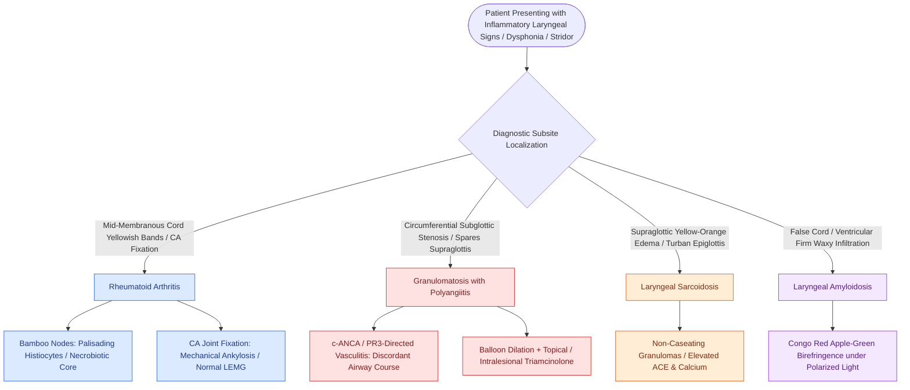

# Systemic autoimmune diseases manifest in the larynx with subglottic stenosis, rheumatoid bamboo nodes, and granulomatous infiltration

## Active Recall

> [!question]- What are rheumatoid bamboo nodes of the vocal folds, and what is their characteristic histological appearance?
> *Answer / Clinical Rationale*: **Bamboo nodes** are transverse, yellowish, band-like subepithelial deposits oriented perpendicular or oblique across the mid-portion of the membranous vocal folds. They occur predominantly in patients with **active rheumatoid arthritis, systemic lupus erythematosus (SLE), or mixed connective tissue disease**. Histologically, they represent immune-mediated rheumatoid nodules composed of a central core of **amorphous, necrobiotic collagen and lipid debris surrounded by palisading histiocytes, fibroblasts, and multinucleated giant cells** in the superficial lamina propria.

> [!question]- How does the clinical course of subglottic stenosis in Granulomatosis with Polyangiitis (GPA) relate to systemic vasculitic disease activity?
> *Answer / Clinical Rationale*: Laryngeal subglottic stenosis (SGS) in GPA occurs in **10% to 20% of patients** and is notoriously **discordant with systemic vasculitic disease activity**. Subglottic cicatrix and airway compromise can relentlessly progress or recur despite complete serologic remission (negative c-ANCA/PR3) and quiescent pulmonary/renal disease. Consequently, localized airway interventions (balloon dilation, intralesional triamcinolone) are often required independently of systemic immunosuppressive regimens.

> [!question]- What is the classical endoscopic appearance of laryngeal sarcoidosis, and which laryngeal subsite does it characteristically spare?
> *Answer / Clinical Rationale*: Laryngeal sarcoidosis classically presents as pale, yellowish-orange, smooth mucosal swelling of the supraglottis (epiglottis, aryepiglottic folds, and ventricular bands), producing the pathognomonic **"turban-like" epiglottis**. In sharp contrast to benign phonotraumatic lesions and papillomatosis, sarcoidosis characteristically **spares the true membranous vocal folds**.

## Core Clinical & Mechanistic Principles

Systemic rheumatologic, granulomatous, and infiltrative diseases frequently involve the larynx, often presenting as diagnostic dilemmas or acute upper airway emergencies *(Cummings Review, Ch7, p.160–161)*. Recognizing their subsite predilections and pathognomonic lesions is essential for selecting appropriate immunosuppressive versus tissue-sparing surgical interventions.

### Comparative Taxonomy of Systemic Laryngeal Manifestations

| Autoimmune / Systemic Disease | Primary Laryngeal Subsite | Pathognomonic Clinical & Endoscopic Appearance | Diagnostic Biomarkers & Histology | Medical & Surgical Management Strategy |
| :--- | :--- | :--- | :--- | :--- |
| **Rheumatoid Arthritis (RA)** | Cricoarytenoid (CA) joint & True vocal folds | **CA Joint Ankylosis**: Erythema, arytenoid fixation, bilateral paramedian immobility. **Bamboo Nodes**: Transverse yellowish mid-cord stripes in SLP. | RF (+), Anti-CCP (+). Central necrobiotic collagen core with palisading histiocytes. | High-dose corticosteroids, DMARDs/biologics. Intralesional steroids for bamboo nodes; emergency trach or lateralization for bilateral fixation. |
| **Granulomatosis with Polyangiitis (GPA)** | Subglottis & Proximal Trachea | **Circumferential Subglottic Stenosis (SGS)**: Friable, ulcerated mucosa progressing to dense fibrous cicatrix. Spares supraglottis. | **c-ANCA (anti-PR3) positive** in 80% (may be negative in localized airway GPA). Necrotizing granulomatous vasculitis. | Rituximab, cyclophosphamide, systemic steroids. Serial endoscopic balloon dilation with intralesional triamcinolone; avoid aggressive laser/resection. |
| **Sarcoidosis** | Supraglottis (Epiglottis, AE folds, False cords) | **"Turban-like" Epiglottis**: Pale, yellowish-orange, massive submucosal edematous thickening. **True vocal folds spared**. | **Elevated serum ACE** and calcium. Non-caseating epithelioid granulomas with Langhans giant cells. | Systemic corticosteroids, methotrexate. Intralesional steroid injections; laser debulking only if airway compromise persists. |
| **Amyloidosis** | False vocal cords, Ventricles, Subglottis | Firm, waxy, yellow-orange nodular or diffuse submucosal expansile masses. Most common head & neck subsite. | **Apple-green birefringence under polarized light with Congo red stain**. Monoclonal light chain deposits (AL vs AA). | Rule out systemic amyloidosis (serum free light chains, fat pad biopsy). Cold-knife endoscopic debulking or CO2 laser excision; low recurrence. |
| **Relapsing Polychondritis** | Thyroid, Cricoid, Tracheal cartilaginous framework | Recurrent painful chondritis, tenderness, collapse of airway framework. **Earlobes strictly spared** (non-cartilaginous). | Clinical McAdam criteria, elevated ESR/CRP. Cartilage destruction with loss of basophilic chondroitin sulfate. | High-dose steroids, dapsone, immunosuppressants. Airway stenting, tracheostomy for dynamic tracheobronchomalacia. |

---

### Detailed Pathologic Subtypes

#### 1. Rheumatoid Arthritis & Cricoarytenoid Ankylosis
- **CA Joint Ankylosis**: Occurs in **25% to 50%** of patients with long-standing rheumatoid disease. Chronic synovial inflammation leads to pannus formation, cartilage erosion, and fibrous or bony ankylosis. 
- **Presentation**: Bilateral CA joint fixation immobilizes both vocal folds in the adducted paramedian position, causing severe inspiratory stridor that mimics bilateral RLN paralysis.
- **Diagnostic Differentiation**: LEMG demonstrates normal motor unit recruitment (ruling out neurogenic paralysis), while direct suspension laryngoscopy confirms passive immobility during mechanical palpation of the arytenoid.

#### 2. Granulomatosis with Polyangiitis (GPA) Airway Stenosis
- Involves the subglottis in **10% to 20%** of cases. Airway stenosis is independent of systemic glomerulonephritis or pulmonary cavitary disease.
- **Surgical Precaution**: Open laryngotracheal resection (LTR) or aggressive laser vaporization carries an exceptionally high risk of recurrent restenosis and anastomotic dehiscence in active disease. Standard therapy relies on **gentle radial cold-knife incisions, balloon dilation, and mucosal preservation**.

#### 3. Amyloidosis of the Larynx
- The larynx is the primary site of localized amyloidosis in the head and neck, accounting for over **60% of all localized cases**.
- Usually represents **AL (light-chain) amyloid** produced by a localized clonal population of plasma cells.
- Primary management is conservative endoscopic resection; tracheostomy is rarely required unless subglottic infiltration produces high-grade luminal stenosis.

Comprehensive anatomical and therapeutic integration links these principles directly to [[The epithelial-sparing microflap preserves native mucosa and prevents glottic webbing|Epithelial-Sparing Microflap Technique]].

## Connected Concepts & Graph Traversal
- **Cartilaginous Framework Destruction**: [[Relapsing polychondritis causes autoimmune auricular and laryngotracheal chondritis with sparing of the non-cartilaginous lobule|Relapsing Polychondritis Chondritis]]
- **Mechanical Fixation Differential**: [[The cricoarytenoid joint moves via coupled rocking and sliding|Cricoarytenoid Joint Biomechanics]]
- **Electrophysiological Testing**: [[Laryngeal electromyography differentiates vocal fold paralysis from joint fixation|LEMG Differentiation of Fixation vs Paralysis]]
- **Airway Dilation Interventions**: [[Endoscopic airway dilation combines radial incisions with balloon bronchoplasty|Endoscopic Airway Dilation Protocol]]
- **Airway Staging**: [[The Cotton-Myer classification grades subglottic stenosis by luminal reduction|Cotton-Myer Stenosis Grading]]
