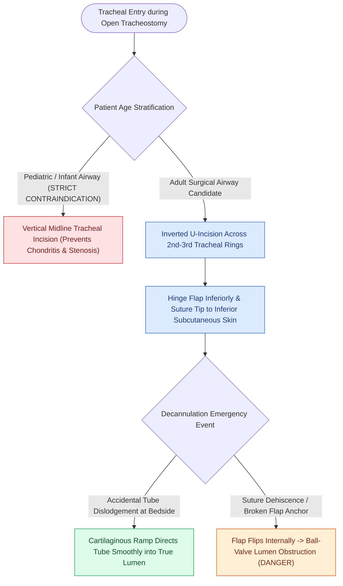

# The Bjork flap facilitates emergency tracheostomy recannulation

## Active Recall

> [!question]- What is the primary clinical advantage of creating a Björk flap during an adult open tracheotomy?
> *Answer / Clinical Rationale*: It creates a smooth cartilaginous ramp anchored to the inferior skin, guiding replacement tubes directly into the tracheal lumen and preventing fatal **false tract** displacement into the mediastinum during accidental decannulation.

> [!question]- Why is the Björk flap strictly contraindicated in pediatric patients?
> *Answer / Clinical Rationale*: In infants and young children, anterior tethering of the compliant tracheal cartilage produces severe **anterior wall collapse, chondritis, and high-grade subglottic/[[The McCaffrey classification stages laryngotracheal stenosis by anatomical subsite|tracheal stenosis]]**.

## Core Clinical & Mechanistic Principles
The **Björk Flap** (described by Viking Olov Björk in 1952) is a specialized tracheal entry technique used during [[Standard open tracheotomy utilizes horizontal intersinusoidal or Bjork flap entry|open tracheotomy]] to create a secure, direct epithelialized conduit between the anterior tracheal lumen and the inferior skin margin.

### Step-by-Step Surgical Construction
1. **Inverted U-Incision**: An inverted U-shaped incision is made across the 2nd or 3rd anterior tracheal cartilage ring.
2. **Inferior Hinge**: The flap is hinged inferiorly and reflected downward.
3. **Dermal Anchoring**: The tip of the cartilaginous flap is secured to the deep dermis/subcutaneous tissue of the inferior skin margin with interrupted nonabsorbable sutures (e.g., 3-0 or 4-0 Prolene).

## Primary Clinical Advantages
- **Facilitated Emergency Recannulation**: The inferiorly sloping flap acts as a smooth, guided "ramp" that directs replacement tubes directly into the tracheal lumen during early accidental decannulation, preventing the tube from plunging into the pretracheal space and creating a fatal false tract.
- **Mature Stoma Formation**: Accelerates epithelialization and creates a stable, mature stoma.

## Absolute Contraindication in Pediatric Patients
- **Pediatric Contraindication**: The Björk flap is **strictly contraindicated in infants and young children**.
- *Pathophysiological Mechanism*: The infant trachea is small and compliant; tethering an anterior cartilaginous flap forward produces anterior tracheal wall collapse, persistent subglottic and tracheal chondritis, and severe, progressive stenosis. In children, a simple vertical midline incision without cartilage excision or flap creation is mandatory.

## Critical Failure Modes & Error Traps
- **Endotracheal Lumen Obstruction**: If the securing suture breaks, the flap can flip backward into the tracheal lumen, acting as an obstructive one-way ball-valve causing acute asphyxiation.

## Connected Concepts & Graph Traversal
- **Parent Procedure**: [[Standard open tracheotomy utilizes horizontal intersinusoidal or Bjork flap entry|Standard Open Tracheotomy]]
- **Alternative Traction Technique**: [[Tracheal stay sutures prevent false tract entry during accidental decannulation|Tracheal Stay Sutures]]
- **Obesity Variant**: [[Defatting tracheotomy secures the airway in morbidly obese patients|Defatting Tracheotomy]]
- **Airway Complications**: [[Subcutaneous emphysema arises when tracheotomy incisions are closed too tightly|Subcutaneous Emphysema]]
- **Clinical Management**: [[The McCaffrey classification stages laryngotracheal stenosis by anatomical subsite|McCaffrey Classification]]
