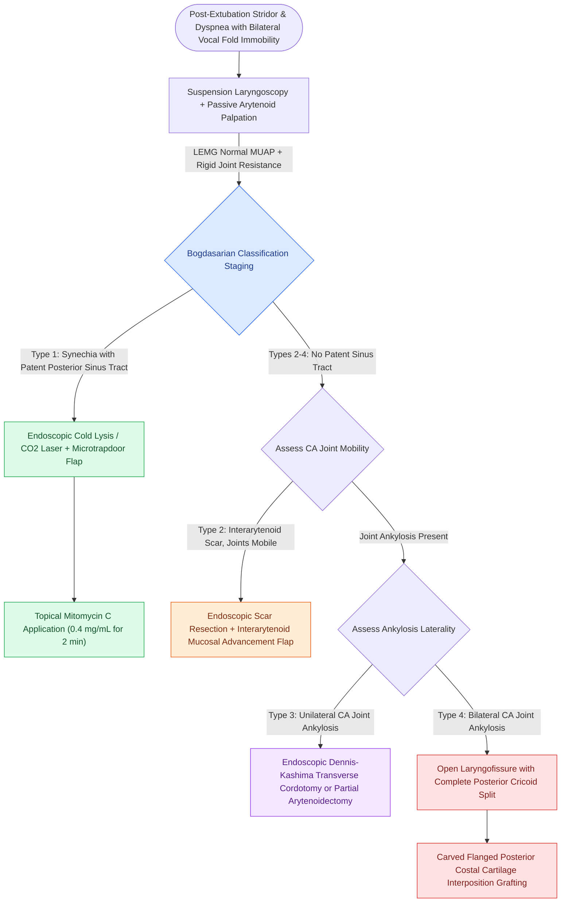

# The Bogdasarian classification categorizes posterior glottic stenosis from Type I interarytenoid scar to Type IV bilateral joint fixation

## Active Recall

> [!question]- How does the Bogdasarian classification differentiate between Type II, Type III, and Type IV posterior glottic stenosis?
> *Answer / Clinical Rationale*: **Type II** represents an interarytenoid scar band without a posterior sinus tract where both cricoarytenoid (CA) joints remain freely mobile. **Type III** involves posterior glottic cicatricial scarring with unilateral CA joint ankylosis/fixation. **Type IV** represents extensive posterior scarring with bilateral CA joint ankylosis and complete vocal fold immobility.

> [!question]- Why is passive manual arytenoid palpation under suspension microlaryngoscopy combined with laryngeal electromyography mandatory before surgically treating posterior glottic stenosis?
> *Answer / Clinical Rationale*: It definitively differentiates mechanical joint fixation and cicatricial posterior webbing from bilateral recurrent laryngeal nerve paralysis. In PGS with joint fixation, LEMG reveals intact motor unit potentials despite physical immobility, while passive palpation confirms rigid joint resistance.

## Core Clinical & Mechanistic Principles
**Posterior Glottic Stenosis (PGS)** is a devastating form of chronic upper airway narrowing localized to the posterior cartilaginous glottis, interarytenoid space, and cricoarytenoid joints. It arises predominantly as an iatrogenic complication of [[Prolonged intubation beyond seven to ten days increases glottic stenosis and ventilator-associated pneumonia risk|prolonged endotracheal intubation]] (responsible for $>85\%$ of acquired cases), external laryngeal trauma, caustic ingestion, or aggressive endolaryngeal surgery crossing the posterior commissure.

### Pathophysiologic Cascade of Intubation Injury
In recumbent intubated patients, the posterior glottis bears the maximal mechanical pressure load from the endotracheal tube:
1. **Perfusion Failure & Ulceration**: The indwelling tube compresses the thin mucoperichondrium covering the medial aspects of the arytenoid cartilages and the cricoid lamina against the posterior pharyngeal wall. When pressure exceeds capillary perfusion pressure ($>25\text{ to }30\text{ mm Hg}$), mucosal ischemia, necrosis, and ulceration ensue within 48 to 72 hours.
2. **Perichondritis & Cicatricial Contracture**: Denuded perichondrium develops bacterial colonization, acute perichondritis, and exuberant granulation tissue. During subsequent secondary intention healing, intense myofibroblastic contracture generates dense crosslinked fibrotic bands across the interarytenoid notch.
3. **Cricoarytenoid Joint Ankylosis**: If inflammatory fibrogenesis extends into the synovial joint capsule or articular cartilage, intra-articular fibrous adhesion and osseous ankylosis lock the arytenoid in a fixed adducted or paramedian position.

### The Bogdasarian & Olson Staging Classification
| Bogdasarian Stage | Anatomic Pathology | CA Joint Status | Primary Operative Management |
| :--- | :--- | :--- | :--- |
| **Type 1** | Interarytenoid synechia / scar with a posterior sinus tract. | Both CA joints mobile. | Endoscopic cold/laser lysis + microtrapdoor flap + mitomycin C. |
| **Type 2** | Interarytenoid scar band without a posterior sinus tract. | Both CA joints mobile. | Endoscopic scar excision + mucosal advancement flap. |
| **Type 3** | Posterior glottic scarring with unilateral joint fixation. | One CA joint ankylosed. | Endoscopic unilateral transverse cordotomy or partial arytenoidectomy. |
| **Type 4** | Complete posterior cicatricial obliteration. | Bilateral CA joints ankylosed. | Open laryngofissure + posterior cricoid split with costal cartilage graft. |

### Operative Mechanics & Reconstruction Ladders
- **Diagnostic Differentiation**: Passive operative palpation with a rigid ball-tipped probe under total intravenous anesthesia confirms rigid posterior fixity, while [[Laryngeal electromyography differentiates vocal fold paralysis from joint fixation|laryngeal electromyography]] distinguishes mechanical joint ankylosis (normal voluntary motor units) from true neurogenic paralysis (fibrillation potentials, absent recruitment).
- **Endoscopic Mucosal Protection**: For Types 1 and 2, simple division without epithelial resurfacing carries a $>50\%$ recurrence rate. Creating a posteriorly based microtrapdoor flap preserves native respiratory epithelium to line the interarytenoid bed, supplemented by [[Topical mitomycin-C inhibits fibroblast proliferation and collagen deposition|topical mitomycin-C]] ($0.4\text{ mg/mL}$ applied for $2\text{ to }4\text{ minutes}$) to arrest fibroblast proliferation.
- **Open Posterior Cricoid Expansion**: In Type 4 disease, endolaryngeal techniques fail. An anterior laryngofissure is performed, dividing the scar down to cartilage and splitting the posterior cricoid lamina down to the hypopharynx, followed by [[Posterior costal cartilage grafts with a carved flange split the posterior cricoid lamina to expand the glottic lumen|posterior costal cartilage grafting]] with lateral stabilizing flanges and soft Silastic endolaryngeal stenting for $2\text{ to }4\text{ weeks}$.

## Critical Failure Modes & Error Traps
- **Confusing Type 4 PGS with Bilateral RLN Paralysis**: Performing a nerve reinnervation or unilateral cordotomy in a patient with undiagnosed bilateral joint ankylosis fails to restore an airway.
- **Over-Resection of Posterior Commisure Mucosa**: Aggressive circumferential laser vaporization without flap preservation leads to extensive neo-chondrogenesis and circumferential subglottic stenosis.

## Connected Concepts & Graph Traversal
- **Subglottic Stenosis Grader**: [[The Cotton-Myer classification grades subglottic stenosis by luminal reduction|Cotton-Myer Classification]]
- **Resection Alternative**: [[Cricotracheal resection removes subglottic stenosis while sparing posterior cricoid and RLNs|Cricotracheal Resection]]
- **Arytenoid Joint Dynamics**: [[The cricoarytenoid joint moves via coupled rocking and sliding|Cricoarytenoid Joint Kinematics]]
- **Epithelial Preservation Craft**: [[The epithelial-sparing microflap preserves native mucosa and prevents glottic webbing|Epithelial-Sparing Microflap]]
- **🔗 Neurovascular Safety Anchor (Pediatrics)**: [[Preserving the recurrent laryngeal nerves at the cricothyroid articulation is essential during cricotracheal resection|RLN Preservation at Cricoid]]
