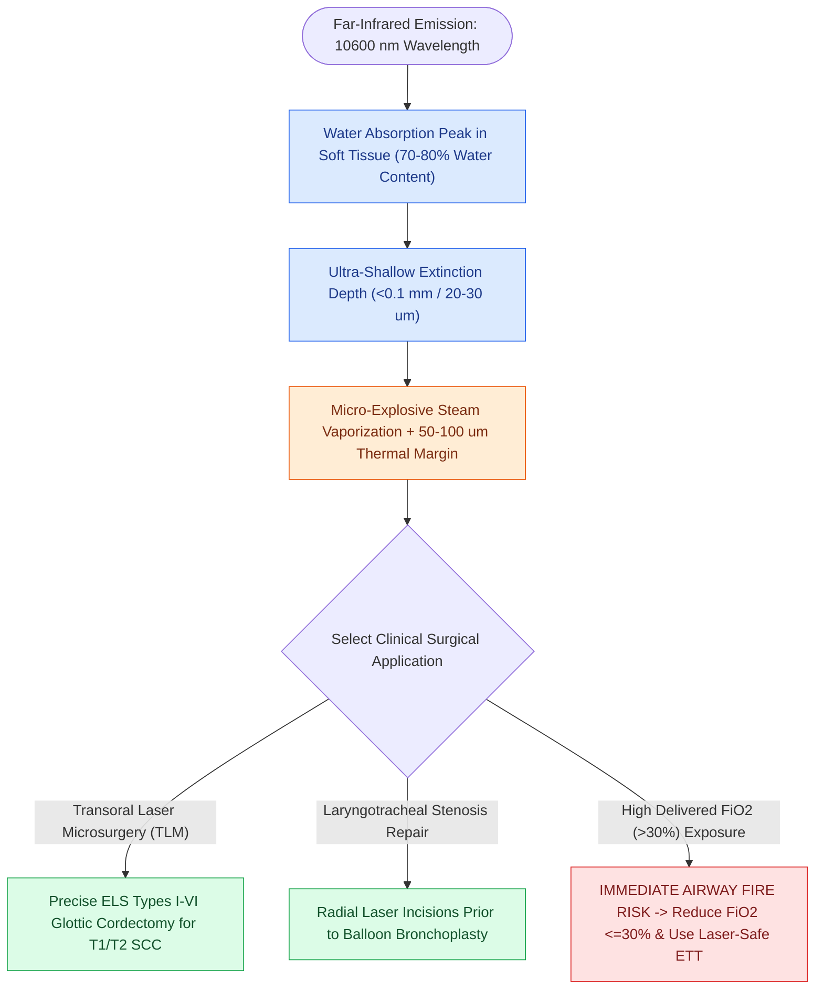

# The CO2 laser vaporizes tissue via 10600 nm water absorption

## Active Recall

> [!question]- What is the primary chromophore for the 10,600 nm CO2 laser, and why does it yield high cutting precision?
> *Answer / Clinical Rationale*: **Intracellular water** is the primary chromophore. Because water has an extremely high absorption coefficient for $10,600\text{ nm}$ energy, the depth of penetration is $<0.1\text{ mm}$, restricting vaporization strictly to the focal point with negligible lateral thermal spread.

> [!question]- What major oncologic surgical procedure relies on the precision cutting of the CO2 laser?
> *Answer / Clinical Rationale*: **Transoral Laser Microsurgery (TLM)** for endoscopic ELS cordectomies in early glottic and supraglottic carcinomas.

## Core Clinical & Mechanistic Principles
The **Carbon Dioxide ($\text{CO}_2$) Laser** operates in the far-infrared electromagnetic spectrum at a wavelength of **$\lambda = 10,600\text{ nm}$**.

### Biophysical Tissue Interaction
- **Primary Chromophore**: **Intracellular and extracellular water**. Because soft tissue is ~70–80% water, $\text{CO}_2$ laser energy is absorbed almost instantaneously upon contact with the tissue surface.
- **Minimal Penetration Depth**: The extinction coefficient in water is extremely high, resulting in an ultra-shallow absorption depth of **$<0.1\text{ mm}$ (typically $20\text{–}30\text{ µm}$)**.
- **Vaporization & Cutting**: Instantaneous heating of intracellular water to $>100^\circ\text{C}$ causes rapid phase transition to steam, micro-explosive cell rupture, and precise tissue vaporization.
- **Zone of Thermal Coagulation**: Surrounding lateral thermal damage is minimal ($50\text{–}100\text{ µm}$ in superpulse/ultrapulse modes), allowing precise microscopic cutting while coagulating microvessels $<0.5\text{ mm}$ in diameter.

## Primary Clinical & Surgical Indications
1. **Transoral Laser Microsurgery (TLM) for Glottic Carcinoma**: The gold standard tool for performing [[The ELS classification categorizes endoscopic cordectomies from Types I to VI|transoral laser cordectomies (ELS Types I–VI)]].
2. **Radial Airway Incisions**: Used to perform radial incisions in [[The Cotton-Myer classification grades subglottic stenosis by luminal reduction|subglottic stenosis]] (see [[Endoscopic airway dilation combines radial incisions with balloon bronchoplasty|endoscopic airway dilation]]).
3. **Partial Arytenoidectomy / Transverse Cordotomy**: For static glottic airway widening in bilateral abductor vocal fold paralysis.

## Critical Failure Modes & Error Traps
- **Airway Fire Hazard**: Ignition of the endotracheal tube in the presence of high delivered oxygen concentrations is a life-threatening emergency (see airway fire prevention).
- **Thermal Damage to Vocal Ligament**: Using continuous mode or high power on benign superficial lesions induces deep collagen coagulation and severe [[Vocal fold scar results from disorganized Type I collagen deposition|vocal fold scarring]].

## Connected Concepts & Graph Traversal
- **KTP Photoangiolytic Laser**: [[The KTP laser targets oxyhemoglobin at 532 nm for photoangiolysis|KTP Laser]]
- **Pulsed Dye Laser (585 nm)**: [[The pulsed dye laser targets vascular lesions at 585 nm|Pulsed Dye Laser]]
- **Airway Fire Prevention**: [[Airway fire prevention requires FiO2 below 30 percent and laser-safe tubes|Airway Fire Protocols]]
- **Endoscopic Stenosis Dilation**: [[Endoscopic airway dilation combines radial incisions with balloon bronchoplasty|Airway Dilation]]
- **Phonomicrosurgical Clearance**: [[Phonomicrosurgery requires suspension laryngoscopy and stereoscopic magnification|Phonomicrosurgery]]
