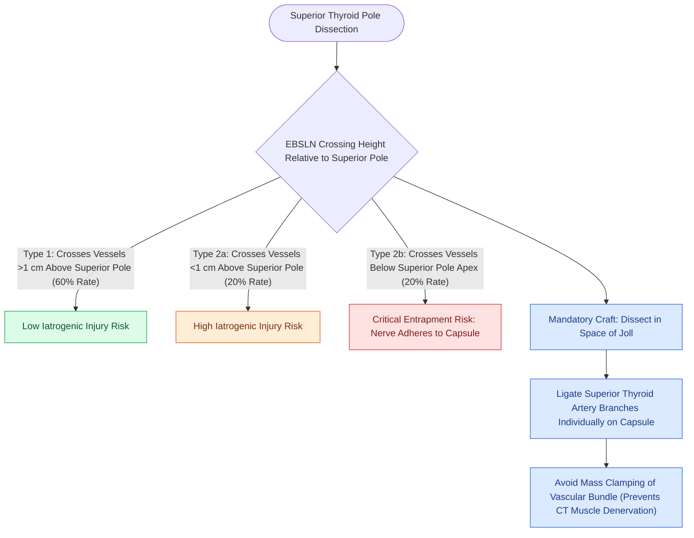

# The Cernea classification stages EBSLN risk relative to superior thyroid vessels

## Active Recall

> [!question]- Which Cernea classification subtype carries the highest risk of iatrogenic nerve injury during thyroid pole dissection?
> *Answer / Clinical Rationale*: **Type 2b**, because the EBSLN crosses below the horizontal plane of the superior thyroid pole, often adhering directly to the thyroid capsule.

> [!question]- What is the safest surgical technique to avoid injury to a Type 2b EBSLN?
> *Answer / Clinical Rationale*: Individual peripheral skeletonization and ligation of terminal superior thyroid artery branches directly on the thyroid capsule rather than applying a mass clamp across the vascular pedicle.

## Core Clinical & Mechanistic Principles
The **Cernea Classification** system standardizes the anatomical course and relationship of the **External Branch of the [[The superior laryngeal nerve provides supraglottic sensation and cricothyroid motor control|Superior Laryngeal Nerve]] (EBSLN)** to the superior vascular pole of the thyroid gland (superior thyroid artery and vein).

### Classification Types
- **Type 1 (Low Risk)**: The EBSLN crosses the superior thyroid vessels **more than $1\text{ cm}$ above** the upper border of the superior thyroid pole. (Occurs in ~60% of cases).
- **Type 2a (High Risk)**: The EBSLN crosses the superior thyroid vessels **less than $1\text{ cm}$ above** the upper border of the superior thyroid pole. (Occurs in ~20% of cases).
- **Type 2b (Highest Risk)**: The EBSLN crosses the superior thyroid vessels **below the upper border** of the superior thyroid pole, adhering directly to the thyroid capsule. (Occurs in ~20% of cases).

## Surgical Technique & Prevention Nuances
- **Individual Vessel Ligation**: To protect the EBSLN during thyroid lobectomy, the surgeon must dissect and skeletonize the branches of the superior thyroid artery individually directly on the thyroid capsule, rather than mass-ligating the vascular bundle.
- **Nerve Identification / Neuromonitoring**: Intraoperative nerve monitoring (IONM) can stimulate the EBSLN and visually or electrophysiologically confirm contraction of the [[The cricothyroid muscle elongates vocal folds to elevate pitch|cricothyroid muscle]].

## Critical Failure Modes & Error Traps
- **Goiter Displacement**: Large multinodular goiters elevate the superior thyroid pole, converting an anatomical Type 1 or 2a nerve into a functional Type 2b course, dramatically increasing the risk of iatrogenic nerve entrapment.

## Connected Concepts & Graph Traversal
- **CT Pitch Tensor Myology**: [[The cricothyroid muscle elongates vocal folds to elevate pitch|Cricothyroid Muscle]]
- **SLN Sensory/Motor Anatomy**: [[The superior laryngeal nerve provides supraglottic sensation and cricothyroid motor control|Superior Laryngeal Nerve]]
- **RLN Intrinsic Motor Supply**: [[The recurrent laryngeal nerve innervates all intrinsic muscles except cricothyroid|Recurrent Laryngeal Nerve]]
- **LEMG Confirmation**: [[Laryngeal electromyography differentiates vocal fold paralysis from joint fixation|LEMG of Cricothyroid]]
- **Vocal Fold Tensing Mechanics**: [[The vocal ligament comprises intermediate and deep lamina propria|Vocal Ligament Tension]]
