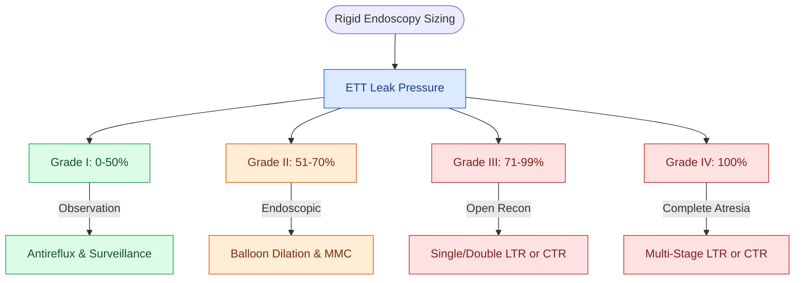

# The Cotton-Myer classification grades subglottic stenosis by luminal reduction

## Active Recall

> [!question]- What defines a Cotton-Myer Grade III subglottic stenosis?
> *Answer / Clinical Rationale*: **$71\%\text{ to }99\%$ cross-sectional luminal obstruction** with a detectable, visible lumen (pinpoint lumen), typically requiring open surgical reconstruction (LTR or CTR).

> [!question]- How does a Grade IV stenosis differ from a Grade III stenosis?
> *Answer / Clinical Rationale*: Grade IV represents **$100\%$ complete obstruction (atresia)** with no detectable lumen whatsoever.

## Core Clinical & Mechanistic Principles
The **Cotton-Myer Classification System** (pioneered by Robin Cotton and Charles Myer III in 1994) is the international standard grading system for quantifying the severity of **subglottic stenosis**.

### Grade Criteria & Cross-Sectional Reduction
The system categorizes subglottic stenosis into four progressive grades based on the percentage reduction of cross-sectional subglottic lumen measured against standardized age-appropriate endotracheal tube sizes:

| Grade | Cross-Sectional Luminal Obstruction | Endoscopic Appearance & Lumen Characteristics | Primary Surgical Strategy |
| :--- | :--- | :--- | :--- |
| **Grade I** | **$0\%\text{ to }50\%$** obstruction | Mild circumferential or crescentic narrowing. | Observation; medical antireflux optimization; serial endoscopic surveillance. |
| **Grade II** | **$51\%\text{ to }70\%$** obstruction | Significant narrowing, but adequate lumen for spontaneous ventilation. | Endoscopic balloon dilation $\pm$ Mitomycin-C; single-stage LTR if mature/cartilaginous. |
| **Grade III** | **$71\%\text{ to }99\%$** obstruction | Severe pinpoint lumen; visible residual lumen present. | Open LTR with cartilage grafting or CTR. |
| **Grade IV** | **$100\%$** obstruction | Complete cicatricial obliteration; **no detectable lumen** (*blind pouch*). | Open airway reconstruction: Multi-stage LTR or CTR. |

**Key Links**: [[Active reflux and eosinophilic esophagitis compromise airway graft survival|Antireflux optimization]] · [[Endoscopic airway dilation combines radial incisions with balloon bronchoplasty|Endoscopic balloon dilation]] · [[Topical mitomycin-C inhibits fibroblast proliferation and collagen deposition|Mitomycin-C]] · [[Laryngotracheal reconstruction expands the airway using carved costal cartilage grafts|Laryngotracheal Reconstruction (LTR)]] · [[Cricotracheal resection removes subglottic stenosis while sparing posterior cricoid and RLNs|Cricotracheal Resection (CTR)]]

## Sizing Technique & Method of Measurement
- **Endotracheal Tube Sizing**: Determined in the operating room during rigid endoscopy under spontaneous respiration.
- **Leak Pressure Sizing**: The largest endotracheal tube that passes through the stenosis with an audible air leak at an airway pressure of $\le 20\text{–}25\text{ cm H}_2\text{O}$ is compared against the predicted normal size for age/height.

## Clinical Utility & Limitations
- **Focus on Cross-Section**: Accurately defines cross-sectional luminal area in the subglottis.
- **Limitation**: Does not account for the **vertical length** of the stenosis or multi-level involvement (glottic/tracheal extension), which requires complementary evaluation via the [[The McCaffrey classification stages laryngotracheal stenosis by anatomical subsite|McCaffrey Classification]].

## Connected Concepts & Graph Traversal
- **McCaffrey Subsite Classification**: [[The McCaffrey classification stages laryngotracheal stenosis by anatomical subsite|McCaffrey Classification]]
- **Endoscopic Balloon Dilation**: [[Endoscopic airway dilation combines radial incisions with balloon bronchoplasty|Endoscopic Airway Dilation]]
- **Open Surgical Reconstruction**: [[Two-stage LTR maintains a tracheostomy with prolonged endolaryngeal stenting|Two-Stage LTR]]
- **Cricotracheal Resection**: [[Cricotracheal resection removes subglottic stenosis while sparing posterior cricoid and RLNs|Cricotracheal Resection]]
- **Guardian Chin Stitch**: [[The guardian chin-to-chest suture prevents cervical hyperextension and anastomotic dehiscence|Guardian Suture]]
- **Autoimmune Etiology**: [[Systemic autoimmune diseases manifest in the larynx with subglottic stenosis, rheumatoid bamboo nodes, and granulomatous infiltration|Autoimmune Subglottic Stenosis]]
