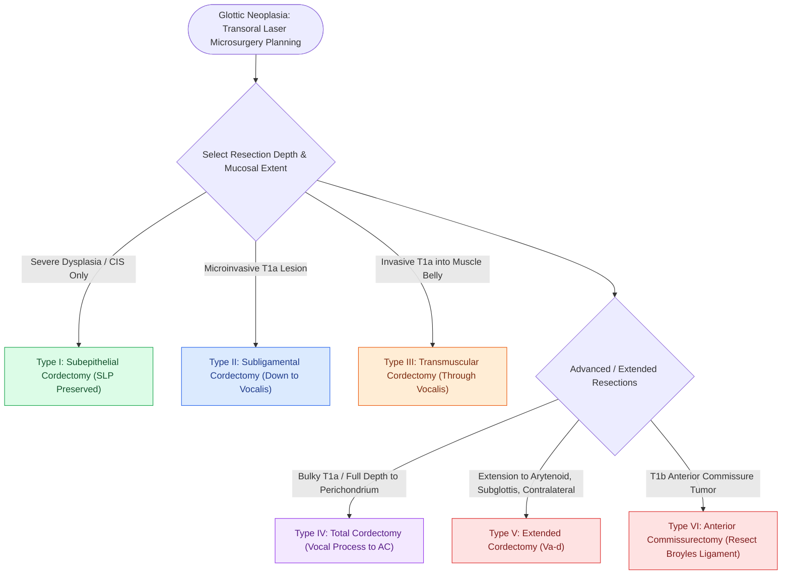

# The ELS classification categorizes endoscopic cordectomies from Types I to VI

## Active Recall

> [!question]- What anatomical layer represents the deep resection boundary for an ELS Type II (subligamental) cordectomy?
> *Answer / Clinical Rationale*: The superficial surface of the **thyrovocalis muscle**, completely resecting the epithelium, superficial lamina propria, and vocal ligament.

> [!question]- Which ELS cordectomy subtype is indicated for a T1b glottic cancer involving the anterior commissure tendon?
> *Answer / Clinical Rationale*: **ELS Type VI (Anterior Commissurectomy)**, which achieves bilateral anterior third cordectomy including en bloc resection of Broyles' ligament.

## Core Clinical & Mechanistic Principles
The **European Laryngological Society (ELS) Classification** (standardized by Remacle et al. in 2000 and revised in 2007) defines the anatomical depth and mucosal extent of endoscopic cordectomies performed via [[The CO2 laser vaporizes tissue via 10600 nm water absorption|Transoral Laser Microsurgery (TLM)]] for premalignant dysplasia and invasive glottic squamous cell carcinoma.

### The ELS Cordectomy Classes (Types I to VI)
| ELS Cordectomy Class | Anatomical Plane & Resection Depth | Oncologic Indications | Postoperative Voice Outcome |
| :--- | :--- | :--- | :--- |
| **Type I (Subepithelial)** | Resection of epithelium only, leaving the underlying SLP intact. | Severe dysplasia, Carcinoma in Situ (CIS). | Excellent; near-normal mucosal wave preserved. |
| **Type II (Subligamental)** | Resection of epithelium, SLP, and vocal ligament down to the surface of the vocalis muscle. | Microinvasive T1a glottic carcinoma. | Mild-to-moderate breathiness/roughness; compensatory wave. |
| **Type III (Transmuscular)** | Resection directly through the belly of the thyrovocalis muscle. | Invasive T1a glottic carcinoma without muscle fixation. | Moderate roughness and breathiness; false fold compensation. |
| **Type IV (Total)** | Complete resection of the vocal fold from vocal process to anterior commissure down to the internal perichondrium of the thyroid lamina. | Bulky T1a or selected T1b/T2 with normal vocal cord mobility. | Significant breathy dysphonia; glottal gap. |
| **Type V (Extended)** | Total cordectomy extending to contralateral cord/commissure (Va), arytenoid (Vb), subglottis $<1\text{ cm}$ (Vc), or false fold (Vd). | Selected T2 lesions extending beyond a single membranous fold. | Variable; depends on degree of glottic reconstruction. |
| **Type VI (Anterior Commissurectomy)** | Bilateral anterior 1/3 cordectomy + en bloc resection of Broyles' ligament and anterior thyroid perichondrium. | T1b glottic carcinoma involving the anterior commissure without cartilage invasion. | High-pitched, strained voice; risk of web formation. |

**Resected Layers**: [[Stratified squamous epithelium forms the vocal fold protective cover|Epithelium]] → [[The superficial lamina propria acts as a pliable shearing fluid bed|SLP]] → [[The vocal ligament comprises intermediate and deep lamina propria|Vocal ligament]] → [[The thyrovocalis muscle provides isometric pitch and tension control|Vocalis muscle]] · [[The mucosal wave travels as a fluid mechanical displacement|Mucosal wave]] · [[The cricoarytenoid joint moves via coupled rocking and sliding|Arytenoid]] · [[Broyles' ligament anchors the vocal ligament to thyroid cartilage|Broyles' ligament]]

## Step-by-Step Surgical Execution
1. **Suspension Laryngoscopy**: Align large-lumen laryngoscope with a $400\text{-mm}$ lens and $\text{CO}_2$ laser micromanipulator (see suspension setup).
2. **Margin Mapping**: Delineate a $1\text{–}2\text{ mm}$ clear mucosal margin around the tumor under high magnification.
3. **Deep Resection Plane**: Laser cuts are carried out in a continuous or superpulse mode, identifying the glistening white fibers of the vocal ligament or striated muscle fibers of the vocalis to confirm accurate depth.
4. **Frozen Section Analysis**: Submit peripheral and deep margins for intraoperative histological confirmation.

## Critical Failure Modes & Error Traps
- **Under-resection at Anterior Commissure**: In Type VI resections, failing to remove Broyles' ligament and underlying perichondrium leaves positive margins at the anterior cartilage apex.

## Connected Concepts & Graph Traversal
- **Resected Deep Boundary**: [[The vocal ligament comprises intermediate and deep lamina propria|Vocal Ligament Histology]]
- **Muscular Substrate**: [[The thyrovocalis muscle provides isometric pitch and tension control|Thyrovocalis Muscle Anatomy]]
- **Anterior Insertion Anchor**: [[Broyles' ligament anchors the vocal ligament to thyroid cartilage|Broyles' Ligament & Cartilage Barrier]]
- **Surgical Laser Tool**: [[The CO2 laser vaporizes tissue via 10600 nm water absorption|CO2 Laser Biophysics]]
- **Supraglottic Surgery**: [[Horizontal supraglottic laryngectomy resects supraglottic cancer while preserving vocal folds|Horizontal Supraglottic Laryngectomy (HSL)]]
- **Conservation Laryngectomy**: [[SCPL with CHEP preserves the epiglottis, cricoid, and one mobile arytenoid|Supracricoid Partial Laryngectomy (SCPL-CHEP)]]
