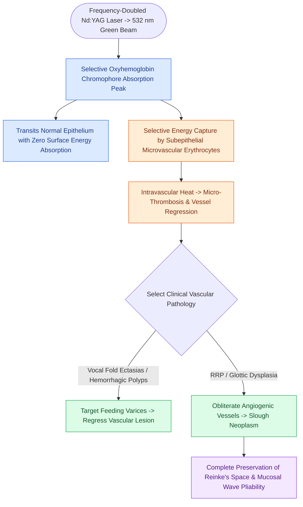

# The KTP laser targets oxyhemoglobin at 532 nm for photoangiolysis

## Active Recall

> [!question]- Why is the 532 nm KTP laser uniquely suited for treating glottic dysplasia compared to the [[The CO2 laser vaporizes tissue via 10600 nm water absorption|CO2 laser]]?
> *Answer / Clinical Rationale*: The KTP laser selectively targets hemoglobin in the abnormal subepithelial angiogenic vessel network of the dysplasia, causing ischemic regression while sparing the non-vascular superficial lamina propria and preserving the mucosal wave.

> [!question]- How is the KTP laser beam delivered for in-office laryngeal procedures?
> *Answer / Clinical Rationale*: Via a flexible silica fiber passed through the instrumentation channel of a flexible distal-chip rhinolaryngoscope under topical local anesthesia.

## Core Clinical & Mechanistic Principles
The **Potassium Titanyl Phosphate (KTP) Laser** produces a visible green beam at a wavelength of **$\lambda = 532\text{ nm}$**, generated by passing a neodymium:YAG laser beam ($1064\text{ nm}$) through a frequency-doubling KTP crystal.

### Mechanism of Selective Photothermolysis
- **Target Chromophore**: **Oxyhemoglobin**. The $532\text{ nm}$ wavelength coincides almost exactly with the major absorption peak of oxyhemoglobin in blood ($542\text{ nm}$).
- **Selective Photoangiolysis**: Laser energy passes through the non-pigmented overlying [[Stratified squamous epithelium forms the vocal fold protective cover|stratified squamous epithelium]] with minimal absorption. The energy is selectively captured by red blood cells within subepithelial microvessels.
- **Intravascular Micro-coagulation**: Rapid heat generation causes microvascular thrombosis, endothelial necrosis, and vessel involution without thermal damage to the overlying epithelial cover or underlying [[The superficial lamina propria acts as a pliable shearing fluid bed|superficial lamina propria]] / [[The vocal ligament comprises intermediate and deep lamina propria|vocal ligament]].

## Primary Clinical Indications
1. **Glottic Dysplasia & Keratosis**: Selectively coagulates abnormal angiogenic vessel networks nourishing dysplastic epithelium, clearing dysplasia while preserving [[The mucosal wave travels as a fluid mechanical displacement|mucosal wave]] pliability.
2. **Recurrent Respiratory Papillomatosis (RRP)**: Obliterates the central fibrovascular cores of papillomas, causing lesion regression with zero ligament scarring.
3. **Vocal Fold Ectasias & Varices**: Coagulates dilated, rupture-prone subepithelial vessels responsible for recurrent hemorrhagic [[Vocal fold polyps arise from phonotraumatic microvascular injury in Reinke's space|vocal fold polyps]].
4. **In-Office / Flexible Fiber Delivery**: Delivered via flexible glass fiber ($300\text{–}400\text{ µm}$) through the working channel of a flexible distal-chip laryngoscope under topical anesthesia.

## Critical Failure Modes & Error Traps
- **Excessive Fluence / Pulse Stacking**: Delivering high continuous power or stacking multiple pulses on a single spot induces non-selective thermal heating of adjacent extracellular matrix, causing mucosal blistering and scarring.

## Connected Concepts & Graph Traversal
- **CO2 Vaporizing Laser**: [[The CO2 laser vaporizes tissue via 10600 nm water absorption|CO2 Laser]]
- **Pulsed Dye Vascular Laser**: [[The pulsed dye laser targets vascular lesions at 585 nm|Pulsed Dye Laser]]
- **Airway Fire Safety**: [[Airway fire prevention requires FiO2 below 30 percent and laser-safe tubes|Airway Fire Protocols]]
- **Phonomicrosurgical Craft**: [[Phonomicrosurgery requires suspension laryngoscopy and stereoscopic magnification|Phonomicrosurgery]]
- **Vocal Fold Hemorrhage**: [[Acute vocal fold hemorrhage requires strict voice rest and absolute performance cancellation to prevent permanent fibrovascular scarring|Vocal Fold Hemorrhage]]
