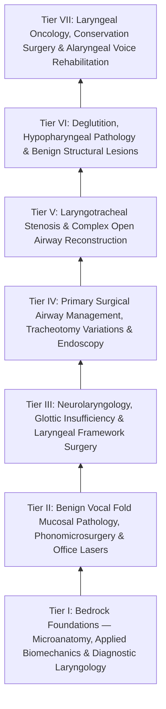

# The Laryngology Knowledge Graph provides a structured mastery curriculum

Welcome to the **Comprehensive Laryngology Residency Mastery Knowledge Graph**. This interconnected Obsidian wiki is structured as a **progressively load-bearing network** moving from microanatomy, neurophysiology, and diagnostics through complex open airway reconstruction, conservation surgery, and [[Total laryngectomy achieves en bloc laryngeal resection with permanent end-stoma|total laryngectomy]] with alaryngeal voice restoration.

> [!NOTE] **Source Document**
> This graph was atomized from the [[Comprehensive Laryngology Residency Mastery Curriculum & Self-Assessment Guide|original linear source curriculum]]. Refer to it for the complete narrative text and self-assessment checkpoints.

---

## Tier I: Bedrock Foundations — Microanatomy, Applied Biomechanics & Diagnostic Laryngology
- **Layered Histology & Extracellular Matrix**:
  - [[The vocal fold comprises five distinct histological layers|Five-Layer Vocal Fold Microarchitecture]]
  - [[Stratified squamous epithelium forms the vocal fold protective cover|Stratified Squamous Epithelial Cover]]
  - [[The basement membrane zone anchors epithelium to superficial lamina propria|Basement Membrane Zone (BMZ)]]
  - [[The superficial lamina propria acts as a pliable shearing fluid bed|Superficial Lamina Propria (Reinke's Space)]]
  - [[Hyaluronic acid regulates lamina propria hydration and shock absorption|Hyaluronic Acid in Vocal Fold ECM]]
  - [[The intermediate lamina propria provides elastic recoil via elastin fibers|Intermediate Lamina Propria (ILP)]]
  - [[The deep lamina propria provides tensile stiffness via crosslinked collagen|Deep Lamina Propria (DLP)]]
  - [[The vocal ligament comprises intermediate and deep lamina propria|The True Vocal Ligament]]
  - [[The macula flava cushions the vocal fold to cartilage transition|Macula Flava Transition Zones]]
  - [[Broyles' ligament anchors the vocal ligament to thyroid cartilage|Broyles' Ligament (Anterior Commissure Tendon)]]
- **Muscles & Deep Laryngeal Spaces**:
  - [[The thyroarytenoid muscle modulates glottal stiffness and adduction|Thyroarytenoid Muscle Complex]]
  - [[The thyrovocalis muscle provides isometric pitch and tension control|Thyrovocalis (Medial TA) Muscle]]
  - [[The thyromuscularis muscle provides rapid vocal fold adduction and shortening|Thyromuscularis (Lateral TA) Muscle]]
  - [[The paraglottic space facilitates transglottic tumor spread|Paraglottic Space (PGS)]]
  - [[The pre-epiglottic space enables rapid supraglottic cancer spread|Pre-Epiglottic Space (PES)]]
- **Kinematics, Myology & Neuroanatomy**:
  - [[The cricoarytenoid joint moves via coupled rocking and sliding|Cricoarytenoid (CA) Joint Kinetics]]
  - [[The posterior cricoarytenoid is the sole vocal fold abductor|Posterior Cricoarytenoid (PCA) Muscle]]
  - [[The lateral cricoarytenoid is the primary membranous fold adductor|Lateral Cricoarytenoid (LCA) Muscle]]
  - [[The interarytenoid muscle closes the posterior glottic chink|Interarytenoid (IA) Muscle]]
  - [[The cricothyroid muscle elongates vocal folds to elevate pitch|Cricothyroid (CT) Muscle]]
  - [[The recurrent laryngeal nerve innervates all intrinsic muscles except cricothyroid|Recurrent Laryngeal Nerve (RLN)]]
  - [[The superior laryngeal nerve provides supraglottic sensation and cricothyroid motor control|Superior Laryngeal Nerve (SLN)]]
  - [[The Cernea classification stages EBSLN risk relative to superior thyroid vessels|Cernea Classification of EBSLN]]
- **Diagnostics & Electrophysiology**:
  - [[Videostroboscopy visualizes mucosal wave dynamics and glottal closure|Diagnostic Videostroboscopy]]
  - [[The mucosal wave travels as a fluid mechanical displacement|Mucosal Wave Dynamics]]
  - [[Glottal closure patterns identify specific laryngeal biomechanical deficits|Glottal Closure Patterns]]
  - [[Adynamic vocal fold segments indicate mucosal stiffening, malignancy, or scar|Adynamic Non-Vibrating Segments]]
  - [[Laryngeal electromyography differentiates vocal fold paralysis from joint fixation|Laryngeal Electromyography (LEMG)]]
  - [[LEMG denervation potentials indicate axonal injury within one to six months|LEMG Waveform Analysis & Timing]]
1. [[Acute epiglottitis presents with rapid-onset odynophagia, fever, and the tripod sign requiring immediate airway protection]]

---

## Tier II: Benign Vocal Fold Mucosal Pathology, Phonomicrosurgery & Office Lasers
- **Pathology Phenotypes**:
  - [[Vocal fold nodules are bilateral mid-membranous lesions treated with voice therapy|Vocal Fold Nodules]]
  - [[Vocal fold polyps arise from phonotraumatic microvascular injury in Reinke's space|Vocal Fold Polyps & Varices]]
  - [[Epidermoid cysts adhere to the vocal ligament and require sharp dissection|Intracordal Epidermoid Cysts]]
  - [[Mucous retention cysts arise from obstructed glands in superficial lamina propria|Intracordal Mucous Retention Cysts]]
  - [[Sulcus vocalis manifests as mucosal furrowing staged by the Ford classification|Sulcus Vocalis & Ford Classification]]
  - [[Vocal fold scar results from disorganized Type I collagen deposition|Vocal Fold Scarring & Fibrogenesis]]
  - [[Acute vocal fold hemorrhage requires strict voice rest and absolute performance cancellation to prevent permanent fibrovascular scarring|Acute Vocal Fold Hemorrhage]]
  - [[Recurrent respiratory papillomatosis is caused by HPV and managed with serial debulking|Recurrent Respiratory Papillomatosis (RRP)]]
- **Phonomicrosurgery & Laser Systems**: 
  - Phonomicrosurgery Setup & Suspension
  - [[Subepithelial hydrodissection expands Reinke's space and protects the vocal ligament|Subepithelial Hydrodissection Technique]]
  - [[The epithelial-sparing microflap preserves native mucosa and prevents glottic webbing|Epithelial-Sparing Microflap Technique]]
  - [[The CO2 laser vaporizes tissue via 10600 nm water absorption|CO2 Laser Biophysics]]
  - [[The KTP laser targets oxyhemoglobin at 532 nm for photoangiolysis|KTP Laser Photoangiolysis]]
  - [[The pulsed dye laser targets vascular lesions at 585 nm|Pulsed Dye Laser (PDL)]]
  - [[Airway fire prevention requires FiO2 below 30 percent and laser-safe tubes|Operating Room Airway Fire Prevention Protocol]]

---
- **Contact Granuloma**: [[Vocal fold contact granulomas arise from mechanical perichondritis of the vocal process treated with proton pump inhibitors, voice therapy, and Botox before excision|Vocal Fold Contact Granuloma]]
- **Autoimmune**: [[Systemic autoimmune diseases manifest in the larynx with subglottic stenosis, rheumatoid bamboo nodes, and granulomatous infiltration|Autoimmune Laryngitis]]
- **Voice Evaluation**: [[Multidimensional voice assessment integrates perceptual CAPE-V and GRBAS scales with acoustic perturbation and aerodynamic measures|Voice Assessment]]
- **Vocal Fold Paralysis**: [[Ansa cervicalis-to-recurrent laryngeal nerve neurorrhaphy restores vocal fold muscle tone and glottic competence without dynamic vocal fold abduction|Laryngeal Reinnervation]]
- **Neuro Laryngology**: [[Oculopalatopharyngeal myoclonus causes continuous one to three Hertz branchial contractions persisting in sleep due to Guillain-Mollaret triangle disruption|Oculopalatopharyngeal Myoclonus]]
- **Reinkes Edema**: [[Reinke's edema causes polypoid degeneration of the superficial lamina propria treated with smoking cessation and lateral microflap evacuation|Reinke's Edema]]
- **Esophagology**: [[Barrett esophagus manifests as salmon-colored columnar metaplasia of the distal esophagus requiring surveillance for adenocarcinoma|Barrett Esophagus]]

## Tier III: Neurolaryngology, Glottic Insufficiency & Laryngeal Framework Surgery
- **Glottic Insufficiency & Injectables**: 
  - Unilateral Vocal Fold Paralysis (UVFP)
  - [[Injection laryngoplasty requires precise placement into lateral thyroarytenoid muscle|Injection Laryngoplasty Principles]]
  - [[Carboxymethylcellulose gel provides short-acting temporary vocal fold augmentation|Carboxymethylcellulose (Radiesse Voice Gel)]]
  - [[Cross-linked hyaluronic acid provides intermediate-duration vocal fold augmentation|Cross-Linked Hyaluronic Acid]]
  - [[Calcium hydroxylapatite provides durable medialization but causes granulomas if superficial|Micronized Calcium Hydroxylapatite (Radiesse Voice)]]
  - [[Autologous fat augmentation requires overcorrection for resorption|Autologous Fat Augmentation]]
- **Framework Surgery & Movement Disorders**:
  - [[Type I thyroplasty medializes the vocal fold with conscious voice tuning|Type I Medialization Thyroplasty]]
  - [[Thyroplasty cartilage window dimensions differ between males and females|Thyroplasty Window Dimensions]]
  - [[Arytenoid adduction closes large posterior glottic gaps and corrects height mismatch|Arytenoid Adduction]]
  - [[Bilateral abductor vocal fold paralysis causes acute airway compromise requiring glottic enlargement|Bilateral Abductor Vocal Fold Paralysis]]
  - [[Endoscopic transverse cordotomy widens posterior airway while preserving anterior phonation|Endoscopic Transverse Cordotomy (Dennis-Karlan)]]
  - [[Adductor spasmodic dysphonia causes strained voice breaks treated with thyroarytenoid Botox|Adductor Spasmodic Dysphonia (ADSD)]]
  - [[Abductor spasmodic dysphonia causes breathy voice breaks treated with PCA Botox|Abductor Spasmodic Dysphonia (ABSD)]]
  - [[Essential voice tremor causes rhythmic four to eight Hertz phonatory oscillations treated with propranolol, primidone, and botulinum toxin|Essential Voice Tremor (EVT)]]

---

## Tier IV: Primary Surgical Airway Management, Tracheotomy Variations & Operative Endoscopy
- [[Standard open tracheotomy utilizes horizontal intersinusoidal or Bjork flap entry|Standard Open Tracheotomy]]
- [[The Bjork flap facilitates emergency tracheostomy recannulation|The Björk Flap]]
- [[Tracheal stay sutures prevent false tract entry during accidental decannulation|Tracheal Stay Sutures]]
- [[Defatting tracheotomy secures the airway in morbidly obese patients|Defatting Tracheotomy (Cervical Lipectomy)]]
- [[Subcutaneous emphysema arises when tracheotomy incisions are closed too tightly|Post-Tracheotomy Subcutaneous Emphysema]]
- [[Rigid bronchoscopy requires 90-degree rotation through the glottis|Operative Rigid Bronchoscopy]]
- [[Jet ventilation requires unimpeded expiratory egress to prevent barotrauma|Jet Ventilation & Barotrauma Prevention]]
- [[Emergency cricothyrotomy provides rapid airway access through the cricothyroid membrane|Emergency Surgical Cricothyrotomy]]
1. [[Adult tracheostomy tube exchange at one week requires a mature tract, tracheal stay sutures, and bougie guidance]]
2. [[Post-tonsillectomy secondary hemorrhage occurs seven to ten days postoperatively from eschar sloughing requiring urgent airway control]]

---

## Tier V: Laryngotracheal Stenosis & Complex Open Airway Reconstruction
- **Staging & Medical Optimization**:
  - [[The Cotton-Myer classification grades subglottic stenosis by luminal reduction|Cotton-Myer Classification (Grades I-IV)]]
  - [[The McCaffrey classification stages laryngotracheal stenosis by anatomical subsite|McCaffrey Classification (Stages I-IV)]]
  - [[Active reflux and eosinophilic esophagitis compromise airway graft survival|Antireflux & EoE Optimization]]
- **Endoscopic & Open Reconstruction**:
  - [[Endoscopic airway dilation combines radial incisions with balloon bronchoplasty|Endoscopic Radial Incision & Balloon Dilation]]
  - [[Topical mitomycin-C inhibits fibroblast proliferation and collagen deposition|Topical Mitomycin-C Application]]
  - [[Laryngotracheal reconstruction expands the airway using carved costal cartilage grafts|Laryngotracheal Reconstruction (LTR)]]
  - [[The posterior cricoid split widens the posterior glottis for high-grade stenosis|Posterior Cricoid Split]]
  - [[Single-stage LTR utilizes an endotracheal tube as a temporary stent avoiding tracheostomy placement|Single-Stage LTR]]
  - [[Two-stage LTR maintains a tracheostomy with prolonged endolaryngeal stenting|Two-Stage LTR]]
  - [[Cricotracheal resection removes subglottic stenosis while sparing posterior cricoid and RLNs|Cricotracheal Resection (CTR)]]
  - [[Tracheal dissection is limited to the anterior 180 degrees to preserve blood supply|Anterior 180° Tracheal Mobilization]]
  - [[Suprahyoid Montgomery release mobilizes the larynx to reduce anastomotic tension|Suprahyoid Montgomery Release]]
  - [[The guardian chin-to-chest suture prevents cervical hyperextension and anastomotic dehiscence|Guardian Chin-to-Chest Suture]]

---

## Tier VI: Deglutition, Hypopharyngeal Pathology & Benign Structural Lesions
- **Swallowing Diagnostics**:
  - [[FEES assesses pharyngeal secretions and aspiration under direct vision|Fiberoptic Endoscopic Evaluation of Swallowing (FEES)]]
  - [[VFSS provides continuous radiographic evaluation of all deglutition phases|Videofluoroscopic Swallow Study (VFSS / MBS)]]
  - [[The Rosenbek Scale standardizes the depth of airway penetration and aspiration|Rosenbek Penetration-Aspiration Scale (1-8)]]
- **Hypopharyngeal Pathology & Saccular Lesions**:
  - [[Zenker's diverticulum herniates through Killian's triangle due to elevated pulsion pressure|Zenker's Diverticulum]]
  - [[Killian's triangle is a posterior muscular dehiscence above the cricopharyngeus|Killian's Triangle]]
  - [[Killian-Jamieson space is an anterolateral muscular gap traversed by the RLN|Killian-Jamieson Space]]
  - [[Endoscopic stapler diverticulotomy divides the cricopharyngeal bar and seals mucosa|Transoral Endoscopic Stapler Diverticulotomy]]
  - [[Transoral laser diverticulotomy divides small Zenker diverticular common bars|Transoral Laser / Harmonic Diverticulotomy]]
  - [[Open diverticulectomy combines pouch resection with cricopharyngeal myotomy|Open Transcervical Diverticulectomy & CP Myotomy]]
  - [[Internal laryngoceles present as supraglottic masses medial to thyroid cartilage|Internal Laryngoceles]]
  - [[External laryngoceles herniate through the thyrohyoid membrane into the lateral neck|External Laryngoceles]]
  - [[Adult-onset laryngoceles require ventricular biopsy to rule out occult SCC|Adult-Onset Laryngocele Ventricular Biopsy Rule]]

---
- **Glottic Web**: [[Endoscopic anterior glottic web repair requires cold microdivision and endolaryngeal silastic keel stenting to prevent recurrent synechia|Anterior Glottic Web Repair]]
- **Posterior Glottic Stenosis**: [[The Bogdasarian classification categorizes posterior glottic stenosis from Type I interarytenoid scar to Type IV bilateral joint fixation|Bogdasarian Classification of Posterior Glottic Stenosis]]

## Tier VII: Laryngeal Oncology, Conservation Surgery & Alaryngeal Voice Rehabilitation
- **Oncology & Conservation Surgery**:
  - [[The ELS classification categorizes endoscopic cordectomies from Types I to VI|ELS Cordectomy Classification (Types I-VI)]]
  - [[Horizontal supraglottic laryngectomy resects supraglottic cancer while preserving vocal folds|Horizontal Supraglottic Laryngectomy (HSL)]]
  - [[The laryngeal ventricle separates supraglottic and glottic lymphatic pathways|Embryologic Ventricular Boundary]]
  - [[SCPL with CHEP preserves the epiglottis, cricoid, and one mobile arytenoid|Supracricoid Partial Laryngectomy with CHEP]]
  - [[SCPL with CHP resects the epiglottis and vocal folds for supraglottic cancer|Supracricoid Partial Laryngectomy with CHP]]
  - Total Laryngectomy (TL)
  - [[Pharyngeal reconstruction requires a three-layer closure to prevent fistula|Pharyngeal Reconstruction & Fistula Prevention]]
- **Alaryngeal Voice Rehabilitation**:
  - [[The electrolarynx provides immediate mechanical speech via acoustic coupling|The Electrolarynx]]
  - [[Esophageal speech utilizes swallowed air across the PE segment for voicing|Esophageal Speech]]
  - [[Tracheoesophageal puncture diverts pulmonary air through a one-way valve into the neopharynx|Tracheoesophageal Puncture (TEP)]]
  - [[Transprosthetic TEP leaks occur through the valve due to Candida biofilm or wear|Transprosthetic TEP Leaks & Candida]]
  - [[Periprosthetic TEP leaks occur around the shaft due to tissue atrophy or dilation|Periprosthetic TEP Leaks & Tissue Bulking]]
  - [[Pharyngoesophageal segment hypertonicity causes TEP failure treated with Botox or myotomy|PE Segment Hypertonicity & Botox]]
  - [[Hands-free stomaplasty stabilizes the peristomal contour using fascia lata slings|Hands-Free Stomaplasty with TFL Sling]]

---

## High-Stakes Operative Complication Matrix & Rescue Protocols
- [[High-stakes laryngeal complications require proactive landmarking and rescue protocols|Laryngology High-Stakes Operative Complication Matrix & Rescue Protocols]]

---

## Tier S: Laryngeal Hypersensitivity, Trauma & Motility
1. [[Laryngopharyngeal reflux presents with globus and throat clearing but responds inconsistently to empiric PPIs]]
2. [[Chronic refractory cough reflects laryngeal hypersensitivity treated with neuromodulators and behavioral suppression therapy]]
3. [[Paradoxical vocal fold motion causes inspiratory stridor from episodic adduction relieved by rescue breathing]]
4. [[Muscle tension dysphonia arises from supraglottic hyperfunction and responds to circumlaryngeal voice therapy]]
5. [[Presbyphonia reflects vocal fold atrophy and bowing managed with therapy before augmentation]]
6. [[External laryngeal trauma is staged by the Schaefer classification directing tracheostomy and open repair]]
7. [[Caustic ingestion injury is graded endoscopically by the Zargar classification within forty-eight hours]]
8. [[Pediatric esophageal button battery impaction causes liquefaction necrosis within two hours and mandates emergent endoscopic extraction]]
9. [[High-resolution manometry classifies achalasia and esophageal motility disorders by the Chicago criteria]]
