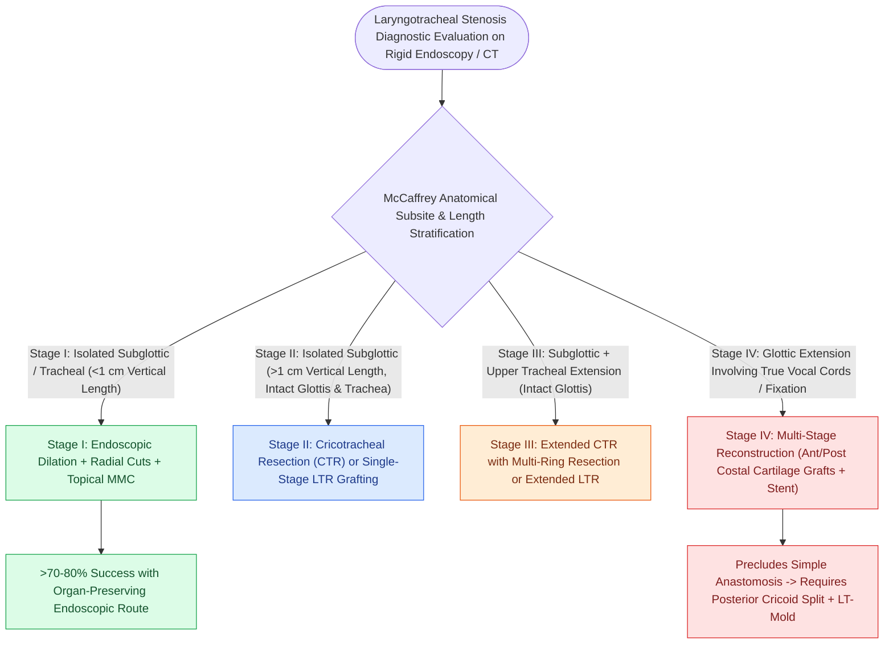

# The McCaffrey classification stages laryngotracheal stenosis by anatomical subsite

## Active Recall

> [!question]- What distinguishes a McCaffrey Stage II from a McCaffrey Stage III stenosis?
> *Answer / Clinical Rationale*: Stage II is an isolated subglottic stenosis $>1\text{ cm}$ long with an intact trachea, whereas Stage III involves both the **subglottis and the upper tracheal rings**.

> [!question]- Why does McCaffrey Stage IV carry the highest surgical complexity?
> *Answer / Clinical Rationale*: Stage IV extends into the **glottic level with true vocal fold involvement or fixation**, preventing simple circumferential resection and necessitating complex multi-level open grafting with anterior and posterior cartilage splits.

## Core Clinical & Mechanistic Principles
The **McCaffrey Classification System** stages adult and pediatric laryngotracheal stenosis based on the **anatomical subsites involved (glottis, subglottis, trachea)** and the **vertical craniocaudal length** of the stenotic segment.

### McCaffrey Clinical Stages

> [!NOTE] **Stage I — Focal Subglottic or Tracheal Stenosis**
> - **Anatomical Subsite**: Confined strictly to the **subglottis or trachea**
> - **Vertical Length**: $<1\text{ cm}$
> - **Surgical Approach**: [[Endoscopic airway dilation combines radial incisions with balloon bronchoplasty|Endoscopic dilation]] with [[Topical mitomycin-C inhibits fibroblast proliferation and collagen deposition|Mitomycin-C]] or focal laser excision.

> [!NOTE] **Stage II — Extended Isolated Subglottic Stenosis**
> - **Anatomical Subsite**: Isolated **[[The Cotton-Myer classification grades subglottic stenosis by luminal reduction|subglottic stenosis]]**
> - **Vertical Length**: $>1\text{ cm}$ (no glottic extension)
> - **Surgical Approach**: Open reconstruction — [[Cricotracheal resection removes subglottic stenosis while sparing posterior cricoid and RLNs|Cricotracheal Resection (CTR)]] or [[Laryngotracheal reconstruction expands the airway using carved costal cartilage grafts|LTR]] with anterior/posterior grafting.

> [!WARNING] **Stage III — Subglottic + Upper Tracheal Extension**
> - **Anatomical Subsite**: Subglottic stenosis extending into the upper trachea (no glottic involvement)
> - **Vertical Length**: Extends into trachea
> - **Surgical Approach**: Extended CTR with multi-ring tracheal resection or extended LTR.

> [!CAUTION] **Stage IV — Glottic Extension**
> - **Anatomical Subsite**: Extends into the **glottis** with true vocal cord involvement $\pm$ vocal cord fixation
> - **Vertical Length**: Multi-level
> - **Surgical Approach**: High-complexity multi-stage reconstruction (anterior/posterior costal cartilage grafting, LT-Mold stent, or [[Endoscopic transverse cordotomy widens posterior airway while preserving anterior phonation|transverse cordotomy]]).

## Surgical Decision Making Based on Staging
- **Stage I**: High success rate with endoscopic management (>70–80%).
- **Stage II / III**: Definitive candidacy for Cricotracheal Resection (CTR) because the glottic sphincter is completely intact.
- **Stage IV**: Precludes standard primary thyrotracheal anastomosis without glottic expansion; requires anterior and [[The posterior cricoid split widens the posterior glottis for high-grade stenosis|posterior cricoid splits]] with costal cartilage grafts and prolonged stenting.

## Connected Concepts & Graph Traversal
- **Cotton-Myer Luminal Grading**: [[The Cotton-Myer classification grades subglottic stenosis by luminal reduction|Cotton-Myer Classification]]
- **Endoscopic Dilation**: [[Endoscopic airway dilation combines radial incisions with balloon bronchoplasty|Endoscopic Airway Dilation]]
- **Open Surgical Reconstruction**: [[Two-stage LTR maintains a tracheostomy with prolonged endolaryngeal stenting|Two-Stage LTR]]
- **Cricotracheal Resection**: [[Cricotracheal resection removes subglottic stenosis while sparing posterior cricoid and RLNs|Cricotracheal Resection]]
- **Guardian Anastomotic Suture**: [[The guardian chin-to-chest suture prevents cervical hyperextension and anastomotic dehiscence|Guardian Suture]]
- **Posterior Glottic Subsite Staging**: [[The Bogdasarian classification categorizes posterior glottic stenosis from Type I interarytenoid scar to Type IV bilateral joint fixation|Bogdasarian Classification]]
