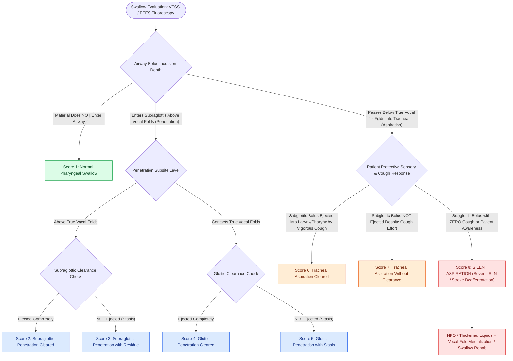

# The Rosenbek Scale standardizes the depth of airway penetration and aspiration

## Active Recall

> [!question]- What characterizes a Rosenbek Score of 8 on a videofluoroscopic swallow study?
> *Answer / Clinical Rationale*: **Silent Aspiration**; material passes below the true vocal folds into the subglottis/trachea with **no cough, throat clearing, or patient awareness response**.

> [!question]- What is the fundamental dividing line between 'penetration' (scores 2–5) and 'aspiration' (scores 6–8)?
> *Answer / Clinical Rationale*: Penetration is bolus entry that remains **at or above the level of the true vocal folds**; aspiration is bolus passage that crosses **below the true vocal folds into the subglottis and trachea**.

## Core Clinical & Mechanistic Principles
The **Rosenbek Penetration-Aspiration Scale (PAS)** (described by John C. Rosenbek in 1996) is an 8-point validated ordinal scoring system used during [[VFSS provides continuous radiographic evaluation of all deglutition phases|VFSS]] and [[FEES assesses pharyngeal secretions and aspiration under direct vision|FEES]] to quantify:
1. The **depth of bolus entry** into the airway (supraglottic penetration vs subglottic aspiration).
2. The presence or absence of **material clearance** from the airway.
3. The patient's **protective sensorimotor response** (cough/throat clear vs silent aspiration).

### The 8-Point Rosenbek Continuum
| Score | Clinical Category | Depth of Airway Entry | Residue & Clearance Status | Patient Airway Protective Response |
| :--- | :--- | :--- | :--- | :--- |
| **1** | **Normal** | Material does not enter the airway | No residue | Normal swallow. |
| **2** | **Penetration** | Enters airway, remains **above vocal folds** | **Ejected / Cleared** completely | Effective protective response. |
| **3** | **Penetration** | Enters airway, remains **above vocal folds** | **NOT ejected** (residual stasis) | Ineffective clearance. |
| **4** | **Penetration** | Contacts the **true vocal folds** | **Ejected / Cleared** from airway | Effective cough / clearance. |
| **5** | **Penetration** | Contacts the **true vocal folds** | **NOT ejected** (residual stasis) | Ineffective clearance. |
| **6** | **Aspiration** | Passes **below the true vocal folds** | **Ejected / Cleared** into larynx/mouth | Vigorous, effective cough. |
| **7** | **Aspiration** | Passes **below the true vocal folds** | **NOT ejected** despite effort | Weak, ineffective cough attempt. |
| **8** | **SILENT ASPIRATION**| Passes **below the true vocal folds** | **NOT ejected** | **NO cough or awareness response** (*highest pneumonia risk*). |

## Clinical & High-Stakes Significance
- **Silent Aspiration (Score 8)**: Represents the most dangerous clinical finding, indicating severe de-afferentation of the [[The superior laryngeal nerve provides supraglottic sensation and cricothyroid motor control|internal branch of the superior laryngeal nerve (iSLN)]] or central brainstem stroke, carrying a profound risk of aspiration pneumonia and mortality.
- **Dietary & Surgical Modifications**: Scores $\ge 6$ prompt immediate dietary modification (thickened liquids, purees), swallow therapy, or surgical intervention (such as [[Injection laryngoplasty requires precise placement into lateral thyroarytenoid muscle|vocal fold medialization]] or [[Arytenoid adduction closes large posterior glottic gaps and corrects height mismatch|arytenoid adduction]]).

## Connected Concepts & Graph Traversal
- **Esophageal Manometry Diagnostics**: [[High-resolution manometry classifies achalasia and esophageal motility disorders by the Chicago criteria|High-Resolution Manometry]]
- **Zenker Pulsion Aspiration**: [[Zenker's diverticulum herniates through Killian's triangle due to elevated pulsion pressure|Zenker's Diverticulum]]
- **Glottic Insufficiency Aspiration**: [[Unilateral vocal fold paralysis causes glottic insufficiency, breathiness, and aspiration|Unilateral Vocal Fold Paralysis]]
- **Supraglottic Resection Aspiration**: [[Horizontal supraglottic laryngectomy resects supraglottic cancer while preserving vocal folds|Supraglottic Laryngectomy]]
- **Sensory Nerve Loss**: [[The superior laryngeal nerve provides supraglottic sensation and cricothyroid motor control|Superior Laryngeal Nerve Sensation]]
