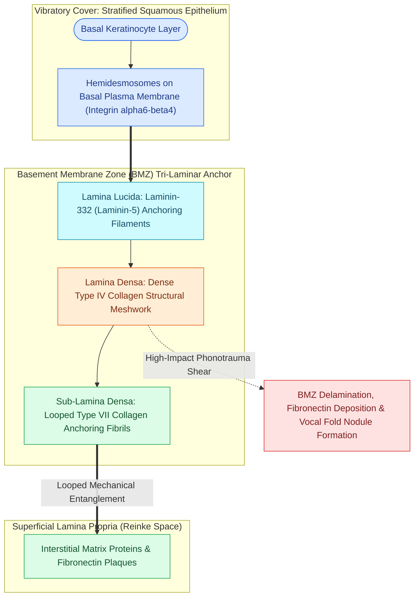

# The basement membrane zone anchors epithelium to superficial lamina propria

## Active Recall

> [!question]- Which specific collagen type constitutes the anchoring fibrils linking the lamina densa to the superficial lamina propria?
> *Answer / Clinical Rationale*: **Type VII collagen** forms the looped anchoring fibrils in the sub-lamina densa zone that physically entangle with the matrix of Reinke's space.

> [!question]- How does chronic phonotrauma alter the histologic appearance of the vocal fold basement membrane zone?
> *Answer / Clinical Rationale*: Repetitive shearing forces induce BMZ delamination, thickening, and multi-layered duplication with stromal hyalinization, which is the pathognomonic histological hallmark of vocal fold nodules.

## Core Clinical & Mechanistic Principles
The **Basement Membrane Zone (BMZ)** is a complex, multi-laminar extracellular matrix interface that firmly secures the overlying [[Stratified squamous epithelium forms the vocal fold protective cover|non-keratinizing stratified squamous epithelium]] to the underlying [[The superficial lamina propria acts as a pliable shearing fluid bed|superficial lamina propria (Reinke's space)]].

### Ultra-structural Architecture
The BMZ consists of distinct ultrastructural zones:
1. **Hemidesmosomes**: Cellular attachments on the basal keratinocyte plasma membrane.
2. **Lamina Lucida**: Contains anchoring filaments composed primarily of **laminin** (laminin-332/laminin-5).
3. **Lamina Densa**: Rich in **Type IV collagen**, forming a continuous structural scaffold.
4. **Sub-Lamina Densa Zone**: Features **Type VII collagen anchoring fibrils** that loop into the superficial lamina propria, mechanically entangling with interstitial collagen fibers and extracellular matrix components.

## Biomechanical Role & Pathology
- **Shear Stress Distribution**: During phonation, vocal fold collision creates significant shearing forces. The BMZ distributes these forces across the superficial lamina propria, preventing epithelial delamination.
- **Phonotraumatic Remodeling**: Repetitive high-impact phonotrauma induces BMZ duplication, thickening, and basement membrane rupture, leading to extravasation of serum proteins and fibrogenesis characteristic of [[Vocal fold nodules are bilateral mid-membranous lesions treated with voice therapy|vocal fold nodules]] and [[Vocal fold polyps arise from phonotraumatic microvascular injury in Reinke's space|vocal fold polyps]].

## Surgical Anatomy, Step-by-Step Technique & Nuances
- **Hydrodissection Boundary**: In [[Phonomicrosurgery requires suspension laryngoscopy and stereoscopic magnification|phonomicrosurgery]], injecting 1:100,000 epinephrine into the subepithelial plane cleaves the space immediately beneath the BMZ, entering Reinke's space without shearing the basal lamina.

## Critical Failure Modes & Error Traps
- **Thermal Injury from Lasers**: Uncontrolled thermal energy from a [[The CO2 laser vaporizes tissue via 10600 nm water absorption|CO2 laser]] can coagulate the BMZ and destroy anchoring fibrils, resulting in epithelial detachment, prolonged ulceration, and fibrous scarring.

## Connected Concepts & Graph Traversal
- **Five Histological Layers**: [[The vocal fold comprises five distinct histological layers|Five Histological Layers]]
- **Vocal Ligament Deep Layers**: [[The vocal ligament comprises intermediate and deep lamina propria|Vocal Ligament]]
- **Mucosal Wave Mechanics**: [[The mucosal wave travels as a fluid mechanical displacement|Mucosal Wave Mechanics]]
- **Phonomicrosurgical Dissection**: [[Phonomicrosurgery requires suspension laryngoscopy and stereoscopic magnification|Phonomicrosurgery]]
- **Adynamic Segment Pathology**: [[Adynamic vocal fold segments indicate mucosal stiffening, malignancy, or scar|Adynamic Segments]]
