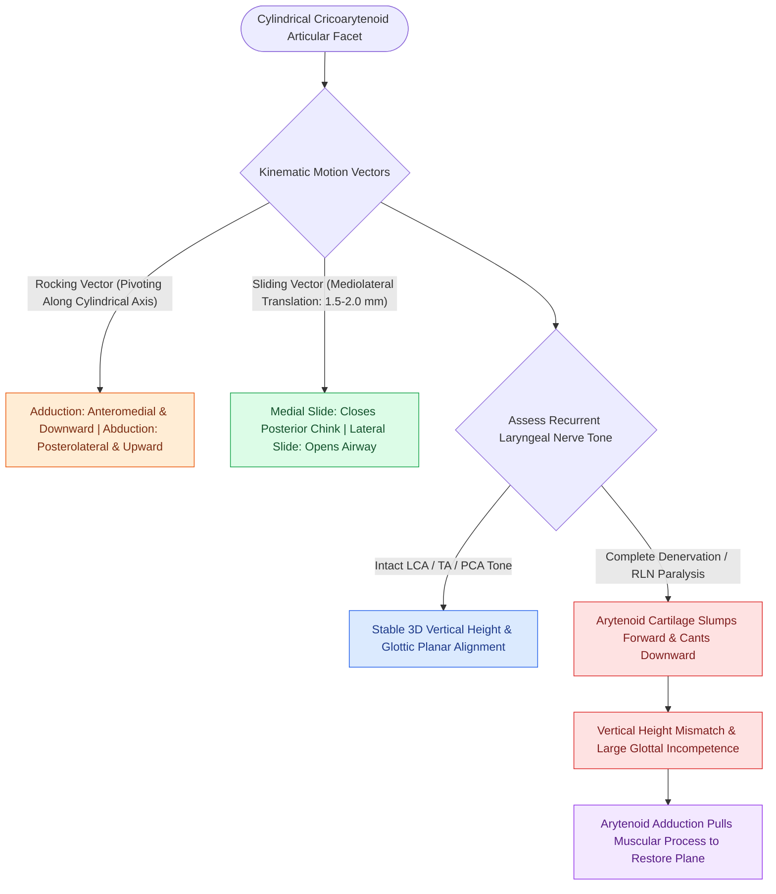

# The cricoarytenoid joint moves via coupled rocking and sliding

## Active Recall

> [!question]- Why does an isolated recurrent laryngeal nerve paralysis produce a vertical height discrepancy between the true vocal folds?
> *Answer / Clinical Rationale*: Loss of LCA/TA muscle tone eliminates the active vector that holds the arytenoid upright and locked on the cricoid facet, allowing the arytenoid to slump forward and cant laterally along the cylindrical facet.

> [!question]- What are the two coupled mechanical motions that characterize CA joint mobility?
> *Answer / Clinical Rationale*: **Rocking** (anteromedial/downward adduction vs posterolateral/upward abduction) and **sliding** (mediolateral translation along the cricoid facet axis by $1.5\text{–}2.0\text{ mm}$).

## Core Clinical & Mechanistic Principles
The **Cricoarytenoid (CA) Joint** is a complex synovial, cylindrical arthrodial joint formed between the concave base of the arytenoid cartilage and the convex articular facet on the posterolateral superior rim of the [[Cricotracheal resection removes subglottic stenosis while sparing posterior cricoid and RLNs|cricoid cartilage]] lamina.

### Coupled Kinematic Vectors
The CA joint does not operate as a simple ball-and-socket or hinge. Its motion is defined by two tightly coupled kinematic vectors constrained by the cylindrical orientation of the cricoid facet and the [[The posterior cricoarytenoid is the sole vocal fold abductor|posterior cricoarytenoid]] ligament:

1. **Rocking Vector (Pivoting)**:
   - *Adduction*: The arytenoid cartilage rocks **anteromedially and downward**, bringing the vocal process into the glottic aperture at the midline.
   - *Abduction*: The arytenoid rocks **posterolaterally and upward**, elevating the vocal process and widening the respiratory aperture.
2. **Sliding Vector (Translation)**:
   - The arytenoid slides **mediolaterally** along the long axis of the cricoid facet ($1.5\text{ to }2.0\text{ mm}$ translation).
   - Medial sliding during adduction brings the bodies of both arytenoids together to close the posterior cartilaginous glottis.

## Clinical Consequence in Vocal Fold Paralysis
- **Loss of Tone & Arytenoid Slump**: In complete [[The recurrent laryngeal nerve innervates all intrinsic muscles except cricothyroid|recurrent laryngeal nerve (RLN) paralysis]], denervation of the [[The lateral cricoarytenoid is the primary membranous fold adductor|LCA]] and [[The thyroarytenoid muscle modulates glottal stiffness and adduction|TA]] causes the arytenoid cartilage to tip anteriorly and slump forward/laterally.
- **Vertical Level Discrepancy**: The paralyzed vocal fold sits at a **lower or canted vertical plane** compared to the intact contralateral side.
- **Surgical Correction**: A standard [[Type I thyroplasty medializes the vocal fold with conscious voice tuning|Type I thyroplasty]] cannot reposition the slumped arytenoid; an [[Arytenoid adduction closes large posterior glottic gaps and corrects height mismatch|arytenoid adduction]] is required to pull the muscular process anteromedially and restore 3D joint height alignment.

## Critical Failure Modes & Error Traps
- **Paralysis vs CA Joint Ankylosis**: CA joint fixation (from rheumatoid arthritis, prolonged intubation, or posterior scar) mimics RLN paralysis. Differentiating the two requires [[Laryngeal electromyography differentiates vocal fold paralysis from joint fixation|LEMG]] and intraoperative passive manual palpation of the arytenoid under direct [[Phonomicrosurgery requires suspension laryngoscopy and stereoscopic magnification|suspension laryngoscopy]].

## Connected Concepts & Graph Traversal
- **Sole Abductor Muscle**: [[The posterior cricoarytenoid is the sole vocal fold abductor|Posterior Cricoarytenoid]]
- **Primary Membranous Adductor**: [[The lateral cricoarytenoid is the primary membranous fold adductor|Lateral Cricoarytenoid]]
- **Posterior Chink Adductor**: [[The interarytenoid muscle closes the posterior glottic chink|Interarytenoid Muscle]]
- **LEMG Joint vs Paralysis**: [[Laryngeal electromyography differentiates vocal fold paralysis from joint fixation|Laryngeal Electromyography (LEMG)]]
- **Pitch Regulation Mechanics**: [[The cricothyroid muscle elongates vocal folds to elevate pitch|Cricothyroid Muscle]]
- **Vocal Process Trauma**: [[Vocal fold contact granulomas arise from mechanical perichondritis of the vocal process treated with proton pump inhibitors, voice therapy, and Botox before excision|Vocal Fold Contact Granuloma]]
