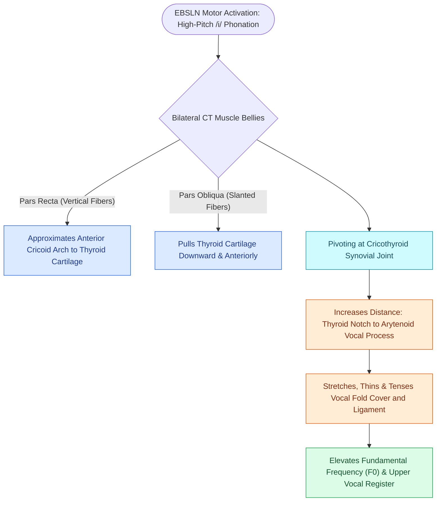

# The cricothyroid muscle elongates vocal folds to elevate pitch

## Active Recall

> [!question]- Why is the cricothyroid muscle the exception among all intrinsic laryngeal muscles?
> *Answer / Clinical Rationale*: It is the only intrinsic laryngeal muscle located externally on the cartilaginous framework and the **only one innervated by the EBSLN** (branch of CN X) rather than the RLN.

> [!question]- What biomechanical change occurs in the vocal fold when the cricothyroid muscle contracts?
> *Answer / Clinical Rationale*: The distance between the thyroid notch and [[The cricoarytenoid joint moves via coupled rocking and sliding|arytenoid cartilage]] increases, which **stretches, thins, and increases longitudinal tension** on the vocal fold and [[The vocal ligament comprises intermediate and deep lamina propria|vocal ligament]], raising pitch ($F_0$).

## Core Clinical & Mechanistic Principles
The **Cricothyroid (CT) Muscle** is the only intrinsic laryngeal muscle located on the external surface of the laryngeal framework and the only intrinsic muscle innervated by the **[[The Cernea classification stages EBSLN risk relative to superior thyroid vessels|External Branch of the Superior Laryngeal Nerve]] (EBSLN)** rather than the [[The recurrent laryngeal nerve innervates all intrinsic muscles except cricothyroid|recurrent laryngeal nerve]].

### Anatomical Subdivisions & Vectors
- **Pars Recta (Straight Belly)**: Vertical fibers originating from the anterior anterolateral arch of the [[Cricotracheal resection removes subglottic stenosis while sparing posterior cricoid and RLNs|cricoid cartilage]] and inserting into the lower border of the [[Thyroplasty cartilage window dimensions differ between males and females|thyroid cartilage lamina]].
- **Pars Obliqua (Oblique Belly)**: Slanted fibers originating from the lateral cricoid arch and inserting into the inferior horn and posterior inferior margin of the thyroid cartilage.
- **Biomechanical Mechanism**: Contraction pulls the anterior cricoid arch upward and backward toward the thyroid cartilage (or pulls the thyroid lamina downward and forward), pivoting at the cricothyroid joint. This increases the distance between the anterior thyroid notch and the arytenoid vocal processes, **elongating, thinning, and stiffening the vocal fold** to elevate fundamental frequency ($F_0$).

## Clinical & Electrophysiologic Significance
- **Innervation**: Exclusively supplied by the [[The superior laryngeal nerve provides supraglottic sensation and cricothyroid motor control|EBSLN]], which is at risk during superior thyroid vascular pedicle ligation (see Cernea Classification).
- **EBSLN Injury Deficit**: Causes inability to produce high-pitched sounds, vocal fatigue, loss of singing range, and subtle rotation/scissoring of the glottic aperture toward the paretic side.
- **LEMG Confirmation**: During LEMG, the CT muscle is targeted $0.5\text{–}1.0\text{ cm}$ lateral to midline at the cricothyroid membrane, verified by asking the patient to phonate a high-pitch /i/.

## Critical Failure Modes & Error Traps
- **Iatrogenic EBSLN Injury**: Failure to identify the EBSLN during thyroidectomy causes permanent loss of high-register voice control in vocal performers.

## Connected Concepts & Graph Traversal
- **Motor Nerve Supply**: [[The superior laryngeal nerve provides supraglottic sensation and cricothyroid motor control|External Branch of Superior Laryngeal Nerve (EBSLN)]]
- **Surgical Risk Anatomy**: [[The Cernea classification stages EBSLN risk relative to superior thyroid vessels|Cernea Classification of EBSLN]]
- **Tensed Structure**: [[The vocal ligament comprises intermediate and deep lamina propria|The Vocal Ligament]]
- **Diagnostic LEMG**: [[Laryngeal electromyography differentiates vocal fold paralysis from joint fixation|LEMG Testing of CT Muscle]]
- **Clinical Management**: [[The cricoarytenoid joint moves via coupled rocking and sliding|Cricoarytenoid (CA) Joint Kinetics]]
