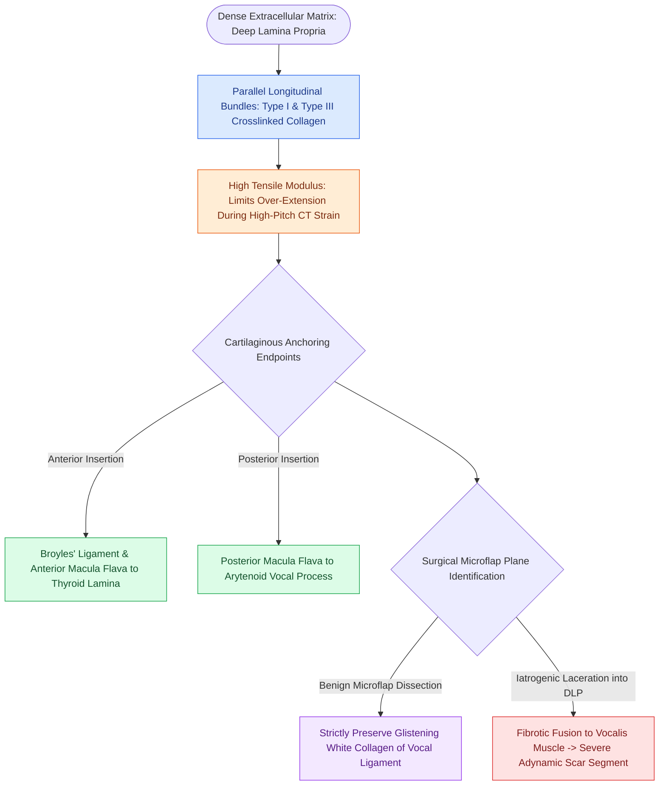

# The deep lamina propria provides tensile stiffness via crosslinked collagen

## Active Recall

> [!question]- What is the primary collagen composition of the deep lamina propria, and what mechanical function does it serve?
> *Answer / Clinical Rationale*: It consists of dense, heavily crosslinked **Type I and Type III collagen** fibers running longitudinally, providing high tensile strength to resist excessive longitudinal stretching during high-pitch register shifts.

> [!question]- Where do the collagen fibers of the deep lamina propria anchor anteriorly and posteriorly?
> *Answer / Clinical Rationale*: Anteriorly, they insert into the [[Thyroplasty cartilage window dimensions differ between males and females|thyroid cartilage]] via Broyles' ligament (anterior macula flava); posteriorly, they insert into the vocal process of the arytenoid cartilage via the posterior macula flava.

## Core Clinical & Mechanistic Principles
The **Deep Lamina Propria (DLP)** is the deepest layer of the vocal fold lamina propria, directly abutting and interdigitating with the fibers of the [[The thyroarytenoid muscle modulates glottal stiffness and adduction|thyroarytenoid (vocalis) muscle]].

### Histological & Biomechanical Profile
- **Heavily Crosslinked Collagen**: Composed primarily of thick, parallel bundles of **Type I and [[Vocal fold scar results from disorganized Type I collagen deposition|Type III collagen]] fibers** running along the longitudinal axis of the vocal fold.
- **High Tensile Stiffness**: Exhibits high tensile modulus and low compliance, acting as a structural "cotton-string" core that limits maximal vocal fold strain and prevents over-extension during extreme elongation by the [[The cricothyroid muscle elongates vocal folds to elevate pitch|cricothyroid muscle]].
- **Cartilaginous Anchoring**: Anteriorly, DLP collagen fibers coalesce into [[Broyles' ligament anchors the vocal ligament to thyroid cartilage|Broyles' ligament]] at the anterior commissure; posteriorly, they insert into the vocal process of the [[The cricoarytenoid joint moves via coupled rocking and sliding|arytenoid cartilage]] via the [[The macula flava cushions the vocal fold to cartilage transition|posterior macula flava]].

## Surgical Anatomy, Step-by-Step Technique & Nuances
- **Deep Resection Margin**: In transoral laser microsurgery for glottic malignancy, a [[The ELS classification categorizes endoscopic cordectomies from Types I to VI|Type II (subligamental) cordectomy]] resects the epithelium, [[The superficial lamina propria acts as a pliable shearing fluid bed|SLP]], and [[The vocal ligament comprises intermediate and deep lamina propria|vocal ligament]] down to the superficial margin of the [[The thyrovocalis muscle provides isometric pitch and tension control|vocalis muscle]], completely removing the DLP.
- **Prevention of Accidental Penetration**: During microflap elevation for benign lesions, the surgeon must identify the transition between the pliable SLP and the glistening white collagenous DLP/ligament to avoid entering this structural layer.

## Critical Failure Modes & Error Traps
- **Scar Tethering**: Deep mechanical laceration of the DLP leads to intense fibrotic fusion between the deep collagen bundles and the vocalis muscle, eliminating the tissue shear differential and creating a severe [[Adynamic vocal fold segments indicate mucosal stiffening, malignancy, or scar|adynamic segment]].

## Connected Concepts & Graph Traversal
- **Superficial Elastin Layer**: [[The intermediate lamina propria provides elastic recoil via elastin fibers|Intermediate Lamina Propria (ILP)]]
- **Combined Ligament**: [[The vocal ligament comprises intermediate and deep lamina propria|The Vocal Ligament]]
- **Underlying Muscle**: [[The thyroarytenoid muscle modulates glottal stiffness and adduction|Thyroarytenoid Muscle]]
- **Anterior Anchor**: [[Broyles' ligament anchors the vocal ligament to thyroid cartilage|Broyles' Ligament]]
- **Oncologic Resection**: [[The ELS classification categorizes endoscopic cordectomies from Types I to VI|ELS Type II Subligamental Cordectomy]]
