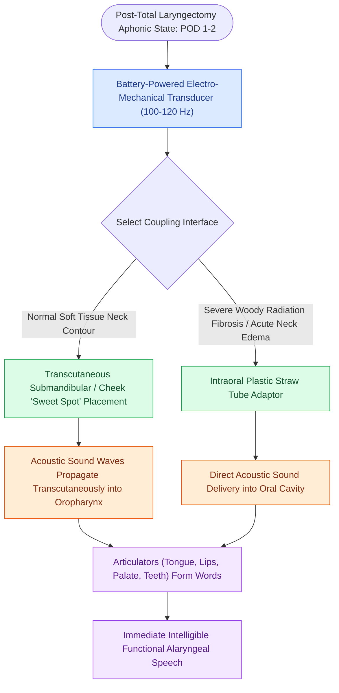

# The electrolarynx provides immediate mechanical speech via acoustic coupling

## Active Recall

> [!question]- How is acoustic sound transmitted into the oral cavity during transcutaneous electrolarynx use?
> *Answer / Clinical Rationale*: Mechanical sound vibrations generated by the vibrating head are transmitted **transcutaneously through the soft tissues of the submandibular region or cheek** into the oropharyngeal air space, where they are shaped by normal articulators.

> [!question]- What is the primary advantage of the electrolarynx over esophageal speech and [[Tracheoesophageal puncture diverts pulmonary air through a one-way valve into the neopharynx|TEP]] speech in the early postoperative period?
> *Answer / Clinical Rationale*: It provides **immediate communication** on postoperative day 1–2 without requiring specialized pulmonary coordination, surgical healing, or prosthesis placement.

## Core Clinical & Mechanistic Principles
The **Electrolarynx (Artificial Larynx)** is an external, battery-powered electro-mechanical transducer used for alaryngeal voice restoration following [[Total laryngectomy achieves en bloc laryngeal resection with permanent end-stoma|Total Laryngectomy]].

### Acoustic Coupling & Articulation Mechanism
- **Transcutaneous Acoustic Transmission**: The vibrating head of the device is pressed firmly against the submandibular neck skin, cheek, or floor of mouth (the "sweet spot").
- **Acoustic Wave Propagation**: Mechanical vibrations ($100\text{–}120\text{ Hz}$) are transmitted directly through the soft tissues into the oropharyngeal air cavity.
- **Articulation**: The patient articulates words using their tongue, lips, teeth, and palate to modulate the acoustic sound waves into intelligible speech without requiring pulmonary airflow or vocal fold tissue.
- **Transoral Adaptor Option**: For patients with severe post-radiation neck fibrosis or surgical edema, an intraoral plastic tube adaptor directs sound directly into the oral cavity.

## Primary Clinical Advantages vs Pitfalls
- **Advantages**:
  - **Immediate Usability**: Can be utilized immediately in the early postoperative period (even while the pharynx is healing and un-swallowable).
  - **No Secondary Surgery**: Requires no surgical puncture or prosthesis maintenance.
  - **Zero Aspiration Risk**: Does not communicate with the airway.
- **Pitfalls**:
  - **Robotic, Monotone Quality**: Lacks natural pitch modulation and emotional inflection.
  - **Manual Dexterity Requirement**: Requires the use of one hand to position and activate the button.
  - **Tissue Fibrosis Interference**: Severe woody radiation fibrosis of the submandibular skin impedes acoustic transmission.

## Connected Concepts & Graph Traversal
- **TEP Voice Restoration**: [[Tracheoesophageal puncture diverts pulmonary air through a one-way valve into the neopharynx|Tracheoesophageal Puncture]]
- **Esophageal Speech Mechanics**: [[Esophageal speech utilizes swallowed air across the PE segment for voicing|Esophageal Speech]]
- **Total Laryngectomy Surgery**: [[Total laryngectomy achieves en bloc laryngeal resection with permanent end-stoma|Total Laryngectomy]]
- **Hands-Free Stoma Control**: [[Hands-free stomaplasty stabilizes the peristomal contour using fascia lata slings|Hands-Free Stomaplasty]]
- **Emergency Airway Care**: [[Total laryngectomy stomas and tracheostomies require distinct emergency airway resuscitation algorithms|Emergency Stoma Resuscitation]]
