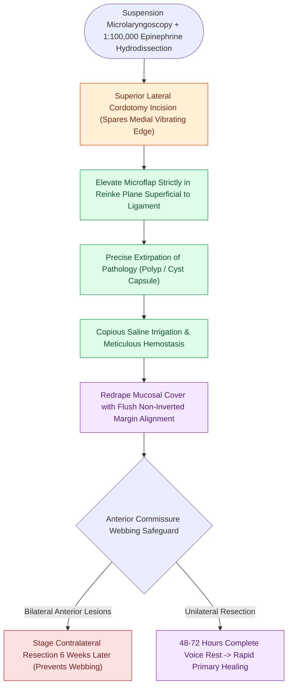

# The epithelial-sparing microflap preserves native mucosa and prevents glottic webbing

## Active Recall

> [!question]- Where should the cordotomy incision be placed during a microflap procedure?
> *Answer / Clinical Rationale*: On the **superior lateral surface** of the true vocal fold, well lateral and superior to the free medial vibratory margin.

> [!question]- Why must bilateral anterior commissure microflap dissections be staged 6 weeks apart?
> *Answer / Clinical Rationale*: Performing simultaneous bilateral anterior dissections creates opposing raw subepithelial surfaces at the acute anterior angle, which bridge across the midline during healing to form a debilitating **anterior glottic web**.

## Core Clinical & Mechanistic Principles
The **Epithelial-Sparing Microflap Technique** is the foundational operative paradigm in modern [[Phonomicrosurgery requires suspension laryngoscopy and stereoscopic magnification|phonomicrosurgery]]. It replaces obsolete historical methods of mucosal "stripping" or "cup forceps avulsion," which caused extensive raw surfaces and disastrous scarring.

### Foundational Tenets
1. **Preservation of Vibratory Edge**: Incisions are never placed directly on the free medial vibrating margin.
2. **Strict Dissection within Reinke's Space**: Dissection is confined strictly to the superficial lamina propria, protecting the underlying [[The vocal ligament comprises intermediate and deep lamina propria|vocal ligament]].
3. **Mucosal Flap Preservation & Redraping**: The elevated mucosal flap is preserved and repositioned over the raw surgical bed without sutures, allowing primary epithelial contact and rapid healing.

## Step-by-Step Surgical Craft
1. **Suspension & Hydrodissection**: Place large-lumen suspension laryngoscope; inject 1:100,000 epinephrine into Reinke's space (see hydrodissection).
2. **Cordotomy**: Using a sharp sickle knife or curved micro-scissors, perform a linear incision on the **superior lateral surface** of the vocal fold parallel to the free edge.
3. **Flap Elevation**: Using fine triangular or round micro-elevators, elevate the epithelial flap off the pathology while keeping the dissection superficial to the vocal ligament.
4. **Lesion Excision**: Grasp the lesion capsule with fine heart-shaped or mini-cup forceps; dissect the lesion free using blunt sweeps or micro-scissors.
5. **Redraping & Flap Alignment**: Wash the bed with saline. Redrape the mucosal flap over the dissected pocket. Ensure exact edge-to-edge alignment without micro-inversion.
6. **Postoperative Protocol**: 48 to 72 hours of absolute voice rest, followed by gradual re-introduction of voice under speech therapy guidance.

## Prevention of Glottic Webbing
- When bilateral lesions involve or approach the anterior commissure, never perform simultaneous bilateral microflaps that leave opposing raw margins at the apex.
- Stage bilateral anterior commissure procedures at least **6 weeks apart** to allow complete epithelialization.

## Critical Failure Modes & Error Traps
- **Micro-inversion of Mucosal Edges**: If the edges of the redraped flap curl inward into the subepithelial pocket, delayed epithelialization and chronic granuloma formation will occur.
- **Deep Penetration**: Inadvertently lacerating the vocal ligament during deep dissection creates permanent [[Vocal fold scar results from disorganized Type I collagen deposition|vocal fold scarring]] and an [[Adynamic vocal fold segments indicate mucosal stiffening, malignancy, or scar|adynamic segment]].

## Connected Concepts & Graph Traversal
- **Setup & Instrumentation**: [[Phonomicrosurgery requires suspension laryngoscopy and stereoscopic magnification|Phonomicrosurgery Setup]]
- **Hydrodissection Maneuver**: [[Subepithelial hydrodissection expands Reinke's space and protects the vocal ligament|Subepithelial Hydrodissection]]
- **Protected Structural Layer**: [[The vocal ligament comprises intermediate and deep lamina propria|The Vocal Ligament]]
- **Avoided Complication**: [[Vocal fold scar results from disorganized Type I collagen deposition|Vocal Fold Scarring]]
- **Subepithelial Pathology Excision**: [[Epidermoid cysts adhere to the vocal ligament and require sharp dissection|Intracordal Epidermoid Cysts]]
- **Acquired Web Reconstruction**: [[Endoscopic anterior glottic web repair requires cold microdivision and endolaryngeal silastic keel stenting to prevent recurrent synechia|Endoscopic Anterior Glottic Web Repair]]
