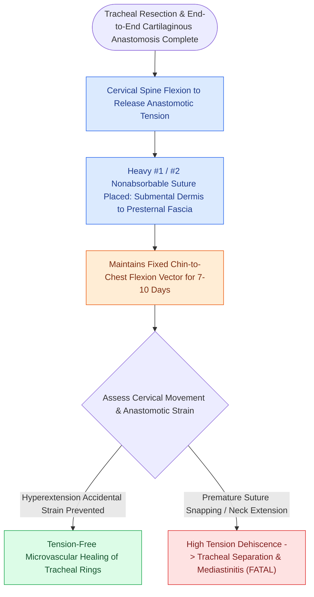

# The guardian chin-to-chest suture prevents cervical hyperextension and anastomotic dehiscence

## Active Recall

> [!question]- What is the primary function of the guardian chin-to-chest suture after cricotracheal resection?
> *Answer / Clinical Rationale*: To enforce continuous **cervical flexion ($30^\circ\text{–}45^\circ$)**, mechanically preventing accidental cervical hyperextension that would generate severe distraction forces and catastrophic dehiscence of the airway anastomosis.

> [!question]- For how long should the guardian suture remain in place postoperatively?
> *Answer / Clinical Rationale*: Continuously for **7 to 10 days**, until primary fibrovascular healing stabilizes the airway anastomosis.

## Core Clinical & Mechanistic Principles
The **Guardian Suture** (also termed the **Grillo stitch** or **chin-to-chest [[Tracheal stay sutures prevent false tract entry during accidental decannulation|stay suture]]**) is a mandatory physical immobilization suture placed at the conclusion of [[Cricotracheal resection removes subglottic stenosis while sparing posterior cricoid and RLNs|cricotracheal resection (CTR)]] or segmental tracheal resection.

### Biomechanical Role in Preventing Anastomotic Disruption
- **Tension Sensitivity of Airway Anastomoses**: Following resection of $2\text{–}5\text{ cm}$ of subglottis or trachea, the primary thyrotracheal or tracheal anastomosis is maintained under tension.
- **Hyperextension Leverage**: Even a single accidental episode of cervical hyperextension (such as during patient emergence from anesthesia, coughing, or ICU bed transfers) generates an enormous longitudinal distraction force across the neck.
- **Catastrophic Dehiscence**: Cervical extension can instantly tear the absorbable suture line, precipitating complete **anastomotic dehiscence, acute [[Subcutaneous emphysema arises when tracheotomy incisions are closed too tightly|mediastinitis]], retraction of the distal trachea into the mediastinum, and fatal asphyxiation**.

## Step-by-Step Surgical Placement & ICU Protocol
1. **Timing**: Placed in the operating room immediately following wound closure, while the patient remains deeply anesthetized and paralyzed.
2. **Suture Material**: A heavy **#0 or #1 braided nonabsorbable suture (e.g., 0-Silk or 0-Ethibond)** on a large cutting needle.
3. **Anatomical Anchor Points**:
   - Passed deeply through the subcutaneous tissue and submental fascia of the **underside of the chin (mentum)**.
   - Passed deeply through the skin and subcutaneous fascia overlying the **manubrium / anterior chest wall**.
4. **Cervical Flexion Setting**: The suture is tied securely with the neck flexed at an angle of **$30^\circ\text{ to }45^\circ$**, physically preventing the patient from raising their chin or extending their neck.
5. **Duration of Immobilization**: Maintained in place continuously for **7 to 10 days postoperatively**, until primary fibrovascular healing and collagen cross-linking bridge the mucosal and cartilaginous anastomosis.

## Critical Failure Modes & Error Traps
- **Premature Cutting of Suture**: Allowing non-surgical staff to cut the guardian suture in the ICU because "the patient is uncomfortable" removes the sole physical protection against lethal anastomotic distraction.

## Connected Concepts & Graph Traversal
- **Cricotracheal Resection**: [[Cricotracheal resection removes subglottic stenosis while sparing posterior cricoid and RLNs|Cricotracheal Resection]]
- **Open Airway Reconstruction**: [[Two-stage LTR maintains a tracheostomy with prolonged endolaryngeal stenting|Two-Stage LTR]]
- **Stenosis Subsite Staging**: [[The McCaffrey classification stages laryngotracheal stenosis by anatomical subsite|McCaffrey Staging]]
- **Luminal Stenosis Staging**: [[The Cotton-Myer classification grades subglottic stenosis by luminal reduction|Cotton-Myer Classification]]
- **High-Stakes Rescue Protocols**: [[High-stakes laryngeal complications require proactive landmarking and rescue protocols|Laryngeal Complications]]
