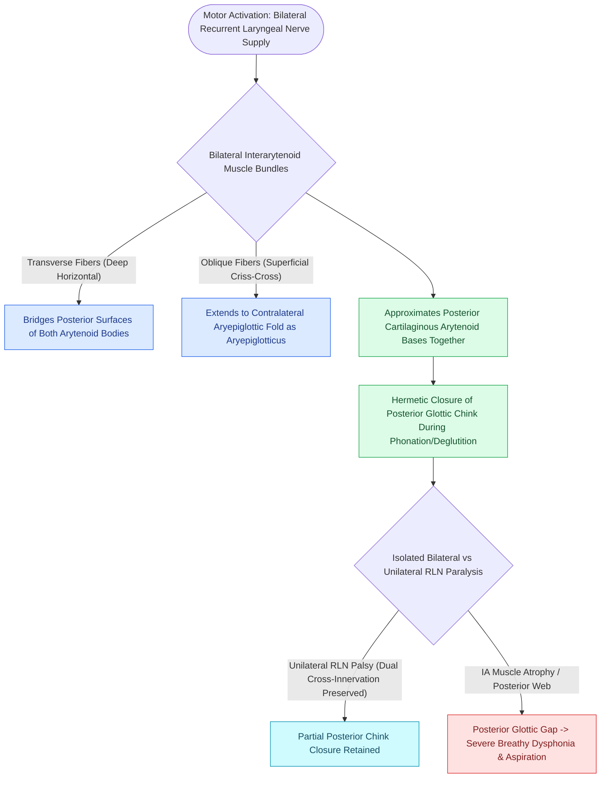

# The interarytenoid muscle closes the posterior glottic chink

## Active Recall

> [!question]- Why is the interarytenoid muscle unique among all intrinsic laryngeal muscles in its neuroanatomy?
> *Answer / Clinical Rationale*: It is the **only intrinsic laryngeal muscle that receives bilateral motor innervation** from both the left and right recurrent laryngeal nerves.

> [!question]- What specific part of the glottic aperture does the interarytenoid muscle close?
> *Answer / Clinical Rationale*: It brings the arytenoid cartilages into direct medial apposition, closing the **posterior cartilaginous glottic chink**.

## Core Clinical & Mechanistic Principles
The **Interarytenoid (IA) Muscle** is an unpaired intrinsic laryngeal muscle that bridges the posterior aspect of both [[The cricoarytenoid joint moves via coupled rocking and sliding|arytenoid cartilages]].

### Anatomical Subdivisions & Innervation
- **Transverse Arytenoid**: Deep, horizontal muscle fibers spanning directly between the posterior surfaces of both arytenoid bodies.
- **Oblique Arytenoid**: Superficial, crisscrossing muscle fibers extending from the base of one arytenoid to the apex of the contralateral arytenoid, with fibers continuing into the aryepiglottic fold (aryepiglottic muscle).
- **Bilateral Innervation**: Unlike all other intrinsic laryngeal muscles, the interarytenoid muscle receives **dual bilateral motor innervation** from both the left and right [[The recurrent laryngeal nerve innervates all intrinsic muscles except cricothyroid|recurrent laryngeal nerves (RLNs)]]. Some sensory/motor fibers also derive from the internal branch of the [[The superior laryngeal nerve provides supraglottic sensation and cricothyroid motor control|superior laryngeal nerve (iSLN)]].

## Biomechanical Role in Glottal Closure
- **Posterior Cartilaginous Closure**: Contraction draws both arytenoid bodies together medially along the cricoid facet, closing the posterior cartilaginous glottic chink.
- **Compensation in Unilateral Paralysis**: Because of its bilateral innervation, in unilateral RLN paralysis the intact contralateral nerve continues to supply motor tone to the IA muscle, helping maintain partial posterior glottic apposition.

## Critical Failure Modes & Error Traps
- **Posterior Glottic Stenosis vs Paralysis**: Dense interarytenoid scarring (e.g., from prolonged endotracheal tube cuff pressure) tethers both arytenoids together, restricting abduction and mimicking bilateral vocal fold paralysis.

## Connected Concepts & Graph Traversal
- **Sole Abductor Muscle**: [[The posterior cricoarytenoid is the sole vocal fold abductor|Posterior Cricoarytenoid]]
- **Membranous Fold Adductor**: [[The lateral cricoarytenoid is the primary membranous fold adductor|Lateral Cricoarytenoid]]
- **Body Adductor & Stiffener**: [[The thyroarytenoid muscle modulates glottal stiffness and adduction|Thyroarytenoid Muscle]]
- **Bilateral RLN Innervation**: [[The recurrent laryngeal nerve innervates all intrinsic muscles except cricothyroid|Recurrent Laryngeal Nerve]]
- **Glottal Gap Diagnostics**: [[Glottal closure patterns identify specific laryngeal biomechanical deficits|Glottal Closure Patterns]]
